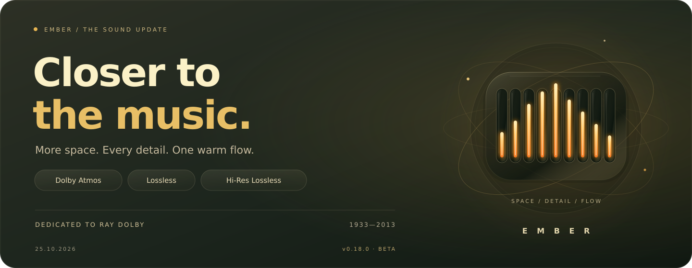
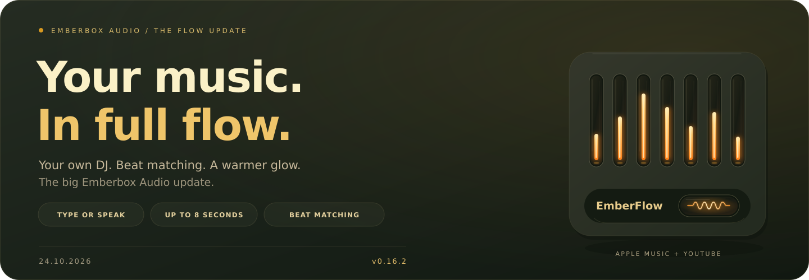
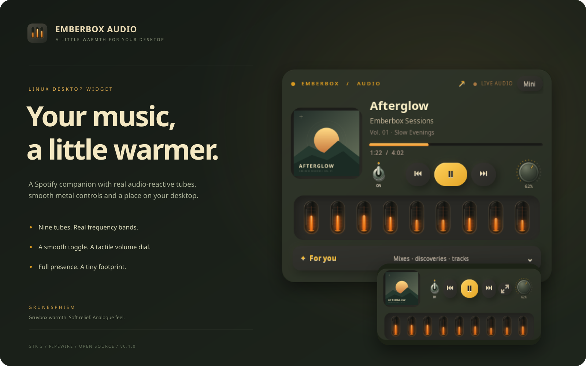
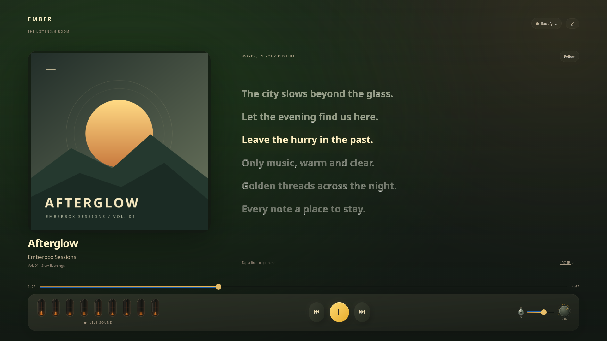

<div align="center">
  
  <h1>Emberbox Audio</h1>
  <p><strong>Your music, a little warmer.</strong></p>
  <p>Linux · GTK 3 · PipeWire · MIT · Early release</p>
  <p><a href="#get-started">Get started</a> · <a href="#system-requirements">System requirements</a> · <a href="docs/DESIGN.md">Grunesphism</a> · <a href="README.ru.md">Русский</a> · <a href="https://github.com/BlackSnaker/emberbox-video">Emberbox Video</a></p>
</div>

<a id="the-sound-update"></a>

## 25 October 2026 · Closer to the music



[Читать на русском →](README.ru.md#the-sound-update)

**Dolby Atmos, Lossless and Hi‑Res Lossless are now in Ember.**

A quiet breath before the first line. A piano note lingering in the room.
The space between instruments. Sometimes those small details make a song
you know by heart feel new again. Those moments keep me working on Ember.

### Dedicated to Ray Dolby

Ray Dolby (1933–2013), the founder of Dolby Laboratories, helped transform
recorded music and cinema sound. His work brought engineering and artistic
possibility together.
[Explore his life and inventions →](https://www.dolby.com/en-gb/about/leadership/ray-dolby/)

His journey inspires me to keep building Ember: to look deeper, care about
small details, and keep searching when a solution still feels far away.
This update is my thank-you to someone whose ideas help us hear more.

### New sound. The same warm glow.

- **Dolby Atmos in Apple Music.** Native playback of real Atmos recordings,
  with spatial rendering for headphones.
- **Lossless and Hi‑Res Lossless.** For recordings without Atmos, Ember selects
  the best available ALAC and reports the source's original bit depth and rate.
- **EmberFlow across formats.** Lossless, Hi‑Res and Atmos can flow into each
  other with up to eight seconds of overlap. Artwork and queue handover follow
  the transition at the audio output.
- **Quality you can see.** The badge beneath the artwork shows the
  decoder-confirmed format. Click for details behind familiar frosted glass;
  the control stays available while paused, too.

**Start listening:** update Ember, choose
**Settings → Connect Apple Lossless…**, complete the separate sign-in and enable
**Apple · Atmos / Lossless · beta**. Your session survives player restarts.
To prepare the components from a terminal, use `./install.sh --apple-lossless`.

*Beta 0.18.0 · An Apple Music subscription is required; format availability
depends on the recording and territory. Spatial playback uses the independent
OpenJOC headphone renderer, without Dolby certification.*

**Thank you, Ray. For the inspiration to make sound better.**

[Connect and explore →](docs/ATMOS_PROTOTYPE.md) · [Install or update →](docs/INSTALL.md) · [All changes →](CHANGELOG.md)

---

<a id="the-flow-update"></a>

## 24 October 2026 · The Flow Update



[Читать новость на русском →](README.ru.md#the-flow-update)

**A personal DJ. Songs that flow together. Warmth you can see.** Today's big
update brings together **Ember DJ and EmberFlow**, from versions 0.13 to 0.16.2.

- **Tell Ember what the music should feel like.** Type or speak a wish, refine
  it with “a little more upbeat” or “without vocals,” and build a set around
  personal picks and your listening preferences. Optional local AI understands
  free-form scenes; the new Russian voice is **Ksenia**. [Meet Ember DJ →](docs/DJ.md)
- **Let the next song find its way in.** EmberFlow mixes real tracks from your
  queue for up to **eight seconds** in built-in **Apple Music and YouTube**.
  **Beats** aligns stable, compatible rhythms with tempo changes up to **±6%**,
  preserving pitch, then gently restores the original tempo. Other material keeps
  a smooth volume blend. [Inside EmberFlow →](docs/FLOW.md)
- **A small piece of warm hi-fi.** The recessed EmberFlow switch now holds a
  larger glass lamp: a visible filament warms from dull red through amber to
  gold, then cools with thermal inertia. Quick repeated presses retain its heat;
  the animation stops once settled.

**Make it yours:** prepare voice/AI in **DJ → ⚙**, or enable
**EmberFlow + Beats** in player settings and add songs to Ember's queue.

[Install or update →](docs/INSTALL.md) · [All changes →](CHANGELOG.md) · [Русская версия →](README.ru.md#the-flow-update)

---



## Ember DJ — your own radio

A Grunesphism DJ tab inside Ember: **type a wish and press Enter**, or use
the microphone. Personal picks, listening and feedback shape the next music
block. Local AI, recognition and speech; a soft entrance, a metal microphone
dial and live tubes. [Open and prepare your DJ →](docs/DJ.md)
Free-form moods and scenes use a local model; follow-ups can refine the previous
set. Direct commands remain immediate.


## EmberFlow — one song flows into the next

A tactile amber switch blends the tail of one track into the opening of the next.
Up to eight seconds of real overlap for **in-player Apple Music and YouTube**,
following your Ember queue: an emerging intro, a focused handover and a dissolving
tail. Quiet outros use a shorter entrance. A briefly staged second deck keeps the
transition local without a neural model. The **Beats** switch aligns compatible
rhythms with pitch-preserving tempo changes, then gently restores the song's own
pace. [Controls and source support →](docs/FLOW.md)

## Your music, a little warmer.

A warm desktop companion for **Spotify, Apple Music, YouTube and Yandex Music**, with audio-reactive gas-discharge tubes and controls that feel like a small piece of hi-fi equipment.

- **Choose your source.** Spotify, Apple Music, YouTube or Yandex Music, including in mini mode. Apple Music has an in-widget library, song search and playback. [Apple Music setup →](docs/APPLE_MUSIC.md)
- **Music without the window juggling.** Artwork, track details, seeking and transport controls beside your work.
- **Real sound, warm light.** Nine frequency bands from the selected application’s audio stream, with smooth, critically damped motion.
- **Tactile controls.** A metal mute toggle, a fine-adjustable volume dial, and separated playback buttons.
- **Small when you want it.** A draggable mini mode with cover art, controls and glowing tubes.
- **Personal picks, close by.** An optional experimental drawer for your Spotify collections and their tracks.

<div align="center">
  
  <p><sub>Actual GTK interface. Original demo artwork and generated audio are used for this preview.</sub></p>
</div>

## Step inside the music

The **≋ quality badge** shows the current decoder format; click for sample rate, channels and available stream details. Apple catalogue labels such as Dolby Atmos and Lossless appear separately from actual playback. [Audio quality and source support →](docs/AUDIO_QUALITY.md)



Open **Listening room · Fullscreen** from settings, press the **⛶** header button or **F11**. A centred large cover, a cover-tinted atmosphere and live tubes bring the same Grunesphism materials to a whole screen. Press **Lyrics** to load line-synchronized text from LRCLIB; **Artwork** returns to the cover. No lyric lookup or line layout runs until you choose Lyrics or Karaoke. Click a timed line to seek; **Esc** brings back your desktop widget exactly where you left it. Plain lyrics and instrumental/missing-text views keep the scene useful when timecodes are unavailable.

The fullscreen **Collection** page brings personal picks, saved albums and search into the room. **+** builds a private queue; its own **Queue** page lets you reorder, remove and play songs in sequence. Transport stays visible across the room. [Source support and queue controls →](docs/COLLECTION.md)

**Step into the artist's world.** Click the artist's name for a photographic
masthead, popular songs, album and single shelves, compilations, appearances and editorial
stories. Open a release, read its liner notes, listen or build your queue without
leaving fullscreen. Content depends on the selected source. [Explore the artist room →](docs/ARTISTS.md)


**Karaoke** gives your voice a stage: large lyrics, amber lighting on supplied word timestamps, a gentle entry countdown and optional local UVR AI vocal reduction. Automatic lyrics usually sync by line; enhanced LRC imports enable real word timing. Prepare AI once inside the player; its measured buffering delay is shown on screen. [Karaoke controls and limitations →](docs/KARAOKE.md)


Large original covers replace enlarged thumbnails. Supported Apple Music catalog songs can display their authentic animated album cover, looping silently and pausing with the track. Optional FFmpeg enables motion covers; unavailable animations retain static artwork.

[Fullscreen controls, lyrics availability and privacy →](docs/FULLSCREEN.md)

*This capture uses the real GTK interface, original demo artwork and an original demonstration verse.*

## Sign in from the player


**Settings → Accounts** brings Spotify, Apple Music and Yandex Music together: launch official sign-in, see connection status and return to your music. First launch opens this panel automatically. Apple Music includes background component checks and setup without terminal commands. [Connect your music →](docs/ACCOUNTS.md)

## YouTube, without an account

Select **YouTube · Search & play**, search by title or paste a YouTube/YouTube Music link. Audio plays inside the widget with cover art, a queue, seeking and the same reactive tubes. Existing browser sessions can also be selected. [Setup and details →](docs/YOUTUBE.md)

## My Wave, in the warm light


**Experimental Yandex Music integration:** start **My Wave**, send like/dislike reactions and browse loaded search, collection and queue tracks inside the widget. Connect Yandex ID from **Settings → Accounts**. Full playback requires Yandex Plus. Subscription playback is **awaiting testers**; interface, routing and adapter checks use fixtures. [Setup and tester checklist →](docs/YANDEX_MUSIC.md)

## System requirements

**Linux desktop · X11 or Wayland + XWayland · PipeWire · Python ≥ 3.10 · GTK 3.**
The currently tested target is **x86_64**; built-in Apple/Yandex DRM uses Linux
x64 Widevine. Windows and macOS are unsupported.

| Resource | Playback and fullscreen | Local AI karaoke |
| --- | --- | --- |
| CPU starting point | 2 modern cores | 4 modern cores / 8 threads; startup benchmark decides suitability |
| System RAM starting point | 4 GB | 8 GB or more; 16 GB in the tested development machine |
| Free-space planning budget | 1 GB | 2 GB total, including the player |
| Display and graphics | Fullscreen layout tested from 1024×600 logical pixels; integrated graphics, OpenGL 3.2 recommended for animation | Same; AI runs on CPU, without CUDA or a discrete GPU |

CPU, RAM and storage figures are **provisional sizing recommendations, not
benchmarked minima**. Additional source applications, distribution packages and
growing caches need their own headroom. AI is optional and needs more resources
than ordinary playback.

[Full requirements, source dependencies and tested configurations →](docs/REQUIREMENTS.md)

## Get started

**Linux desktop + PipeWire required.** GNOME 50 with Wayland + XWayland is the original tested desktop. KWin 6.7.5 has also been checked in a nested Wayland/XWayland session; full Plasma Shell testing remains on the [KDE tester checklist](docs/KDE.md). Windows and macOS are not supported.

Clone and run the installer as your normal user:

```sh
git clone https://github.com/BlackSnaker/emberbox-audio.git
cd emberbox-audio
./install.sh --autostart
```

The installer checks existing components and prepares the missing ones: GTK and audio tools, YouTube playback with its JavaScript support, and FFmpeg for motion covers. It supports **Arch, Debian/Ubuntu, Fedora and openSUSE**, uses `sudo` only for missing system packages with the package manager's confirmation, and keeps Python extras in an isolated app-managed runtime. Your desktop theme and audio services are kept as configured.

Then open **Emberbox Audio** from your applications menu. Omit `--autostart` to launch only when you choose. The same launcher supports GNOME and KDE; without a user service manager it falls back to direct launch. **`./install.sh --check`** previews checks and commands without changes. `--no-deps` requires dependencies to be present; `--yes` explicitly accepts package confirmations. [Install options, plain output and troubleshooting →](docs/INSTALL.md)

To run from the checkout after dependencies are ready, use `./run.sh`.

Select a source in the header. Apple Music plays through a background web engine, with playlists, albums, songs and catalogue search inside Emberbox. It requires a compatible installed DRM-capable runtime and an Apple Music subscription. [One-time setup →](docs/APPLE_MUSIC.md)

Open Spotify to listen to Spotify. Basic playback uses MPRIS; the personal-picks drawer has a separate local connection. [Spotify setup →](docs/SPOTIFY.md)

## Grunesphism / Грунесфизм

Our name for the visual language of Emberbox: **Gruvbox warmth + soft neumorphic relief + tactile analogue details.**

Dark olive-charcoal surfaces, warm cream type, amber light behind glass, a smooth metal switch and a small ridged dial. The light responds to real audio; the motion is physically inspired. Cover colour only gently tints the body. No large outside frame, focus rectangles or hover-tooltip clutter.

[Palette, materials and motion →](docs/DESIGN.md)

## Controls

| Action | Control |
| --- | --- |
| Move the widget | Drag its header or cover |
| Music source | **Spotify / Apple Music / YouTube / Yandex Music ⌄**, or **S⌄ / A⌄ / Y⌄ / Я⌄** on the compact cover |
| Compact mode | **Mini** / expand icon |
| Volume | Wheel over the dial, or drag up/right; **Shift** for finer steps |
| Mute | Metal toggle; the volume setting is retained |
| Seek | Click the progress bar |
| Browse collections | **For you** for Spotify; **Your library** for Apple Music |

## Early release notes

This is an early source release, built from the working desktop widgets. Apple Music's in-widget integration is experimental and uses Apple's website in a separately configured local engine; compatible runtime binaries are not distributed. Browser MPRIS remains an optional fallback. Spotify personal recommendations use an optional, version-sensitive local desktop-client integration. Website and client updates may require integration fixes; see the setup notes.

- The widget is designed to live on the desktop, underneath ordinary app windows.
- Position, compact mode and audio preferences are kept locally in the standard XDG directories.
- Login stays on Apple's website in an Emberbox-owned profile. Credentials are not exported to the GTK interface; music metadata and thumbnails are cached locally.
- Network work runs outside GTK’s UI thread.

[Install / uninstall](docs/INSTALL.md) · [Contribute & test](CONTRIBUTING.md) · [Changelog](CHANGELOG.md)

## Made to feel at home

Emberbox Audio is one half of a pair. Its companion, [Emberbox Video](https://github.com/BlackSnaker/emberbox-video), shares the tubes, materials and Grunesphism design language.

Built by [BlackSnaker](https://github.com/BlackSnaker). Source and original preview artwork are [MIT licensed](LICENSE). Spotify and Apple Music are third-party services; this is an independent project.
