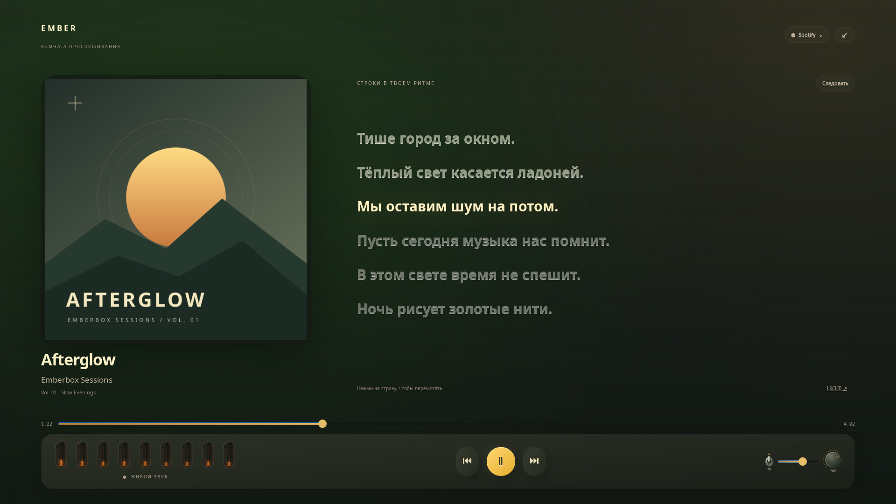
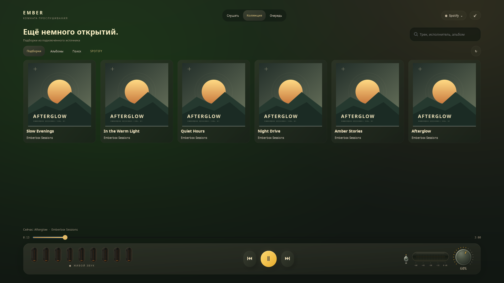
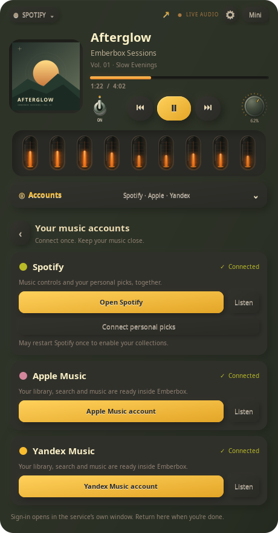
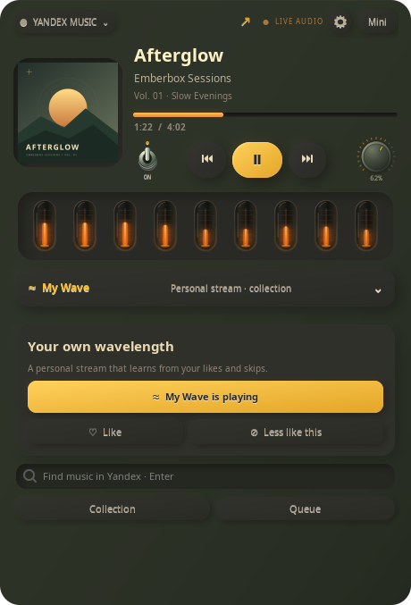

# Emberbox Audio

[English](README.md) · **Русский**

### Твоя музыка. Чуть теплее.


Настольный компаньон **Spotify, Apple Music, YouTube и Яндекс Музыки**: обложка, управление музыкой, личные подборки и девять газоразрядных ламп, реагирующих на настоящий звук.

## Что внутри

- Переключение **Spotify / Apple Music / YouTube / Яндекс Музыка**, в том числе в мини-режиме. Медиатека, поиск и воспроизведение Apple Music — внутри виджета. [Подключение Apple Music](docs/APPLE_MUSIC.ru.md).
- Обложка, название трека, перемотка и управление музыкой рядом с работой.
- Девять настоящих частотных полос звука, плавное движение ламп и мягкое свечение стекла.
- Гладкий тумблер и крутилка громкости отдельного приложения.
- Компактный режим с обложкой, лампами и разнесёнными кнопками.
- Необязательная экспериментальная панель личных подборок и треков Spotify.


*Для превью используются оригинальная графика и измеренный сгенерированный звук. Личные данные аккаунтов не публикуются.*

**Грунесфизм** — так мы называем этот визуальный стиль: тёплая палитра Gruvbox, мягкий неоморфный объём, тактильные металлические регуляторы и янтарное свечение за стеклом. Фон едва подстраивается под обложку; движения плавные, а лишних рамок и всплывающих подписей нет. [Подробнее о дизайне](docs/DESIGN.ru.md).

## Музыка на весь экран

Значок **≋ качества** показывает формат текущего потока; по нажатию — частота, каналы и доступные подробности. Отметки каталога Apple, например Dolby Atmos и Lossless, отображаются отдельно от фактического воспроизведения. [Качество звука и поддержка источников →](docs/AUDIO_QUALITY.ru.md)



Кнопка **⛶** в шапке, **F11** или **«Комната прослушивания · На весь экран»** в настройках открывают отдельную сцену: крупная обложка по центру, мягкий фон в её цветах и живые лампы. **Текст песни** отдельно включает синхронизированные строки из LRCLIB; **Обложка** возвращает исходный вид. До выбора «Текст песни» или «Караоке» слова не загружаются и не отрисовываются. По строке с таймкодом можно перемотать песню; **Esc** возвращает настольный виджет на прежнее место. Если таймкодов нет, показывается обычный текст; если нет слов — спокойный вид для инструментальной музыки или ненайденного текста.

В полноэкранной **Коллекции** доступны подборки, сохранённые альбомы и поиск. **+** собирает приватную очередь, а отдельная страница **Очередь** позволяет менять порядок, удалять песни и слушать их последовательно. Управление остаётся видно на всех страницах. [Возможности источников и работа с очередью →](docs/COLLECTION.ru.md)

**Караоке** оставляет место твоему голосу: крупные слова, янтарная подсветка по настоящим таймкодам, мягкий отсчёт перед вступлением и локальная нейросеть UVR для приглушения вокала. Автотекст обычно синхронизирован по строкам; расширенный LRC позволяет подсвечивать слова. AI подготавливается один раз прямо в плеере; измеренная задержка показана на экране. [Управление и возможности караоке →](docs/KARAOKE.ru.md)



[Управление, доступность текстов и сетевые запросы](docs/FULLSCREEN.ru.md).

Крупные исходники вместо растянутых миниатюр. Для поддерживаемых каталожных треков Apple Music — оригинальная видеообложка альбома: без звука, по кругу и с паузой вместе с треком. Для анимации нужен необязательный FFmpeg; если её нет, остаётся статичная обложка.

*На скриншоте настоящий GTK-интерфейс, оригинальная демонстрационная графика и специально написанный текст.*

## Вход прямо из плеера



**Настройки → Аккаунты**: подключи Spotify, Apple Music и Яндекс Музыку, заверши официальный вход и возвращайся к музыке. При первом запуске панель откроется сама. Статусы обновляются автоматически; для Apple Music есть проверка компонентов и настройка без терминала. [Как подключиться](docs/ACCOUNTS.ru.md).

## YouTube без аккаунта

Выбери **YouTube · поиск и музыка**, найди трек или вставь ссылку YouTube/YouTube Music. Музыка играет внутри виджета: с обложкой, очередью, перемоткой и живыми лампами. Можно выбрать и уже играющую вкладку браузера. [Подключение и детали](docs/YOUTUBE.ru.md).

## Моя волна в тёплом свете



**Экспериментальная интеграция Яндекс Музыки:** запуск **Моей волны**, реакции «Нравится / Не моё», поиск и загруженные треки коллекции и очереди внутри виджета. Вход в Яндекс ID доступен через **Настройки → Аккаунты**. Для полного воспроизведения нужен Яндекс Плюс. Проверка настоящего воспроизведения с подпиской **ожидает тестеров**; интерфейс и команды проверены на тестовых данных. [Подключение и список проверок](docs/YANDEX_MUSIC.ru.md).

## Установка

Нужен Linux с PipeWire. Исходное проверенное окружение — GNOME 50, Wayland + XWayland. Дополнительно проверен KWin 6.7.5 во вложенном сеансе Wayland/XWayland; полноценный Plasma Shell остаётся в [списке проверок KDE для тестеров](docs/KDE.ru.md).

Склонируй проект и запусти установщик от обычного пользователя:

```sh
git clone https://github.com/BlackSnaker/emberbox-audio.git
cd emberbox-audio
./install.sh --autostart
```

Установщик проверит имеющиеся компоненты и подготовит недостающие: GTK, аудиоутилиты, воспроизведение YouTube с поддержкой JavaScript и FFmpeg для видеообложек. Поддерживаются **Arch, Debian/Ubuntu, Fedora и openSUSE**. `sudo` используется только для недостающих системных пакетов с подтверждением пакетного менеджера; Python-модули помещаются в изолированное окружение приложения. Настройки темы и аудиослужб сохраняются.

Открой **Emberbox Audio** в меню приложений. Без `--autostart` запуск при входе не включается. Один запускатель работает в GNOME и KDE; если пользовательский менеджер служб недоступен, используется прямой запуск. **`./install.sh --check`** покажет проверки и команды без изменений. `--no-deps` требует уже готовые зависимости, а `--yes` явно принимает подтверждения установки пакетов. [Все параметры, простой вывод и диагностика](docs/INSTALL.ru.md).

Для запуска из исходников с готовыми зависимостями — `./run.sh`.

Выбери источник в меню сверху. У Apple Music плейлисты, альбомы, треки и поиск по каталогу открываются внутри Emberbox; сайт работает в фоновом движке. Нужны совместимый установленный движок с DRM и подписка Apple Music. [Разовая настройка](docs/APPLE_MUSIC.ru.md). Для Spotify запусти клиент Spotify. Основное управление работает через MPRIS; для личных рекомендаций есть [отдельное экспериментальное подключение](docs/SPOTIFY.ru.md).

Перетаскивай виджет за верхнюю полоску или обложку. Кнопка **Mini** включает компактный режим. Крути громкость колесом или перетаскиванием, с Shift — точнее. Металлический тумблер выключает звук и сохраняет выбранную громкость.

Это ранний выпуск **v0.11.0**. Личные подборки зависят от внутренних интерфейсов клиента Spotify и могут потребовать обновления интеграции после обновления клиента. Интерфейс публичной версии в основном на английском; названия подборок приходят из Spotify.

[English README](README.md) · [Установка и удаление](docs/INSTALL.ru.md) · [Второй плеер](https://github.com/BlackSnaker/emberbox-video) · [MIT](LICENSE)

[История изменений](CHANGELOG.ru.md) · [Участие в разработке](CONTRIBUTING.ru.md)
