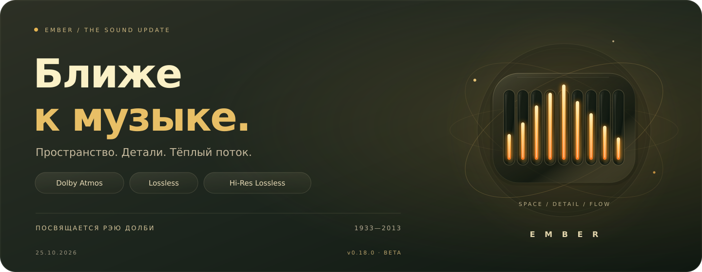
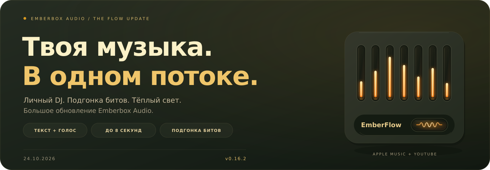

# Emberbox Audio

[English](README.md) · **Русский** · [Системные требования](#системные-требования)

### Твоя музыка. Чуть теплее.

<a id="the-sound-update"></a>

## 25 октября 2026 · Ближе к музыке



[Read in English →](README.md#the-sound-update)

**Dolby Atmos, Lossless и Hi‑Res Lossless — теперь в Ember.**

Тихий вдох перед первой строчкой. Послезвучие клавиши. Пространство между
инструментами. Иногда именно такие детали заставляют заново услышать песню,
которую знаешь наизусть. Ради этих моментов и хочется делать Ember лучше.

### Посвящается Рэю Долби

Рэй Долби (1933–2013), основатель Dolby Laboratories, изменил мир звукозаписи
и кинозвука. Его работа соединяла инженерную мысль и возможности искусства.
[О его жизни и изобретениях →](https://www.dolby.com/en-gb/about/leadership/ray-dolby/)

Его путь вдохновляет меня заниматься Ember: разбираться глубже, замечать
маленькие детали и продолжать искать решение, даже когда оно кажется далёким.
Это обновление — моя благодарность человеку, чьи идеи помогают слышать больше.

### Новый звук. То же тёплое свечение.

- **Dolby Atmos в Apple Music.** Нативное воспроизведение настоящих Atmos-дорожек
  с пространственным рендером для наушников.
- **Lossless и Hi‑Res Lossless.** Для записей без Atmos Ember выбирает лучший
  доступный ALAC, сохраняя сведения об исходных разрядности и частоте.
- **EmberFlow между форматами.** Lossless, Hi‑Res и Atmos могут плавно
  перетекать друг в друга с перекрытием до восьми секунд. Обложка и очередь
  следуют моменту перехода на звуковом выходе.
- **Качество, которое видно.** Плашка под обложкой показывает формат,
  подтверждённый декодером. Нажатие открывает подробности за знакомым
  запотевшим стеклом; плашка остаётся доступной и на паузе.

**Начало прослушивания:** обнови Ember, выбери
**Настройки → Подключить Apple Lossless…**, заверши отдельный вход и включи
**Apple · Atmos / Lossless · бета**. Сеанс сохраняется после перезапуска.
Компоненты можно подготовить командой `./install.sh --apple-lossless`.

*Бета 0.18.0 · Нужна подписка Apple Music; доступность форматов зависит от
записи и региона. Пространственный режим использует независимый OpenJOC-рендер
для наушников без сертификации Dolby.*

**Спасибо, Рэй. За вдохновение делать звук лучше.**

[Подключение и возможности →](docs/ATMOS_PROTOTYPE.ru.md) · [Установить или обновить →](docs/INSTALL.ru.md) · [Все изменения →](CHANGELOG.ru.md)

---

<a id="the-flow-update"></a>

## 24 октября 2026 · Большое обновление Ember



**Личный DJ. Музыка одним потоком. Свет, который чувствуется.** Сегодняшнее
обновление объединило **Ember DJ и EmberFlow** — от версии 0.13 до 0.16.2.

- **Музыка по твоим словам.** Напиши или скажи пожелание, уточни «повеселее»
  или «без вокала» — Эмбер соберёт сет с учётом личных подборок и музыкальных
  предпочтений. Необязательный локальный ИИ разбирает свободные описания
  атмосферы, а новый русский голос Эмбер — **Ксения**. [Знакомство с Ember DJ →](docs/DJ.ru.md)
- **Следующий трек входит красиво.** EmberFlow смешивает настоящие песни из
  очереди до **восьми секунд** во встроенных **Apple Music и YouTube**.
  Тумблер **«Биты»** совмещает устойчивые близкие ритмы, меняя темп до **±6%**
  с сохранением высоты голоса, затем мягко возвращает обычную скорость.
  Для остальных треков остаётся плавное наложение. [Как работает EmberFlow →](docs/FLOW.ru.md)
- **Маленькая деталь с большим теплом.** Утопленный переключатель EmberFlow
  получил увеличенную стеклянную лампу: видимая нить разгорается от тусклого
  красного через янтарный к золотому и остывает с тепловой инерцией.
  Повторное нажатие сохраняет её накал; после прогрева анимация завершается.

**Попробовать:** подготовь голос/ИИ в **DJ → ⚙** или включи
**EmberFlow + «Биты»** в настройках плеера и добавь песни в очередь Ember.

[Установить или обновить →](docs/INSTALL.ru.md) · [Все изменения →](CHANGELOG.ru.md) · [Read in English →](README.md#the-flow-update)

---


Настольный компаньон **Spotify, Apple Music, YouTube и Яндекс Музыки**: обложка, управление музыкой, личные подборки и девять газоразрядных ламп, реагирующих на настоящий звук.

## Ember DJ — личное радио

Вкладка DJ внутри Ember в нашем Грунесфизме: напиши пожелание **с клавиатуры и нажми Enter**
или скажи в микрофон. Личные подборки, прослушивания и отметки помогают
выбирать следующий музыкальный блок. Локальные ИИ, распознавание и озвучка;
мягкое появление, металлический диск и живые лампы.
Свободные описания настроения и атмосферы разбираются локальной моделью;
уточнения могут продолжать прежний сет. Прямые команды остаются быстрыми.
[Как открыть и настроить DJ →](docs/DJ.ru.md)


## Что внутри

- Переключение **Spotify / Apple Music / YouTube / Яндекс Музыка**, в том числе в мини-режиме. Медиатека, поиск и воспроизведение Apple Music — внутри виджета. [Подключение Apple Music](docs/APPLE_MUSIC.ru.md).
- Обложка, название трека, перемотка и управление музыкой рядом с работой.
- Девять настоящих частотных полос звука, плавное движение ламп и мягкое свечение стекла.
- Гладкий тумблер и крутилка громкости отдельного приложения.
- Компактный режим с обложкой, лампами и разнесёнными кнопками.
- Необязательная экспериментальная панель личных подборок и треков Spotify.


*Для превью используются оригинальная графика и измеренный сгенерированный звук. Личные данные аккаунтов не публикуются.*

**Грунесфизм** — так мы называем этот визуальный стиль: тёплая палитра Gruvbox, мягкий неоморфный объём, тактильные металлические регуляторы и янтарное свечение за стеклом. Фон едва подстраивается под обложку; движения плавные, а лишних рамок и всплывающих подписей нет. [Подробнее о дизайне](docs/DESIGN.ru.md).

## EmberFlow — песни перетекают одна в другую

Янтарный тумблер мягко смешивает хвост уходящей песни с началом следующей.
До восьми секунд настоящего перекрытия для **встроенных Apple Music и YouTube**,
следуя очереди Ember: появление нового трека, передача основного звучания
и растворение старого хвоста. Для затихшего окончания вход короче. Второй
проигрыватель подготавливается ненадолго; нейросеть для перехода не нужна.
Тумблер **«Биты»** в настройках совмещает устойчивые близкие ритмы с сохранением
высоты голоса; после микса песня мягко возвращается к своему темпу.
[Управление и поддержка источников →](docs/FLOW.ru.md)

## Музыка на весь экран

Значок **≋ качества** показывает формат текущего потока; по нажатию — частота, каналы и доступные подробности. Отметки каталога Apple, например Dolby Atmos и Lossless, отображаются отдельно от фактического воспроизведения. [Качество звука и поддержка источников →](docs/AUDIO_QUALITY.ru.md)


Кнопка **⛶** в шапке, **F11** или **«Комната прослушивания · На весь экран»** в настройках открывают отдельную сцену: крупная обложка по центру, мягкий фон в её цветах и живые лампы. **Текст песни** отдельно включает синхронизированные строки из LRCLIB; **Обложка** возвращает исходный вид. До выбора «Текст песни» или «Караоке» слова не загружаются и не отрисовываются. По строке с таймкодом можно перемотать песню; **Esc** возвращает настольный виджет на прежнее место. Если таймкодов нет, показывается обычный текст; если нет слов — спокойный вид для инструментальной музыки или ненайденного текста.

В полноэкранной **Коллекции** доступны подборки, сохранённые альбомы и поиск. **+** собирает приватную очередь, а отдельная страница **Очередь** позволяет менять порядок, удалять песни и слушать их последовательно. Управление остаётся видно на всех страницах. [Возможности источников и работа с очередью →](docs/COLLECTION.ru.md)

**Открой альбом текущей песни.** Нажми его название в виджете или на полном экране: обложка, список треков, описание, воспроизведение и очередь — прямо внутри Ember. Просмотр сохраняет текущее состояние музыки.

**Открой мир артиста.** Нажми имя исполнителя: фотографическая шапка,
популярные песни, полки альбомов и синглов/EP, сборники, участия и доступные истории. Открой релиз,
прочти описание, слушай и собирай очередь, оставаясь на полном экране.
Наполнение зависит от выбранного источника. [Комната артиста →](docs/ARTISTS.ru.md)


**Караоке** оставляет место твоему голосу: крупные слова, янтарная подсветка по настоящим таймкодам, мягкий отсчёт перед вступлением и локальная нейросеть UVR для приглушения вокала. Автотекст обычно синхронизирован по строкам; расширенный LRC позволяет подсвечивать слова. AI подготавливается один раз прямо в плеере; измеренная задержка показана на экране. [Управление и возможности караоке →](docs/KARAOKE.ru.md)


[Управление, доступность текстов и сетевые запросы](docs/FULLSCREEN.ru.md).

Крупные исходники вместо растянутых миниатюр. Для поддерживаемых каталожных треков Apple Music — оригинальная видеообложка альбома: без звука, по кругу и с паузой вместе с треком. Для анимации нужен необязательный FFmpeg; если её нет, остаётся статичная обложка.

*На скриншоте настоящий GTK-интерфейс, оригинальная демонстрационная графика и специально написанный текст.*

## Вход прямо из плеера


**Настройки → Аккаунты**: подключи Spotify, Apple Music и Яндекс Музыку, заверши официальный вход и возвращайся к музыке. При первом запуске панель откроется сама. Статусы обновляются автоматически; для Apple Music есть проверка компонентов и настройка без терминала. [Как подключиться](docs/ACCOUNTS.ru.md).

## YouTube без аккаунта

Выбери **YouTube · поиск и музыка**, найди трек или вставь ссылку YouTube/YouTube Music. Музыка играет внутри виджета: с обложкой, очередью, перемоткой и живыми лампами. Можно выбрать и уже играющую вкладку браузера. [Подключение и детали](docs/YOUTUBE.ru.md).

## Моя волна в тёплом свете


**Экспериментальная интеграция Яндекс Музыки:** запуск **Моей волны**, реакции «Нравится / Не моё», поиск и загруженные треки коллекции и очереди внутри виджета. Вход в Яндекс ID доступен через **Настройки → Аккаунты**. Для полного воспроизведения нужен Яндекс Плюс. Проверка настоящего воспроизведения с подпиской **ожидает тестеров**; интерфейс и команды проверены на тестовых данных. [Подключение и список проверок](docs/YANDEX_MUSIC.ru.md).

## Системные требования

**Linux · X11 либо Wayland + XWayland · PipeWire · Python ≥ 3.10 · GTK 3.**
Текущая проверенная архитектура — **x86_64**; встроенный DRM Apple/Яндекса
использует Widevine для Linux x64. Windows и macOS не поддерживаются.

| Ресурс | Музыка и полный экран | Локальное AI-караоке |
| --- | --- | --- |
| Ориентир по CPU | 2 современных ядра | 4 современных ядра / 8 потоков; пригодность определяет тест перед запуском |
| Ориентир по RAM всей системы | 4 ГБ | От 8 ГБ; на проверенном компьютере разработчика — 16 ГБ |
| Запас свободного места | 1 ГБ | 2 ГБ суммарно, вместе с плеером |
| Экран и графика | Полноэкранная компоновка проверена от 1024×600 логических пикселей; встроенная графика, для анимации рекомендуется OpenGL 3.2 | Те же; AI работает на CPU, без CUDA и дискретной видеокарты |

Цифры CPU, RAM и места — **предварительные рекомендации, а не подтверждённый
тестами минимум**. Приложения источников, пакеты дистрибутива и растущий кэш
требуют своего запаса. AI необязателен и требует больше ресурсов, чем обычное
прослушивание.

[Все требования, зависимости источников и проверенные конфигурации →](docs/REQUIREMENTS.ru.md)

## Установка

Нужен Linux с PipeWire. Исходное проверенное окружение — GNOME 50, Wayland + XWayland. Дополнительно проверен KWin 6.7.5 во вложенном сеансе Wayland/XWayland; полноценный Plasma Shell остаётся в [списке проверок KDE для тестеров](docs/KDE.ru.md).

Склонируй проект и запусти установщик от обычного пользователя:

```sh
git clone https://github.com/BlackSnaker/emberbox-audio.git
cd emberbox-audio
./install.sh --autostart
```

Установщик проверит имеющиеся компоненты и подготовит недостающие: GTK, аудиоутилиты, воспроизведение YouTube с поддержкой JavaScript и FFmpeg для видеообложек. Поддерживаются **Arch, Debian/Ubuntu, Fedora и openSUSE**. `sudo` используется только для недостающих системных пакетов с подтверждением пакетного менеджера; Python-модули помещаются в изолированное окружение приложения. Настройки темы и аудиослужб сохраняются.

Открой **Emberbox Audio** в меню приложений. Без `--autostart` запуск при входе не включается. Один запускатель работает в GNOME и KDE; если пользовательский менеджер служб недоступен, используется прямой запуск. **`./install.sh --check`** покажет проверки и команды без изменений. `--no-deps` требует уже готовые зависимости, а `--yes` явно принимает подтверждения установки пакетов. [Все параметры, простой вывод и диагностика](docs/INSTALL.ru.md).

Для запуска из исходников с готовыми зависимостями — `./run.sh`.

Выбери источник в меню сверху. У Apple Music плейлисты, альбомы, треки и поиск по каталогу открываются внутри Emberbox; сайт работает в фоновом движке. Нужны совместимый установленный движок с DRM и подписка Apple Music. [Разовая настройка](docs/APPLE_MUSIC.ru.md). **Spotify теперь тоже входит и играет внутри Ember**: Настройки → Аккаунты. Отдельный клиент необязателен. [Подключение Spotify](docs/SPOTIFY.ru.md).

Перетаскивай виджет за верхнюю полоску или обложку. Кнопка **Mini** включает компактный режим. Крути громкость колесом или перетаскиванием, с Shift — точнее. Металлический тумблер выключает звук и сохраняет выбранную громкость.

Это ранний выпуск **v0.19.1**. Встроенный Spotify использует интерфейс официального сайта; обновления сайта могут потребовать исправления адаптера. Интерфейс публичной версии в основном на английском; названия подборок приходят из Spotify.

[English README](README.md) · [Установка и удаление](docs/INSTALL.ru.md) · [Второй плеер](https://github.com/BlackSnaker/emberbox-video) · [MIT](LICENSE)

[История изменений](CHANGELOG.ru.md) · [Участие в разработке](CONTRIBUTING.ru.md)
