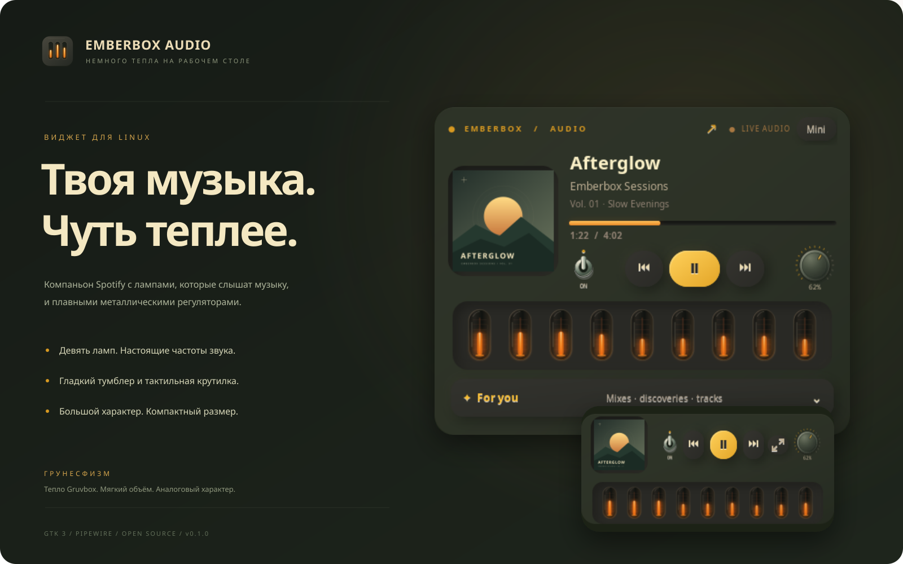
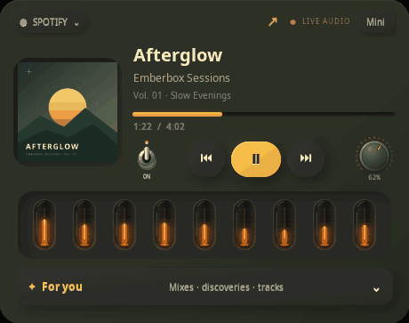

# Emberbox Audio

[English](README.md) · **Русский**

### Твоя музыка. Чуть теплее.



Настольный компаньон **Spotify и веб-плеера Apple Music**: обложка, управление музыкой, личные подборки и девять газоразрядных ламп, реагирующих на настоящий звук.

## Что внутри

- Переключение **Spotify / Apple Music**, в том числе в мини-режиме. [Подключение Apple Music](docs/APPLE_MUSIC.ru.md).
- Обложка, название трека, перемотка и управление музыкой рядом с работой.
- Девять настоящих частотных полос звука, плавное движение ламп и мягкое свечение стекла.
- Гладкий тумблер и крутилка громкости отдельного приложения.
- Компактный режим с обложкой, лампами и разнесёнными кнопками.
- Необязательная экспериментальная панель личных подборок и треков Spotify.



*Для превью используются оригинальная графика и измеренный сгенерированный звук. Личные данные аккаунтов не публикуются.*

**Грунесфизм** — так мы называем этот визуальный стиль: тёплая палитра Gruvbox, мягкий неоморфный объём, тактильные металлические регуляторы и янтарное свечение за стеклом. Фон едва подстраивается под обложку; движения плавные, а лишних рамок и всплывающих подписей нет. [Подробнее о дизайне](docs/DESIGN.ru.md).

## Установка

Нужен Linux с PipeWire. Проверено на LunaOS (Arch), GNOME 50 и Wayland с XWayland; остальные окружения пока требуют проверки.

Сначала установи [системные зависимости](docs/INSTALL.ru.md), затем:

```sh
git clone https://github.com/BlackSnaker/emberbox-audio.git
cd emberbox-audio
./install.sh --autostart
```

Открой **Emberbox Audio** в меню приложений. Установка выполняется в каталог пользователя, без `sudo` и без изменения темы системы. Без `--autostart` запуск при входе не включается. Для запуска из исходников — `./run.sh`.

Выбери источник в меню сверху. Для Apple Music включи трек на music.apple.com и выбери медиасеанс браузера; управление и звук могут быть общими с другими вкладками. [Подключение и ограничения](docs/APPLE_MUSIC.ru.md). Для Spotify запусти клиент Spotify. Основное управление работает через MPRIS; для личных рекомендаций есть [отдельное экспериментальное подключение](docs/SPOTIFY.ru.md).

Перетаскивай виджет за верхнюю полоску или обложку. Кнопка **Mini** включает компактный режим. Крути громкость колесом или перетаскиванием, с Shift — точнее. Металлический тумблер выключает звук и сохраняет выбранную громкость.

Это ранний выпуск **v0.2.0**. Личные подборки зависят от внутренних интерфейсов клиента Spotify и могут потребовать обновления интеграции после обновления клиента. Интерфейс публичной версии в основном на английском; названия подборок приходят из Spotify.

[English README](README.md) · [Установка и удаление](docs/INSTALL.ru.md) · [Второй плеер](https://github.com/BlackSnaker/emberbox-video) · [MIT](LICENSE)

[История изменений](CHANGELOG.ru.md) · [Участие в разработке](CONTRIBUTING.ru.md)
