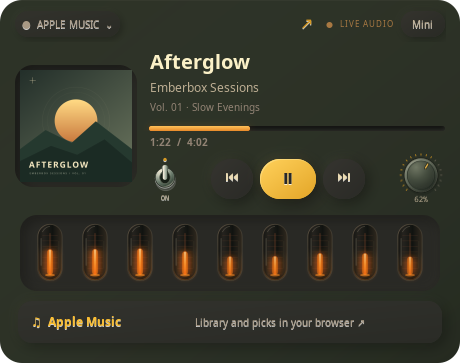

# Apple Music and source switching

**English** · [Русский](APPLE_MUSIC.ru.md)

Emberbox controls the **Apple Music web player through your browser's Linux MPRIS media session**. No Apple developer key, browser extension or account-token import is used. Sign in and listen at [music.apple.com](https://music.apple.com/) in your usual browser; an Apple Music subscription is needed for full tracks.

## Connect

1. Click the **Spotify ⌄** source button in the header and select **Apple Music**.
2. Open Apple Music and start a song in Firefox or a Chromium browser with Linux media controls enabled.
3. Reopen the source selector and click that browser's media session. Sessions only appear after media playback begins. The track title helps identify the right browser.
4. Use play/pause, previous/next, seeking, the dial and mute toggle. Individual buttons depend on the capabilities the browser advertises.

The compact view has the same selector over the cover: **S⌄ / A⌄**. Source and browser choice survive restarts. If multiple instances share the same identity, choose the intended instance again. A known `music.apple.com` media URL can be detected automatically; a generic browser session requires explicit selection. Other known website URLs are rejected for Apple Music.

## Switching behaviour

Switching pauses a playing previous source and does **not** start the new source automatically. Switching never opens a browser window. The arrow and the Apple Music footer explicitly open the website. Spotify's personal-picks drawer is only shown in Spotify mode; Apple Music library and recommendations remain on the website.

Volume and mute preferences are stored separately for Spotify and Apple Music. The visualizer listens to the selected application's output through PipeWire, rather than the system monitor or microphone. Metadata polling and player commands run outside the GTK UI thread.

## Browser limits

- MPRIS is typically one current media session per browser instance. If another tab takes media focus without exposing its URL, the widget cannot tell that it is a different site. Use a dedicated browser window/profile for music and avoid concurrent media in the same browser.
- Volume, mute and the spectrum can include other tabs sharing the same browser audio stream. This is application-level control, not tab-level isolation. Sandboxed clients can hide host PIDs; application identity is used where a process boundary is unavailable.
- Artwork, position, duration, seeking and next/previous depend on the browser and the website. Missing metadata is not fabricated.
- No Apple Music personalized-feed API is implemented. No Apple account data, cookies, passwords or session tokens are read.
- If no session appears, first play a song, check the browser's hardware/media-key integration, then close and reopen the source selector. DRM and regional availability are handled by Apple and the browser.

This release has automated D-Bus routing tests, GTK source-switch tests and a real PipeWire signal/volume/mute check using generated audio. Subscription playback must be checked with your own signed-in browser.

[Apple Music web guide](https://support.apple.com/en-ca/guide/music-web/welcome/web) · [MPRIS specification](https://specifications.freedesktop.org/mpris-spec/latest/)
