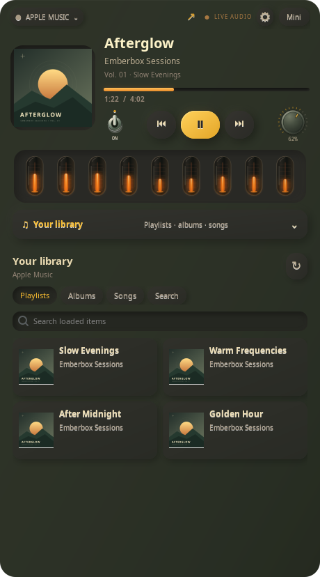

# Apple Music inside Emberbox

**English** · [Русский](APPLE_MUSIC.ru.md)

Select **Apple Music · library** in the source menu. Playlists, albums, saved songs and catalogue search are rendered inside the GTK widget. Clicking a song starts playback without opening a browser window. The same controls, compact view, volume dial, mute switch and audio-reactive tubes work with this source.



## Connect from the player

Open **Settings → Accounts** and click **Sign in to Apple Music**. Background component checks prepare playback, then the official sign-in window opens. On completion it hides and your library is available in Emberbox. Missing components can be selected in the same panel. [Step-by-step connection](ACCOUNTS.md).

## Compatibility and optional manual setup

This experimental Linux integration runs Apple's own website in a hidden, isolated browser process. It needs **A systemd user session, a compatible installed Electron/Chromium runtime with AAC and Widevine support, and a locally installed Linux x64 Widevine module**. A standard Chromium executable alone is not an Electron runtime. Engine compatibility varies; ordinary Electron builds may lack proprietary codecs or fail Apple sign-in. No runtime binaries or DRM modules are distributed by Emberbox.

From this checkout, configure the paths you installed:

```sh
python tools/apple_player.py \
  --runtime /absolute/path/to/compatible-runtime \
  --widevine /absolute/path/to/WidevineCdm/version
```

For an installed copy, the setup script is in `~/.local/share/emberbox-audio/tools/`. Configuration is saved to `~/.config/emberbox-audio/apple-engine.json`. The local player module is packaged with Python; Node.js and package downloads are not required.

1. Select **Apple Music** in Emberbox and open **Your library**.
2. If asked, click **Sign in to Apple Music**. Sign in on Apple's own website in the separate login window. Full tracks require an Apple Music subscription.
3. Return to Emberbox. Browse **Playlists / Albums / Songs**, or use **Search**, type a name and press Enter.
4. Open a collection and click a track. Music and the measured audio spectrum stay inside the widget.

No Apple developer key is required for this website-based mode. Login is kept in an Emberbox-owned profile; existing browser profiles, cookies and tokens are not imported or exported. The GTK bridge receives selected music metadata and playback state only. It does not accept arbitrary JavaScript or arbitrary API routes. The website retains browser sandboxing, context isolation and web security.

## Source switching and playback

Switching pauses the previous source without automatically starting the next one. Selecting Apple Music or clicking a track does not open a website window. The arrow opens the library drawer. The compact view keeps its **A⌄** source selector.

The spectrum and volume target this engine's own process tree through PipeWire. Other browser tabs and system sounds are not included. The engine lives in a separate user service so restarting the GTK widget does not close the Apple session. Music metadata and network requests run outside GTK's UI thread.

## Limits and optional browser mode

- This is an experimental adapter to Apple's website, not a standalone MusicKit developer application. Website changes can require updates.
- The library and song search are implemented. Apple's personalized Home feed and radio are not implemented in the native drawer.
- Availability, DRM and subscription checks are handled by Apple. A track unavailable to the account cannot be made playable by the widget.
- A running media session in Firefox or Chromium can still be selected explicitly in the source menu as a fallback. That uses MPRIS; its library requires the optional companion in `browser/apple-music/`. Browser audio may be shared with other tabs in that fallback mode.

Verification includes offline adapter and GTK tests, saved-session library/search requests, subscription playback, seeking, pause/resume, source deactivation and actual app-specific PipeWire spectrum measurement.

[MusicKit JS reference](https://js-cdn.music.apple.com/musickit/v1/index.html) · [Apple Music web guide](https://support.apple.com/en-ca/guide/music-web/welcome/web)
