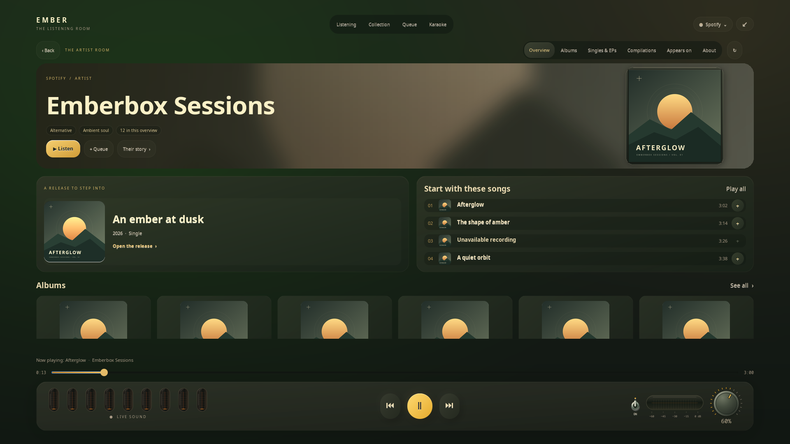
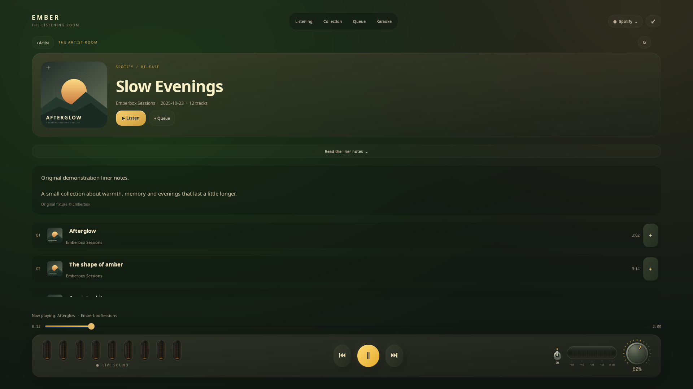

# A room for the artist

**English** · [Русский](ARTISTS.ru.md)

In fullscreen, click the **artist's name ›** beneath the song. Collection track
rows and open collections also have an **Artist ›** action; the current artist's
name is clickable in Queue. Browsing stays inside the listening room and does
not start a track.

## A warmer portrait

The artist's complete photograph sits inside a restrained matte metal frame on
the right: a shallow bevel, a fine warm highlight and a soft shadow. Portrait,
landscape and square photos keep their original proportions and all source
edges. A larger, softly blurred copy of the same photo supplies the warm
background; the clear photograph is never stretched or faded away.

The cream name, genre badges and amber controls have their own reading area,
so they do not cover the photograph. The masthead grows when the heading needs
more room. Missing photos retain a quiet gradient fallback. Photo loading and
composition run away from GTK; original-aspect photos use a separate thumbnail
cache entry and completed banners use a small bounded memory cache.

**Overview**, **All releases** (Apple Music), **Albums**, **Singles & EPs**, **Compilations**, **Appears on** and
**About** share the compact toolbar above the scroll area. Overview pairs a
horizontal featured release with compact popular songs, followed by album,
single and compilation shelves. Releases are deduplicated across the overview.
If the catalogue really contains only one release, its supplied artist story
appears beside it instead of repeated covers. About shows the source's description with
attribution; biographies are not generated. Collaborations and unresolved names
offer artist cards for an explicit choice. Exact recording relationships take
precedence; name searches are never silently assigned to a namesake.

## Complete Apple Music discography

Opening an Apple artist automatically scans the **artist albums relationship**,
one page of up to 100 releases per background request. **All releases** retains
every ID supplied by that catalogue, including alternate editions and releases
without playback access. Albums, Singles & EPs and Compilations filter this same
loaded catalogue; EPs use the source's singles view and title designation.
The compact overview remains a preview, with small shelves.

The footer reports the loaded count and region. Only the source's final page
marks the scan complete. A network error retains the loaded releases and offers
**Continue loading the discography**, retrying the failed page. Leaving the
artist or changing source discards late replies; returning to the same artist
resumes or reuses its catalogue. Refresh starts a new scan. The region stays
fixed throughout pagination. “Complete” means the releases returned for that
artist by this Apple Music storefront, not recordings absent from its catalogue.
Appearances still use Apple's separate, paged appearances view.

There is no 200-release catalogue ceiling. Cover pages contain **48 releases**
with previous/next controls, so a large catalogue does not create thousands of
GTK controls at once. Distinct IDs with the same title are never merged.

## Open a release

Click a cover for tracks, available release date and track count. **Read the
liner notes** softly unfolds the source's album description when supplied.

- Click a song to play from that point and continue through the loaded playable
  songs. Explicit queue additions remain ahead of the new continuation.
- **+** adds a song; **Queue** adds the loaded playable selection without
  interrupting music. **Listen** starts the loaded songs.
- Unavailable recordings remain visible with disabled playback/queue controls.
- **Load more** follows the source's next page for release tracks and other
  categories. Artist lists no longer stop at 200 entries. Spotify still exposes
  up to its first 100 cached album tracks.
- **‹ Artist** restores the artist category; **‹ Back** returns to the preceding
  room page. **Alt+Left** also goes back; **Esc / F11** restores the desktop widget.

Transport, seeking, volume and tubes stay available. Track changes retain the
artist you deliberately opened. A source change opens that source's context;
late replies from another page/source are discarded.

## Source coverage

| Source | Artist room |
| --- | --- |
| Apple Music, in-player connection | Catalogue portrait, supplied editorial notes, popular songs, albums, singles/EPs, compilations, appearances and paged release tracks. Uses the existing account/playback connection. |
| Spotify | Information exposed by the connected desktop client. Categories and biographies depend on its page. The optional adapter remains version dependent; missing categories stay empty. |
| Yandex Music | Artist identity, loaded releases, songs and supplied descriptions from the official site's session. Separate categories depend on the site. Subscription playback still awaits tester verification. |
| YouTube | In-player search for the current name/channel. No verified artist discography or biography is available through this connection; another service's catalogue is not substituted. |

Unavailable text and empty sections do not stop music. Offline adapter checks
do not establish live catalogue coverage for every Spotify/Yandex artist.

## Data and verification

Requests reuse the selected source's connection, sending the selected artist or
recording ID, or the name when resolving it, to that source. No additional
account or third-party biography service is introduced. Artwork uses the normal
local thumbnail cache; the current full discography stays in memory while other browsing results use
bounded caches. Passwords, cookies and tokens are not copied into this page.

Apple independently fetches missing overview views by the exact artist ID,
with a 2.2-second optional phase and a 6.5-second artist-command deadline. A
failed section preserves successful music sections and offers a refresh.
The full list uses the documented [artist albums relationship](https://developer.apple.com/documentation/applemusicapi/fetch-a-relationship-on-this-resource-by-name-5akdm).
Apple uses documented [artist views](https://developer.apple.com/documentation/applemusicapi/artists/views-data.dictionary)
and [artist attributes](https://developer.apple.com/documentation/applemusicapi/artists/attributes-data.dictionary).
Editorial markup becomes plain text, not executable content or GTK markup.
Spotify/Yandex browsing uses in-page navigation and reports unavailable navigation
without forcing a page reload that would interrupt playback.

Checks cover exact identity, collaborations, pagination, unavailable songs,
unchanged transport, stale replies, source changes and real GTK at 1024×600,
1280×720 and 1920×1080 in both languages. Previews use original artwork and
fictional artist/release text.

[Player](../README.md) · [Collection and queue](COLLECTION.md) · [Accounts](ACCOUNTS.md)
