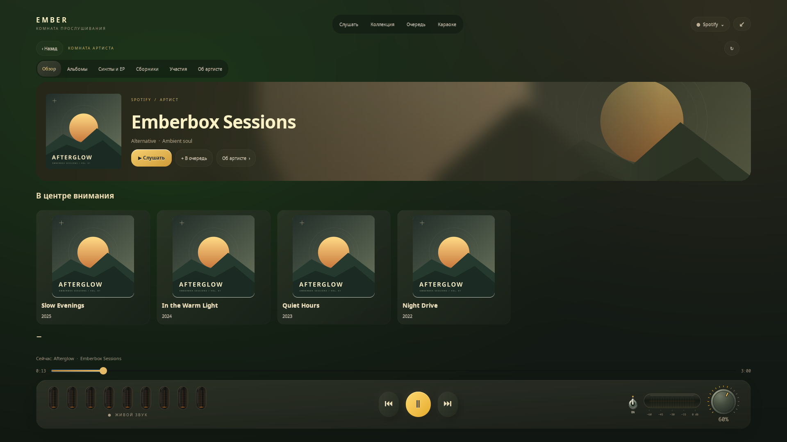
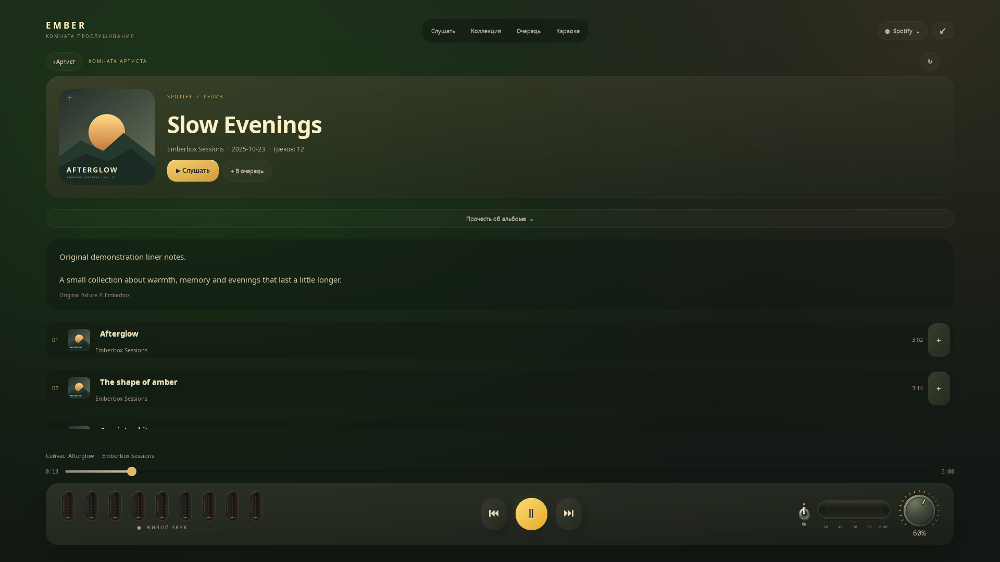

# Комната артиста

[English](ARTISTS.md) · **Русский**

На полном экране нажми **имя исполнителя ›** под песней. У строк треков
и открытых коллекций есть действие **Артист ›**; имя текущего исполнителя
нажимается и в Очереди. Просмотр остаётся внутри комнаты прослушивания
и сам не запускает трек.

## Тёплый портрет

Широкая фотографическая шапка растворяется в оливково-угольном фоне:
скруглённый портрет, крупное кремовое имя, доступные жанры и янтарные кнопки.
Изображение артиста задаёт сдержанный фон и более чёткую правую часть.
Если фото не пришло, остаётся спокойное оформление. Подготовка изображения
идёт вне GTK; готовые шапки хранятся в небольшом ограниченном кэше.

**Обзор**, **Альбомы**, **Синглы и EP**, **Сборники**, **Участия** и **Об артисте**
закреплены над прокруткой. Обзор собирает выделенные релизы и популярные песни.
Раздел «Об артисте» показывает описание выбранного источника с указанием
происхождения; биография не генерируется. У совместных треков и неразрешённых
имён предлагаются карточки для выбора. Точные связи записи с артистом имеют
приоритет; результат поиска не присваивается тёзке автоматически.

## Открой релиз

Нажми обложку, чтобы увидеть треки, доступную дату выпуска и число композиций.
**Прочесть об альбоме** плавно раскрывает описание, если источник его передал.

- Нажатие песни запускает её и продолжает загруженные доступные треки.
  Явно добавленные песни остаются перед новым автоматическим продолжением.
- **+** добавляет песню; **В очередь** — загруженный доступный список без
  прерывания музыки. **Слушать** запускает загруженные песни.
- Недоступные записи видны, но кнопки воспроизведения и добавления отключены.
- **Загрузить ещё** использует следующую страницу источника, до 200 загруженных
  записей. Spotify отдаёт до первых 100 кэшированных треков альбома, а не полный
  каталог.
- **‹ Артист** возвращает прежнюю категорию; **‹ Назад** — предыдущую страницу
  комнаты. **Alt+Left** также возвращает назад; **Esc / F11** — к виджету.

Воспроизведение, перемотка, громкость и лампы доступны на всех страницах.
Смена песни не подменяет артиста, которого ты открыл намеренно. Смена источника
открывает его контекст; запоздавшие ответы другой страницы или источника
отбрасываются.

## Возможности источников

| Источник | Комната артиста |
| --- | --- |
| Apple Music, встроенное подключение | Каталожный портрет, доступные описания, популярные песни, альбомы, синглы/EP, сборники, участия и постраничные треки релиза. Используется существующий аккаунт и движок. |
| Spotify | Сведения подключённого настольного клиента. Категории и биографии зависят от его страницы. Необязательный адаптер зависит от версии; непереданные категории остаются пустыми. |
| Яндекс Музыка | Исполнитель, загруженные релизы, песни и доступные описания из сеанса официального сайта. Отдельные категории зависят от сайта. Воспроизведение с подпиской ещё ожидает проверки тестерами. |
| YouTube | Поиск текущего имени или канала внутри плеера. Подтверждённой дискографии и биографии у этого подключения нет; каталог другого сервиса не подставляется. |

Отсутствие текста или пустой раздел не останавливает музыку. Проверки
адаптеров на тестовых данных не определяют полноту живого каталога
каждого артиста Spotify или Яндекса.

## Данные и проверка

Запросы используют подключение выбранного источника: ему передаётся ID артиста
или записи, а при разрешении имени — это имя. Дополнительный аккаунт или
сторонний сервис биографий не вводится. Графика использует обычный локальный
кэш обложек, результаты каталога и состояние просмотра — ограниченный кэш
памяти. Пароли, cookies и токены в эту страницу не копируются.

Apple использует документированные [разделы артиста](https://developer.apple.com/documentation/applemusicapi/artists/views-data.dictionary)
и [атрибуты исполнителя](https://developer.apple.com/documentation/applemusicapi/artists/attributes-data.dictionary).
Разметка описаний преобразуется в обычный текст, не выполняется и не
интерпретируется как разметка GTK. Spotify и Яндекс используют навигацию
внутри страницы; при её отсутствии возвращают ошибку, без принудительной
перезагрузки страницы, которая прервала бы звук.

Проверены точные идентификаторы, совместные треки, страницы альбома,
недоступные песни, отсутствие команд воспроизведения от просмотра,
запоздавшие ответы, смена источника и настоящий GTK при 1024×600, 1280×720
и 1920×1080 на двух языках. Превью используют оригинальную графику
и вымышленные сведения об артисте и релизах.

[Плеер](../README.ru.md) · [Коллекция и очередь](COLLECTION.ru.md) · [Аккаунты](ACCOUNTS.ru.md)
