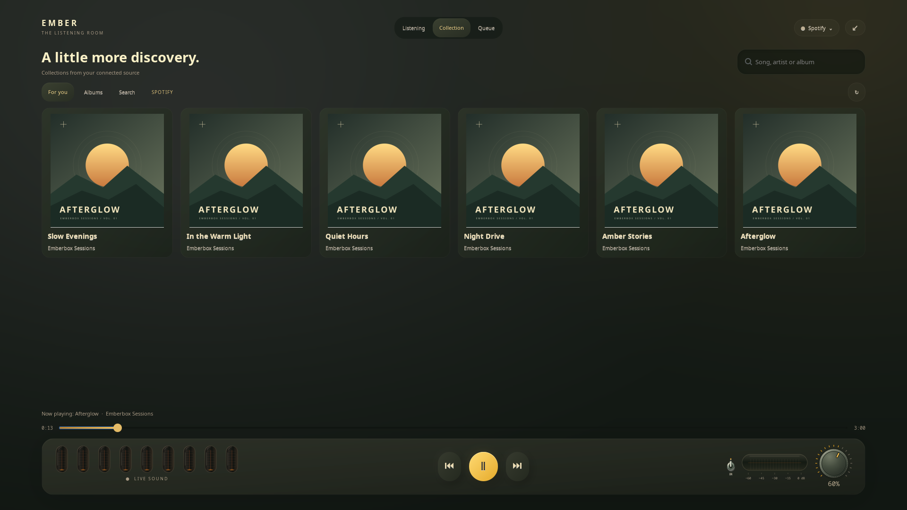
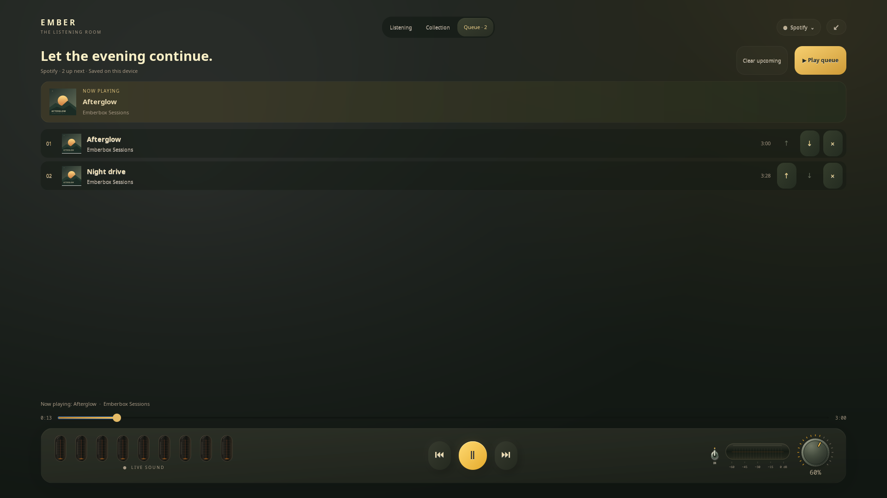

# Collection and listening queue

**English** · [Русский](COLLECTION.ru.md)

The fullscreen header has three pages: **Listening**, **Collection**, and **Queue**. Transport, seeking, volume and the live tubes stay visible while you choose music.

## Find something to play

Open **Collection**, then choose **For you**, **Albums**, or **Search**. Open a cover to see its tracks. Type a song, artist or album name into the search field and press **Enter**; **Ctrl+F** opens and focuses search. Space and arrow keys inside the field edit text instead of controlling playback.

Click a track to play it now. **+** adds it to the selected source's queue without interrupting music. A collection's **Play N** starts the loaded tracks in order; **Queue N** appends them. **Load more** appears when the source exposes another page. Some Spotify collections expose only their first 100 loaded tracks; the displayed count makes that limit explicit.

| Source | Collection | Search | Albums |
| --- | --- | --- | --- |
| Spotify | Personal shelves from the connected desktop client | Tracks and album cards returned by that client | Albums from personal shelves; search can return more |
| Apple Music, in-player connection | Saved playlists and songs inside collections | Catalogue songs | Saved library albums |
| Apple Music, Firefox companion | Saved library collections | In-player connection required for catalogue search | Saved library albums |
| YouTube, in-player connection | Recently chosen videos on this device | Public video search and individual links | No separate album catalogue; search by title |
| Yandex Music | Playlists and My Wave | Tracks exposed by the official site | No separate album list in this adapter; search by title |

These pages reuse the existing connections in **Accounts**. They do not create a new account or change a subscription. Spotify's optional desktop integration and Yandex's site adapter remain version dependent. Yandex Plus playback still needs subscription tester verification.

## Build an evening

Clicking a track in Search or a loaded album starts at that row and continues through the following visible songs. The generated continuation appears in **Queue** and keeps working when you leave fullscreen. A new list replaces the previous automatic continuation; songs added explicitly with **+** are retained ahead of the new continuation. Already queued copies are not also added automatically. With 200 explicit pending songs, remove one before starting a new list so none is silently lost. Only the loaded list is used; this does not start an endless recommendation stream.

The queue heading follows the computer's local time: morning from 05:00, daytime from 12:00, evening from 18:00, and night from 23:00. It updates automatically while the page is open and when you return to it.

**Queue** shows the current song and the upcoming tracks. Use **↑ / ↓** to change their order, **×** to remove a pending track, or **Clear upcoming** to empty the tail. Clicking a queued row starts there. **Play queue** starts the pending list; the player advances through it while Emberbox is running. The footer and media-key Next/Previous use the managed queue during that session.

Queues are separate for each source and contain up to **200 tracks**. They are stored privately on this device. Switching sources does not automatically start that source's saved queue. Restoring the widget also never starts a queue automatically. Adding more music discards older played history while preserving the current song and pending order.

Leaving fullscreen or hiding the widget keeps queue control running. Fully quitting the widget stops its automatic queue transitions; the independent service player can finish its current music. A normal pause leaves the pending list intact. Choosing a song in a desktop track list creates the same continuation. Starting My Wave or a source-owned collection releases the custom queue until you start it again.

## Responsiveness and data

Browsing, search and playback requests run outside GTK. Superseded results cannot replace a newer search or another source's page. Album cards and track lists scroll inside the page, including on 1024×600 screens. Source errors leave the room and transport controls available.

Search terms are sent to the selected service through its existing connection. Queue files contain track metadata and public artwork URLs, not passwords, cookies or account tokens. The previews use original demonstration artwork and fixture tracks, not a user's library.
