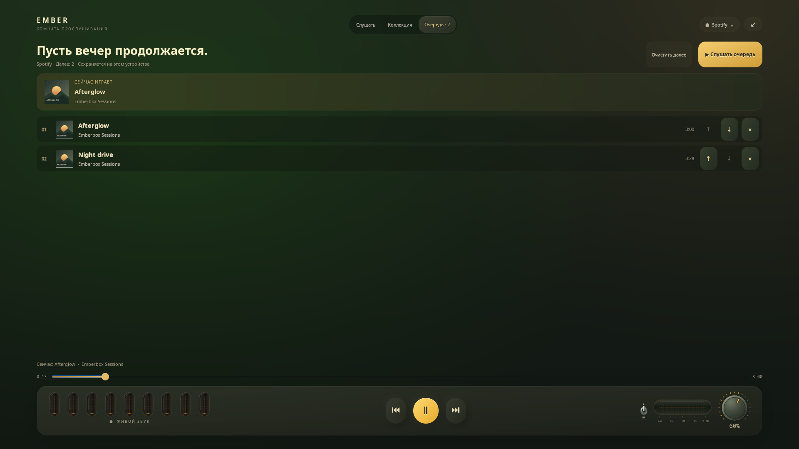

# Коллекция и очередь прослушивания

[English](COLLECTION.md) · **Русский**

В шапке полного экрана три страницы: **Слушать**, **Коллекция** и **Очередь**. Кнопки воспроизведения, перемотка, громкость и живые лампы остаются видны во время выбора музыки.

## Найти музыку

Открой **Коллекцию**, затем **Подборки**, **Альбомы** или **Поиск**. Нажми на обложку для списка треков. Введи название песни, исполнителя или альбома и нажми **Enter**; **Ctrl+F** открывает поиск и ставит курсор в строку. Пробел и стрелки внутри строки редактируют текст и не управляют музыкой.

Нажатие на трек включает его сразу. **+** добавляет песню в очередь выбранного источника без прерывания музыки. **Слушать · N** запускает загруженные треки коллекции по порядку, **В очередь · N** добавляет их в конец. Кнопка **Загрузить ещё** появляется, когда источник отдаёт следующую страницу. Некоторые коллекции Spotify предоставляют только первые 100 загруженных треков — показанное число явно обозначает этот предел.

| Источник | Коллекция | Поиск | Альбомы |
| --- | --- | --- | --- |
| Spotify | Личные подборки из подключённого настольного клиента | Треки и карточки альбомов, которые отдаёт клиент | Альбомы из личных подборок; поиск может вернуть дополнительные |
| Apple Music, встроенное подключение | Сохранённые плейлисты и треки коллекций | Треки каталога | Альбомы из медиатеки |
| Apple Music, модуль Firefox | Сохранённые коллекции | Для поиска по каталогу нужно встроенное подключение | Альбомы из медиатеки |
| YouTube, встроенное подключение | Недавно выбранные видео на этом устройстве | Общедоступные видео и ссылки на отдельные ролики | Отдельного каталога альбомов нет; можно искать по названию |
| Яндекс Музыка | Плейлисты и Моя волна | Треки с официального сайта | Отдельного списка альбомов в этом адаптере нет; можно искать по названию |

Используются существующие подключения из **Аккаунтов**. Новая учётная запись не создаётся, подписка не меняется. Необязательная интеграция с клиентом Spotify и адаптер сайта Яндекса зависят от их версий. Воспроизведение с Яндекс Плюсом по-прежнему требует проверки тестерами с подпиской.

## Собрать свой вечер

В **Очереди** видны текущая песня и треки далее. **↑ / ↓** меняют порядок, **×** удаляет ожидающую песню, **Очистить далее** убирает хвост. Нажатие на строку начинает воспроизведение с неё. **Слушать очередь** запускает ожидающий список; плеер переходит по нему, пока Emberbox работает. В этой сессии кнопки «следующий/предыдущий» и медиаклавиши используют созданную очередь.

У каждого источника своя очередь, до **200 треков**. Она сохраняется на этом устройстве в приватном файле. Переключение источника не запускает его сохранённую очередь автоматически. Восстановление виджета тоже не запускает очередь само. При добавлении музыки старая проигранная история сокращается; текущий трек и порядок ожидающих песен сохраняются.

Выход из полного экрана и скрытие виджета сохраняют управление очередью. Полное закрытие виджета останавливает его автопереходы; независимый плеер источника может продолжить текущую музыку. Обычная пауза сохраняет ожидающие треки. Ручной выбор другой песни через настольные панели Emberbox освобождает управление очередью до следующего её запуска.

## Отзывчивость и данные

Загрузка коллекций, поиск и запросы воспроизведения выполняются вне GTK. Устаревший ответ не заменяет новый поиск или страницу другого источника. Обложки и списки прокручиваются внутри страницы, в том числе на экране 1024×600. Ошибка источника оставляет комнату и управление доступными.

Поисковый запрос передаётся выбранному сервису через его существующее подключение. Файлы очереди содержат сведения о треках и публичные ссылки на обложки, без паролей, cookies и токенов аккаунта. На превью — оригинальные демонстрационные обложки и контрольные треки, а не личная медиатека пользователя.
