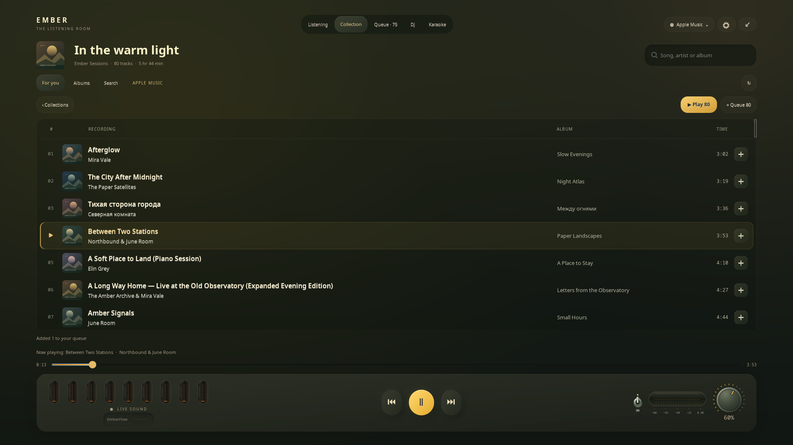
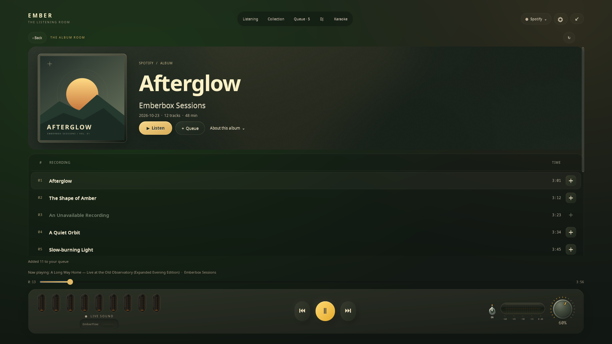

# Grunesphism / Грунесфизм

**English** · [Русский](DESIGN.ru.md)

**Gruvbox warmth. Soft relief. Analogue feel.**

Grunesphism is the name we use for Emberbox’s visual language. It combines a Gruvbox palette, restrained neumorphism and details borrowed from small hi-fi instruments. It is a project design vocabulary, not a claim of a separate established design movement.

## Surfaces and colour

| Token | Colour | Role |
| --- | --- | --- |
| Body | `#2c2c29` | Warm olive-charcoal shell |
| Well | `#292925` | Inset lamp housing |
| Recess | `#20221e` | Progress-track depth |
| Primary text | `#fbf1c7` | Warm cream, never bright white |
| Secondary text | `#bdae93` | Quiet labels |
| Amber | `#fabd2f` | Main playback action |
| Orange | `#fe8019` | Progress and discharge glow |

Relief stays shallow: soft directional gradients, a restrained light edge and darker inset wells. There is no large shadow or frame around the outside of the widget. Contrast comes from the materials inside the body.

Artwork may shift the shell by at most nine RGB levels per channel. A 1.4-second transition keeps the tint subtle and avoids sudden changes between tracks.

## Physical details

- The artist room uses a large, uncropped photograph in a narrow gallery mount. Behind it, two soft-focus layers of the same image retain its colours and light: a broad source-coloured glow, a quiet dark field for the name and a faint matte texture. Monochrome portraits retain their original pixels. The static backdrop is composed off the UI thread and cached.
- The mute switch has a smooth metal collar and a rounded lever, with a 250 ms smootherstep movement.
- The volume dial has a ridged edge, warm scale ticks and an indicator that follows its target smoothly.
- Fullscreen uses a larger volume dial and a passive horizontal glass VU instead of a second volume slider. Its amber discharge follows stereo PCM energy on a −60 to 0 dBFS scale, with a quick rise and a soft decay; pause, mute and stale audio return it to rest.
- Transport buttons have visible breathing room, including in mini mode.
- Glass tubes have no feet or simulated sockets. Small highlights describe the glass; the orange glow softly reaches the edge.

## Records with room to read

Collection and Queue use a shared recessed surface with aligned record, album,
time and action columns. Warm cream titles, quieter artist names and tabular
durations give each line a clear hierarchy. Artist names are direct links;
queue actions stay small and separate. A narrow amber edge and static transport
symbol identify the current record. Hover and keyboard focus use a soft tint,
without tooltip captions or dotted outlines.

Album columns yield to titles on narrow windows. Short screens combine the
collection toolbar and reduce decoration, keeping records visible. Playback
state changes update the affected rows without rebuilding the collection or
resetting its scroll position. The list has no continuous animation loop.

## The album room

The complete cover takes the lead in a fine gallery mount. A soft reflection
of its colours lights the header; the title, artist and release facts sit on
a quiet field beside it. The artist name opens the artist room. Liner notes
unfold from a small **About this album** button into the same scrolling page.
Dates, track counts and running time come from the release; incomplete lists
do not claim a complete running time.

The songs share one recessed record table, without repeated cover thumbnails.
Playback and queue actions stay separate, and current, paused and preparing
states update existing rows without moving the scroll. On short screens the
header contracts to keep music in view; the bottom transport stays outside
the scrolling content.

The cover light is composed off the UI thread and cached. A finite 660 ms
entrance reveals the header and records with a gentle stagger, without changing
layout during the animation. Leaving the page cancels it; system animation
preferences are respected.

## Light comes from sound

Nine frequency bands cover 55 Hz to 11 kHz. The live meter reads the relevant application stream through PipeWire; it does not use the microphone or animate random bars. FFT measurements drive the indicators, and a critically damped response preserves continuous velocity between samples. Light rises promptly and decays more slowly. The tubes use 384 cached vector-rendered states to keep the animation smooth.

The result is **physically inspired**, rather than an exact simulation of gas-discharge physics. Silence and pause bring the lamps gently back to rest.

## Interaction stays quiet

Pausing sends a finite packet of soft travelling reflections across the cover while
a critically damped motion settles it into the body. An inner shadow and a faint
lower reflection reveal the socket. Resuming returns to the unmodified live
image; rapid reversals preserve both depth and velocity. Desktop, Mini and
fullscreen keep their layout fixed. Animated covers contribute one held frame.
The animation paints one cached print with Cairo and a few soft crests; a plain
GTK image takes over at rest. A molded, rounded shoulder and a deeper concave
well pick up a restrained tint from the artwork. Soft upper-left shadows and
warm lower-right reflections and a fine glass edge make the relief visible; the complete photograph
fits inside it and its interior colours stay unchanged. The smooth well is
baked once outside GTK and reused as a second cached surface during movement.
The motion follows GTK's display frame clock. Fewer crest passes and bounded
shadow bands leave headroom for 60 Hz. One retained logical-resolution buffer
keeps vector work independent of HiDPI scale; GTK composites the finished image.
Cold preparation does not advance the spring before its first visible frame.
The offline 1920×1080 fullscreen reference reaches 60 FPS with normal meters
and timers active. A software-only 2× Xvfb run is slower (about 33 FPS); the
frame clock follows the display, and 60 FPS is not guaranteed on every backend.
Two directional reflections fade as they travel, and release lets an existing
crest finish instead of emitting another. The settled frame is prepared with
the same painter as the animation, so the final handoff keeps its geometry,
colour and edge light. Preparing pixels runs outside GTK. No additional
GL surface or context is created inside the cover. System animation preferences
and page/track transitions cancel the effect cleanly. It never controls or delays playback.

The artist room unfolds over 1.05 seconds: atmospheric light, a subtly approaching portrait, then the name and music panels. A prewarmed GL layer moves fixed textures inside the catalogue viewport; the hidden live page is painted once, not resized or faded as a tree on every frame. The transport and navigation stay available. Preparation waits briefly for the correctly sized photograph, catalogue arrivals are applied after the handoff, and navigating away cancels immediately. Without accelerated GL, one cached image fades in over 320 ms. Disabling system animations opens the live page directly.

Fullscreen opens with a centred cover; **Lyrics** explicitly enables text lookup and the split layout. Until then, no lyric lookup, line layout or scrolling runs.

The 900 ms entrance uses a prewarmed hardware GL renderer: a rounded shell and cover move over a gradient, then a single cached image of the room reveals its controls. The GTK scene stays unmapped throughout the movement, avoiding costly opacity-zero Cairo groups and per-frame resizing. Only our own widgets are captured, in memory. The background is cached and prepared off the UI thread. Systems without accelerated GL use a short compositor fade; disabling system animations skips the entrance. Esc cancels immediately.

Lyrics and artwork exchange places over 660 ms: one cover travels between the two layouts while the panel appears with a gentle vertical delay. A ready lyric result is included in the cached destination; later results fade in after the movement. Exiting fullscreen reverses the entrance toward the current desktop widget, including Mini. The normal/Mini switch takes 380 ms and blends two cached card images while resizing, without rebuilding live controls on every frame. Hiding or closing clears transition layers.

No dotted focus rectangles or hover captions. Accessible names remain available for assistive technology. Main actions stay visible; miniature controls remain separated. Compact mode preserves the character of the instrument rather than reducing it to a generic transport bar.

## Original preview media

`assets/demo-cover.svg` and `assets/demo-scene.svg` are original geometric artwork created for this project. Documentation previews show the actual GTK widgets with fixture metadata and measured, generated PCM audio. They do not reveal a user’s Spotify picks or YouTube history.
