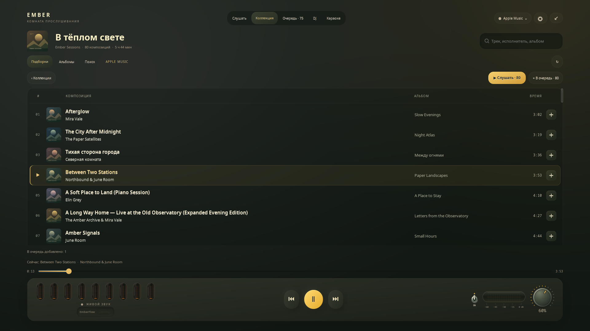
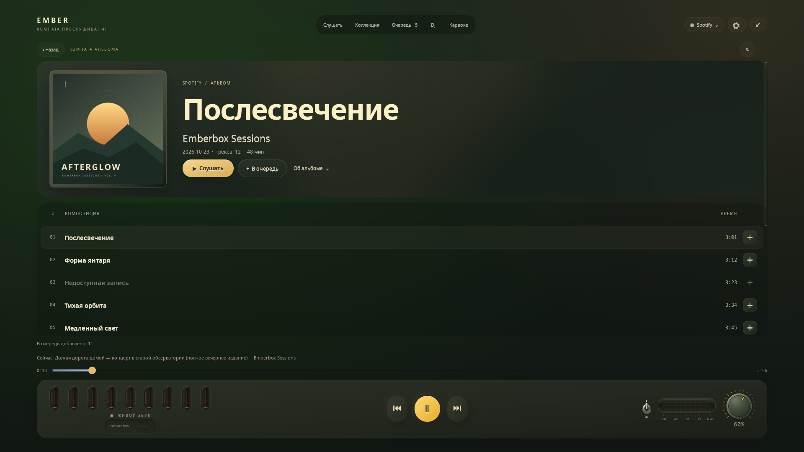

# Грунесфизм / Grunesphism

[English](DESIGN.md) · **Русский**

**Тепло Gruvbox. Мягкий объём. Ощущение аналоговой техники.**

«Грунесфизм» — наше название визуального языка Emberbox. В нём соединены палитра Gruvbox, сдержанный неоморфизм и детали небольших музыкальных приборов. Это термин проекта, а не заявление о существовании отдельного общепринятого направления дизайна.

## Поверхности и цвет

| Элемент | Цвет | Роль |
| --- | --- | --- |
| Корпус | `#2c2c29` | Тёплый оливково-угольный фон |
| Ламповая ниша | `#292925` | Углубление под индикаторы |
| Глубокий фон | `#20221e` | Основа дорожки прогресса |
| Основной текст | `#fbf1c7` | Тёплый кремовый вместо яркого белого |
| Вторичный текст | `#bdae93` | Спокойные подписи |
| Янтарный | `#fabd2f` | Главное действие плеера |
| Оранжевый | `#fe8019` | Прогресс и свечение разряда |

Объём неглубокий: мягкие направленные градиенты, тонкая светлая грань и более тёмные углубления. Большой внешней тени и рамки вокруг виджета нет. Контраст создают материалы внутри корпуса.

Цвет обложки может сдвинуть фон максимум на девять уровней RGB по каждому каналу. Переход за 1,4 секунды сохраняет спокойный характер интерфейса.

## Физические детали

- В комнате артиста — крупная фотография целиком в тонком галерейном обрамлении. Позади два размытых слоя того же снимка сохраняют его оттенки и свет: широкое мягкое свечение, спокойная тёмная область под имя и едва заметная матовая фактура. Чёрно-белый портрет сохраняет исходные пиксели. Статичный фон готовится вне потока интерфейса и кешируется.
- У тумблера гладкое металлическое основание и скруглённый рычаг. Переключение смягчено кривой smootherstep и длится 250 мс.
- У крутилки рифлёный край, тёплые отметки шкалы и плавно следующий за значением указатель.
- На полном экране крутилка увеличена, а вместо второго регулятора громкости стоит горизонтальный стеклянный VU-индикатор. Янтарный разряд следует энергии стереозвука по шкале от −60 до 0 dBFS: быстро разгорается и мягко затухает. Пауза, выключение звука и остановка аудиопотока возвращают его в покой.
- Между кнопками остаётся воздух, в том числе в мини-режиме.
- У стеклянных ламп нет ножек и декоративных подставок. Блики обозначают стекло, а оранжевое свечение мягко доходит до его краёв.

## Списки, которые легко читать

Коллекция и Очередь используют общую утопленную поверхность с выровненными
колонками композиции, альбома, времени и действий. Названия — тёплым кремовым,
имена исполнителей — спокойнее; длительность набрана ровными цифрами.
К исполнителю ведёт его имя, а действия очереди остаются небольшими и отдельными.
Текущую запись обозначают тонкий янтарный край и значок воспроизведения.
Наведение и фокус подсвечиваются мягко, без всплывающих подписей и пунктирных рамок.

В узком окне место альбома отдаётся названию. На низком экране панели подборки
объединяются и становятся компактнее, оставляя место самим песням. Состояние
воспроизведения меняется без перестройки коллекции и сброса прокрутки.
У списка нет непрерывного цикла анимации.

## Комната альбома

Крупная обложка целиком видна в тонком галерейном оформлении. Мягкий отсвет
её цветов освещает шапку; рядом на спокойном фоне расположены название,
исполнитель и сведения о релизе. Имя исполнителя открывает его карточку.
Небольшая кнопка **«Об альбоме»** раскрывает описание в той же прокручиваемой
странице. Дата, число треков и длительность берутся из данных релиза;
незагруженная до конца подборка не выдаётся за полную по времени.

Композиции собраны на одной утопленной поверхности без повторяющихся обложек.
Запуск и добавление в очередь разделены. Состояния воспроизведения, паузы и
подготовки обновляют существующие строки, сохраняя прокрутку. На низком экране
шапка становится компактнее, а нижний блок управления остаётся вне прокрутки.

Свет обложки готовится вне потока интерфейса и кешируется. Конечная анимация
за 660 мс мягко проявляет шапку и список с небольшой задержкой между ними,
сохраняя размеры элементов. Уход со страницы останавливает её; системное
отключение анимаций учитывается.

## Свет рождается из звука

Девять частотных полос покрывают диапазон от 55 Гц до 11 кГц. Измеритель читает аудиопоток нужного приложения через PipeWire. Микрофон не используется, случайные полоски не генерируются.

Измерения FFT управляют индикаторами, а критически затухающий отклик сохраняет непрерывную скорость между отсчётами. Свет быстро набирает яркость и медленнее затухает. Для плавной анимации используются 384 кешированных состояния, отрисованных из вектора.

Это физически вдохновлённая анимация, а не точная симуляция газового разряда. Тишина и пауза мягко возвращают лампы в состояние покоя.

## Спокойное взаимодействие

Пауза выпускает по обложке мягкие расходящиеся блики, пока движение
с критическим затуханием плавно погружает её в корпус. Внутренняя тень и тихий
свет снизу обозначают глубину. Продолжение возвращает исходное живое изображение;
быстрые повторные нажатия сохраняют глубину и скорость. Расположение элементов
в обычном, Mini- и полноэкранном режиме фиксировано. Анимированная обложка отдаёт
один неподвижный кадр. Cairo рисует одно подготовленное изображение и несколько мягких гребней,
а в покое остаётся обычная статичная картинка GTK. Тонкая матовая кромка получает
сдержанный оттенок обложки; узкие контактные тени сохраняют её исходный цвет.
Два направленных блика затухают по мере движения. Продолжение даёт начатой
волне закончиться. Конечный кадр готовит тот же рендер, поэтому при передаче
не меняются геометрия, цвет и свет по краям. Подготовка пикселей идёт вне
потока интерфейса. Внутри обложки не создаются дополнительные GL-поверхности
и контексты. Системные настройки анимаций, переходы между страницами и смена
песни учитываются. Эффект не управляет воспроизведением
и не задерживает его.

Комната артиста раскрывается за 1,05 секунды: атмосферный свет, мягкое приближение портрета, затем имя и музыкальные подборки. Заранее прогретый GL-слой движет готовые текстуры только в области каталога. Скрытая живая страница отрисовывается один раз: нет покадровой перестройки и затухания всего дерева виджетов. Кнопки воспроизведения и навигация доступны. Подготовка недолго ждёт фотографию нужного размера; обновления каталога применяются после перехода, а уход со страницы сразу его отменяет. Без аппаратного GL один готовый кадр проявляется за 320 мс. Системное отключение анимаций сразу открывает живую страницу.

Полный экран сначала показывает обложку по центру. **Текст песни** отдельно включает поиск слов и вид с двумя колонками. До этого нет запросов текста, построения строк и их прокрутки.

Раскрытие за 900 мс использует заранее подготовленный аппаратный GL-рендерер: скруглённый корпус и обложка движутся на фоне градиента, затем один кешированный кадр интерфейса проявляет кнопки. Во время движения GTK-сцена исключена из отрисовки: нет дорогих групп Cairo с нулевой прозрачностью и покадрового изменения размеров. В памяти сохраняется изображение только собственных виджетов. Фон кешируется и готовится вне потока интерфейса. Без аппаратного GL используется короткое затухание средствами композитора; системное отключение анимаций пропускает переход. Esc сразу отменяет его.

Текст и обложка меняются местами за 660 мс: обложка движется между двумя композициями, а панель проявляется с мягкой задержкой сверху вниз. Готовые слова включаются в кешированный кадр; более поздний результат плавно появляется после движения. Выход из полного экрана обращает раскрытие к текущему виджету, в том числе Mini. Переключение обычного вида и Mini длится 380 мс: два кадра карточки смешиваются при изменении размера без покадровой перестройки живых элементов. Скрытие и закрытие очищают слои перехода.

Нет пунктирных рамок фокуса и всплывающих подписей. Доступные имена элементов сохранены для вспомогательных технологий. Главные действия видны постоянно, а мини-режим сохраняет характер маленького прибора.

## Материалы для превью

`assets/demo-cover.svg` и `assets/demo-scene.svg` — оригинальная геометрическая графика проекта. На превью показаны настоящие GTK-виджеты с демонстрационными названиями и измеренным сгенерированным PCM-звуком. Личные подборки Spotify и история YouTube пользователя в них не публикуются.
