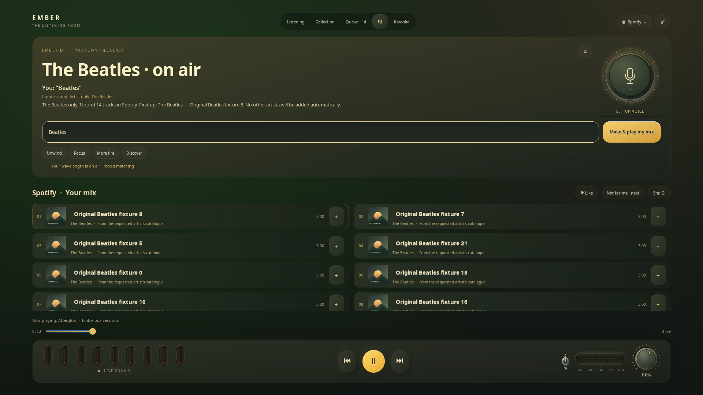

# Ember DJ — your own radio

**English** · [Русский](DJ.ru.md)

Open **DJ** inside the fullscreen listening room, or use
**widget settings → Ember DJ · Your own radio** to jump directly to that tab. A metal microphone dial, amber light, discharge tubes and a gentle
entrance extend Emberbox's Grunesphism materials.

## Type a wish, or say it

- Type “Relaxing music in my taste” and press **Enter** or **Make & play my mix**.
  Follow up with “calmer”, “without vocals”, “jazz, without metal” or “like Tame Impala”.
- Conversational wishes include “something happier”, “livelier”, “for work”,
  “for a date” and “something else”. A new generic mood after Beatles changes
  direction; “Beatles, but happier” or “their songs, but happier” keeps the artist.
  “More” continues the preceding conditions. Other occasions, such as “music
  for an evening walk”, can use the source's own collection search.
- Russian wishes tolerate spaced and Unicode hyphens: “что-нибудь погрустнее”
  and “что - нибудь погрустнее” both request a melancholy mix. Conversational
  openings are ignored while the original wish remains visible. Use an explicit
  quoted title to find the song itself: `Найди трек «Что-нибудь»`.
- The microphone turns on **only when clicked**. Click again or pause to finish;
  capture stops automatically within 15 seconds. The label and indicator show
  when capture is actually active.
- Music gently ducks while listening or speaking. The dial and saved volume
  stay unchanged. Voice replies can be disabled.
- Common mood/genre wishes and direct track searches use a lightweight local parser.
  **Free-form wishes · local AI** handles imagery such as “an old jazz bar”,
  “a noir movie” or “music that makes me jump around the room”. A short request
  can still need inference; a single mood keyword is not enough to bypass it.
  New preferences enable this mode; existing choices are preserved.
- First use: **⚙ → Prepare voice** and **Prepare local AI**. Ember's own model
  is preferred. Setup shows progress and cancellation,
  runs in the background and requires no sudo. Voice languages: Russian / English.

“Same atmosphere, but nobody singing” keeps the previous scene and adds the
instrumental constraint. A new wish starts fresh. The original text remains
visible alongside a localized description of the chosen sound. An unavailable
model or invalid interpretation leads to a request for a musical detail/setup;
current music continues. Free-form understanding remains experimental and does
not promise correct interpretation of every possible sentence.

## Real music, shaped by your taste

| Source | Candidate music |
| --- | --- |
| Apple Music | Account recommendations, recent tracks, mood playlists and catalogue search. Sign-in and subscription required. |
| Spotify | Personal shelves through the experimental desktop-client connection, their tracks and search. A connected Spotify client is required. |
| Yandex Music | Available collection playlists and search through the existing web engine; subscription playback still needs tester verification. |
| YouTube | Public music search and taste learned in Ember; individual videos must be playable. |

After first opening DJ, Ember keeps bounded local preferences from actual
listening time, **Like / Not for me** and skips. **Not for me** excludes that
track and skips ahead. Preferences are separate for each source. Use
**⚙ → Reset taste memory** to clear them.

A new wish starts a new block, preserving pending manual and other non-DJ
queue entries. DJ fetches a continuation near the end while the catalogue
returns suitable unheard candidates. **End DJ** removes future DJ tracks,
leaving current playback intact. Starting a normal list or switching sources
ends the old session. Leaving the DJ tab **keeps music playing**; returning restores the same DJ.

## Boundaries and privacy

This is an early independent DJ, not a connection to Spotify DJ. Mood matching
uses the wish, collection labels and available genres, not acoustic BPM,
harmony or vocal detection. “Without vocals” requires an explicitly labelled
instrumental recording/collection; an empty match is reported honestly.
Language models never invent playable song identifiers.

Vosk recognition and speech synthesis run locally in separate processes.
Russian uses **Kseniya, Silero v5.5, 48 kHz**, with automatic stress and “ё”
restoration; English uses LJ Speech / Piper. Spoken replies are short radio
links; the full catalogue result stays on screen. After upgrading an older
Russian voice, choose **⚙ → Prepare voice** to download its replacement.
Microphone
PCM stays in memory and is never saved. A temporary synthesized WAV is deleted
after each reply. Leaving the DJ tab stops capture and speech. Only the wish
and preceding musical intent enter the local language model: no library,
listening history, credentials or audio. Catalogue access and streaming still
use the selected online service.

Preferences: `$XDG_CONFIG_HOME/emberbox-audio/dj-preferences.json`, mode 0600.
Models and setup log: `$XDG_CACHE_HOME/emberbox-audio/ember-dj/`; delete this
folder to remove downloaded DJ components. Accounts retain their existing
source profiles. Listening preferences are not used for model training.

## Resources and attribution

Planning recommendation for local AI: **4 modern CPU cores, 8 GB total RAM
and 3 GB additional free storage**. CPU mode was checked on the developer's
16 GB system; a minimum hardware configuration has not been benchmarked.
Russian synthesis weights are about 145 MB, recognition about 46 MB; the PyTorch
CPU runtime may also be needed. An existing runtime is reused; otherwise it is
installed in DJ's private environment, without CUDA or sudo. English speech,
recognition and runtime need roughly 200–350 MB. Qwen3.5 2B Q4 is about 1.28 GB.
Ember's model is preferred; a suitable local Ollama is an alternative. No CUDA, cloud API key or extra
account is required. Downloaded runtimes currently target Linux x86_64,
glibc ≥ 2.34. Downloads are SHA256 checked; model weights are not in Git.

In a local check, Kseniya generated a 4.3-second link in about 4.8 seconds from
a cold start; the separate synthesis process peaked at about 683 MiB. This is
a developer-machine measurement, not a guarantee for other CPUs. Synthesis uses
two threads and exits after the link. Music selection/playback does not wait for
speech preparation; ducking starts only when the spoken audio is ready.

- [Vosk models](https://alphacephei.com/vosk/models): small RU/EN models, Apache-2.0.
- [Silero v5.5](https://github.com/snakers4/silero-models#text-to-speech): Russian Kseniya voice;
  [CC BY-NC-SA 4.0 model licence](https://github.com/snakers4/silero-models/blob/master/LICENSE),
  including its noncommercial restriction. Model weights are downloaded separately.
- [Piper 1.2.0](https://github.com/rhasspy/piper/releases/tag/v1.2.0): English synthesis;
  retain its included licences. Female [LJ Speech](https://huggingface.co/rhasspy/piper-voices/blob/main/en/en_US/ljspeech/medium/MODEL_CARD) voice, public-domain source data.
  Weights are downloaded from the provider repository, not bundled with Emberbox source.
- [Qwen3.5-2B](https://huggingface.co/Qwen/Qwen3.5-2B), Apache-2.0;
  [Unsloth GGUF](https://huggingface.co/unsloth/Qwen3.5-2B-GGUF) with pinned revision and SHA256;
  [llama.cpp](https://github.com/ggml-org/llama.cpp), MIT; or an existing local Ollama service.

Emberbox source remains MIT; external components retain their own licences.
Availability depends on source, region and subscription.
[General requirements →](REQUIREMENTS.md)

## Responsiveness

Common wishes never start language-model inference. Search and personal metadata
are cached with a 48-entry bound; at most three source lookups run concurrently.
A slow personal feed does not hold up ready search results. A request waits
up to five seconds for source metadata, then returns available tracks or a clear
pending message. External network/stream startup time cannot be guaranteed.
Canceling a request stops waiting within a short polling interval. Hidden DJ
views stop their animation ticks. Optional native language inference uses two
CPU threads and its model is unloaded after 30 idle seconds.

Semantic interpretation has a separate twelve-second budget including cold start.
The first interpreted wish took about 8–10 seconds; subsequent free-form requests
took about 4–6 seconds on the reference machine. Fully covered vocal-only changes
keep the current sound without starting inference.
These are measurements, not a guarantee for other CPUs. The catalogue's five-second
wait is separate. Identical wishes/context reuse a 64-entry interpretation cache.
Account secrets, the library and audio are never supplied to the language model.

## Exact artists and useful replies

**Beatles** or **“Play songs by The Beatles”** resolves the exact catalogue
artist first. This mode can select up to 14 available recordings without
the two-songs-per-artist diversity cap. It excludes unrelated “Black Beatles”
search hits and personal radio recommendations. Continuations retain that
artist, cycling available recordings when exhausted. Explicit manual queue
entries are preserved for after the DJ session. Use **“like Beatles”** or
**“similar to Beatles”** to explicitly broaden the mix.

Your wish stays in the input and is shown beside Ember’s response, together
with the interpreted scope. Replies name the actual result count and first
recording; Ember uses a female voice.
