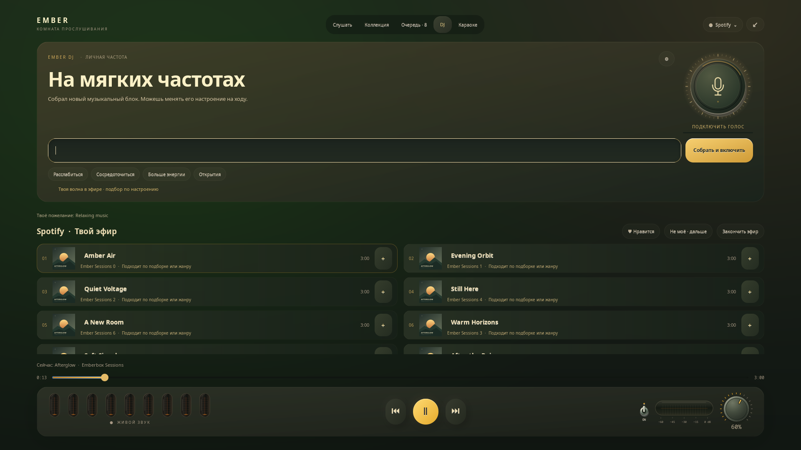

# Ember DJ — твоё личное радио

[English](DJ.md) · **Русский**

DJ открывается во вкладке **DJ** в полноэкранной комнате прослушивания.
Пункт **настройки виджета → Ember DJ · Личное радио** сразу переводит к этой вкладке. Металлический микрофонный диск, янтарные акценты,
газоразрядные лампы и мягкое появление продолжают наш Грунесфизм.

## Пожелание — текстом или голосом

- Напиши, например, «Хочу расслабляющую музыку в моём вкусе» и нажми **Enter**
  или **Собрать и включить**. Можно уточнить: «поспокойнее», «без вокала»,
  «хочу джаз, без металла», «как Tame Impala».
- Разговорные просьбы тоже работают: «давай что-нибудь повеселее», «поживее»,
  «для работы», «для свидания», «что-нибудь другое». После Beatles новая просьба
  «повеселее» меняет музыкальное направление. «Beatles, но повеселее» или «их же,
  но повеселее» сохраняет исполнителя; «ещё» продолжает предыдущие условия.
  Другие сценарии, например «музыку для вечерней прогулки», могут использовать
  поиск подборок самого сервиса.
- «Что-нибудь погрустнее», «что - нибудь погрустнее» и варианты с длинным
  или неразрывным дефисом означают одно настроение. Вводные «ну, а можно»
  также допускаются. Исходная фраза сохраняется на экране. Для поиска самой
  песни с таким названием используй кавычки: `Найди трек «Что-нибудь»`.
- Микрофон включается **только по кнопке**. Скажи пожелание и нажми ещё раз
  или сделай паузу; запись заканчивается автоматически, максимум через 15 секунд.
  Индикатор и подпись явно показывают, когда микрофон включён.
- Музыка мягко становится тише на время обращения и голосового ответа.
  Крутилка и сохранённая громкость не меняются. Ответы голосом можно отключить.
- Простые пожелания и прямой поиск трека разбираются лёгким локальным кодом.
  **Свободные пожелания · локальный ИИ** подключает смысловой разбор: например,
  «будто в старом джазовом баре», «герой нуарного фильма», «музыка, чтобы прыгать
  по комнате». Короткая фраза тоже может требовать ИИ; одного знакомого слова
  недостаточно для пропуска этого шага. Новые настройки включают этот режим,
  прежний выбор сохраняется. Текстовый ввод работает без голосовых моделей.
- Для первого подключения открой **⚙**: **Подготовить голос** и
  **Подготовить ИИ**. Предпочитается отдельная модель Ember; подготовка идёт
  в фоне, с прогрессом и отменой, без sudo. Язык голоса: русский / английский.

«В том же духе, но чтобы никто не пел» сохраняет основу предыдущего сета и
добавляет инструментальное ограничение. Понятные изменения только вокала,
включая «а теперь верни вокал», не запускают ИИ повторно.
Новый запрос начинает новую атмосферу.
Исходный текст остаётся виден, рядом показывается описание выбранного звучания.
Если модель недоступна или ответ не прошёл проверку, Эмбер предлагает уточнить
пожелание или подготовить ИИ; текущая музыка продолжается. Понимание свободных
фраз остаётся экспериментальным: это расширение возможностей, а не обещание
безошибочного понимания любого текста.

## Откуда берётся музыка

DJ выбирает реальные доступные треки **текущего источника**:

| Источник | Основа подбора |
| --- | --- |
| Apple Music | Личные рекомендации аккаунта, недавние песни, плейлисты по настроению и поиск каталога. Нужны вход и подписка. |
| Spotify | Личные полки через экспериментальное подключение настольного клиента, их треки и поиск. Нужен подключённый Spotify. |
| Яндекс Музыка | Доступные плейлисты коллекции и поиск через существующий веб-движок; подписочное воспроизведение ещё требует проверки тестерами. |
| YouTube | Публичный поиск музыки и накопленные в Ember вкусы; доступность зависит от самого видео. |

После первого открытия DJ локально учитывает прослушанные в Ember песни
(по реальному времени воспроизведения), отметки **Нравится / Не моё** и
пропуски. **Не моё** запоминает исключение и переходит дальше. Память раздельная
для каждого источника; **⚙ → Сбросить память вкусов** очищает её.

Новый запрос начинает новый музыкальный блок. Вручную добавленные песни
и остальные ожидающие треки сохраняются. DJ подбирает продолжение ближе
к концу блока, пока каталог возвращает новые подходящие записи. **Закончить
эфир** удаляет только будущие песни DJ; текущая музыка остаётся. Выбор обычного
списка или другого источника завершает прежний эфир. Переход на другую вкладку
**не останавливает музыку**; возврат восстанавливает тот же DJ.

## Честные ограничения и приватность

Это первая версия собственного DJ, не подключение к Spotify DJ. Настроение
определяется по запросу, названиям подборок и доступным жанрам; это не анализ
BPM, гармонии или вокала в аудиозаписи. При «без вокала» принимаются только
явно обозначенные инструментальные записи/подборки. Если таких нет, DJ
сообщает об этом. Названия и идентификаторы треков не сочиняются моделью.

Распознавание Vosk и озвучка работают локально в отдельных процессах.
Русский голос — **Ксения, Silero v5.5, 48 кГц**, с автоматическими ударениями
и восстановлением «ё»; английский — LJ Speech / Piper. Голосом звучит короткая
реплика по настроению, подробный результат остаётся на экране. После обновления
старого русского голоса нажми **⚙ → Подготовить голос** для загрузки новой модели.
Звук микрофона находится в памяти и не записывается на диск. Для озвучки
создаётся временный синтезированный WAV, удаляемый после ответа. Выход из
вкладки прекращает микрофон и речь. Языковой модели передаются только пожелание
и предыдущие музыкальные условия — без медиатеки, истории, токенов и звука.
Каталог и воспроизведение по-прежнему требуют сети и выбранного сервиса.

Память: `$XDG_CONFIG_HOME/emberbox-audio/dj-preferences.json` (права 0600).
Модели и журнал установки: `$XDG_CACHE_HOME/emberbox-audio/ember-dj/`.
Удаление этого каталога удаляет загруженные компоненты DJ. Данные аккаунтов
остаются в прежних профилях источников. История не используется для обучения.

## Ресурсы и компоненты

Рекомендуемый ориентир для локального ИИ: **4 современных ядра, 8 ГБ RAM
для системы и 3 ГБ свободного места дополнительно**. Проверен CPU-режим
на компьютере разработчика с 16 ГБ; минимальная конфигурация ещё не измерена.
Русская модель синтеза — около 145 МБ, распознавание — около 46 МБ;
дополнительно может потребоваться среда PyTorch CPU. Имеющаяся среда используется
повторно; иначе она устанавливается в приватное окружение DJ, без CUDA и sudo.
Английский голос с распознаванием и средой — порядка 200–350 МБ.
Qwen3.5 2B Q4 — около 1,28 ГБ. Предпочитается модель Ember; подходящий локальный
Ollama может использоваться как альтернатива. CUDA, облачный ключ и отдельный аккаунт не нужны.
Текущие скачиваемые среды рассчитаны на Linux x86_64, glibc ≥ 2.34.

В локальной проверке Ксения подготовила реплику длительностью 4,3 секунды
примерно за 4,8 секунды с холодного запуска; пиковая память отдельного процесса
синтеза — около 683 МиБ. Это замер на компьютере разработчика, а не гарантия
для других CPU. Используются два потока; процесс завершается после реплики.
Подбор и запуск музыки не ждут синтеза, приглушение начинается при готовой речи.

Компоненты загружаются с проверкой SHA256. Крупные модели не входят в Git:

- [Vosk](https://alphacephei.com/vosk/models): небольшие русская и английская модели, Apache-2.0.
- [Silero v5.5](https://github.com/snakers4/silero-models#text-to-speech): русский голос Ксения;
  [лицензия модели CC BY-NC-SA 4.0](https://github.com/snakers4/silero-models/blob/master/LICENSE),
  включая ограничение некоммерческого использования. Модель загружается отдельно.
- [Piper 1.2.0](https://github.com/rhasspy/piper/releases/tag/v1.2.0): английский синтез и лицензии в архиве;
  женский голос [LJ Speech](https://huggingface.co/rhasspy/piper-voices/blob/main/en/en_US/ljspeech/medium/MODEL_CARD), датасет public domain.
  Веса загружаются из репозитория поставщика и не входят в исходники Emberbox.
- [Qwen3.5-2B](https://huggingface.co/Qwen/Qwen3.5-2B), Apache-2.0,
  [GGUF-квантизация Unsloth](https://huggingface.co/unsloth/Qwen3.5-2B-GGUF) с закреплённой ревизией и SHA256,
  и [llama.cpp](https://github.com/ggml-org/llama.cpp), MIT. Альтернатива — уже работающий локальный Ollama.

Оригинальный код Emberbox — MIT; внешние компоненты сохраняют собственные
лицензии. Подбор остаётся экспериментальным и зависит от доступных данных
сервиса, региона и подписки. [Общие требования →](REQUIREMENTS.ru.md)

## Быстродействие

Для обычных пожеланий языковая модель не запускается. Поиск и личные
подборки кэшируются, кэш ограничен 48 записями; одновременно разрешено
не больше трёх обращений к источникам. Медленная личная подборка не задерживает
готовый поиск. Ожидание метаданных ограничено пятью секундами: затем
показываются доступные треки или понятное сообщение об ожидании источника.
Скорость внешнего сервиса и запуска потока гарантировать нельзя. Отмена
быстро прерывает ожидание. У скрытой вкладки прекращается анимация.
Необязательный собственный языковой движок использует два CPU-потока
и выгружает модель после 30 секунд простоя.

Смысловой разбор имеет отдельный бюджет до 12 секунд, включая холодный запуск.
На проверенном компьютере первый разбор занимал около 8–10 секунд,
последующие свободные запросы — около 4–6 секунд. Понятные изменения только
вокала не требуют повторного запуска модели. Это замеры, не гарантия для
других CPU. Пять секунд ожидания каталога считаются
отдельно. Повторы одинаковых пожеланий и контекста берутся из кэша до 64 записей.
Скрытые данные аккаунта, медиатека и аудио в языковую модель не передаются.

## Конкретный исполнитель и понятный ответ

Запрос **Beatles** или **«Включи песни Beatles»** сначала находит точного
исполнителя в каталоге. Для него нет лимита «две песни одного артиста»:
новый блок содержит до 14 доступных записей. «Black Beatles» другого артиста
и личные рекомендации в этот режим не подмешиваются. Следующий блок
сохраняет того же исполнителя; при исчерпании доступных записей возможен
новый круг. Явно добавленные вручную песни сохраняются и остаются доступны
после завершения эфира. Для расширения подбора нужен явный запрос
**«как Beatles»** или **«похожие на Beatles»**.

Пожелание остаётся в поле ввода и крупно показано рядом с ответом. Эмбер
показывает, как поняла запрос, число найденных треков и первую запись.
Ответ строится из реального результата, голос Эмбер — женский.
