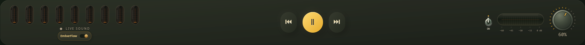

# EmberFlow — one song flows into the next

**English** · [Русский](FLOW.ru.md)

Turn on **EmberFlow** beside the widget's timeline, under the fullscreen tubes,
or in player settings in mini mode. The tactile amber switch is shared across
these views. Its preference is saved; it is off on first installation.

## Listen as one continuous set

Add songs to Ember's **Queue**, play an album/search result list or start an
Ember DJ set. The next queued track is prepared near the end of the current one.
Its opening overlaps the outgoing tail for up to **eight seconds**:

1. The incoming texture is introduced gently.
2. A shorter middle phase hands over the foreground, limiting the time competing
   vocals and bass lines spend at similar volume.
3. The outgoing ambience dissolves behind the new song.

The envelope has no sharp slope or curvature changes at phase boundaries. Gains
sum to unity, retaining peak headroom; the master dial remains independent.
Short tracks receive proportionally shorter transitions. When the existing lamp
meter detects an already quiet outro, the entrance shortens to 1.4 seconds.
Stale measurements and muted playback cannot trigger this shortcut.
Source format and quality settings are retained.

| Source | EmberFlow |
| --- | --- |
| In-player Apple Music | Yes, with the updated native playback engine and an authorized subscription. |
| In-player YouTube | Yes, for the Ember listening queue. |
| Spotify, Yandex Music, browser companion sessions | Not supported in this release. The switch describes source availability. |

The transition follows the next item in the Ember queue. It does not choose a
different song. A restored queue can be adopted when its current song is already
playing; restoring the preference alone never starts playback. Pausing, seeking,
manually changing tracks, switching source or disabling Flow clears staged audio.
Vocal reduction temporarily uses ordinary transitions.

## When the beats meet

The separate **Beats** switch in player settings enables rhythm matching when
EmberFlow is on; it defaults to enabled. Native Apple Music and YouTube estimate
both tempo and beat phase from measured attacks. When the pulse is confident
and tempos are close, the incoming song changes speed by at most **±6%**, with
pitch preserved, and enters on the outgoing beat grid. Its original tempo returns
over four beats after the old song has faded out.

A short intro is analyzed before mixing, then playback starts at the beginning.
The search covers roughly **80–180 BPM**, including half/double-time matching,
and requires at least six stable attacks. Speech, loose rhythm, quiet intros,
unrelated tempos or low confidence retain the ordinary musical crossfade.
Syncopated passages also need a repeating onset envelope; a few coincidental
hits alone are insufficient.
Disable Beats to keep volume blending alone.

Late network startup may shorten the overlap; an unready next track falls back to the
normal queue. With no next item there is nothing to mix.

## Lightweight by design

- No neural model or playback re-encoding. Short analysis runs in memory; no PCM
  is saved to disk and no microphone is used.
- At most one extra deck is staged, beginning within the last 28 seconds.
  It is paused while preparing, and the outgoing deck is released after mixing.
- Apple uses two authorized MusicKit pages inside Ember's existing engine.
  The hidden staged page is throttled until playback. This temporarily adds a
  renderer and decoder, so memory and startup CPU rise during preparation.
- Apple measures energy in the authorized page's ordinary Web Audio graph. The
  silent pre-listen rewinds before the handover. Audio envelopes are scheduled
  by the engine against the actual output clock.
- YouTube uses a second audio-only mpv deck, with a 16 MiB forward demux cache
  per deck and no video rendering. Percentage gain is compensated for mpv's
  cubic volume law; the source's master volume and mute remain separate.
- One low-priority, single-thread FFmpeg worker reads at most 6.5 seconds of the
  already selected public YouTube audio stream, with a nine-second deadline.
  The playback deck is primed at the selected tempo while paused. No temporary
  output device is created. The installer already checks FFmpeg availability.
- The outgoing YouTube grid reuses the lamp meter's worker and updates at most
  once a second. Turning Beats off stops this analysis and intro decoding.
- The GTK switch animates only while changing state. No continuous switch timer
  or extra audio process runs while Flow is off.

Apple support depends on MusicKit's current playback implementation. The engine
keeps a short, already authorized outgoing media element alive during handover;
a twenty-four-second watchdog bounds that lease, including analysis and startup. Both
pages receive a shared envelope start time. Logical source volume is isolated
from the fade, and user transport commands cancel the handover. Authentication
and EME/CDM checks remain with the service. No media URLs or keys are extracted.

## Verification

The live Apple check exercised queue-driven overlap, independently audible
outgoing/incoming pages, queue adoption without restarting the new song, pause,
cleanup and absence of delayed resume. A private PulseAudio sink check used
generated 220/440 Hz tones to measure actual mpv overlap and verify that the
mixed peak did not exceed its input peak. These are reference-machine checks,
not performance guarantees for every source or computer.

Generated 120/124 BPM drum fixtures measure tempo and actual beat displacement
in the native browser engine and real mpv output. The mpv check also measures an
880 Hz reference to verify pitch preservation, and checks speed recovery. These
fixtures do not guarantee beat detection in every recording.

Real Apple recordings also confirmed measured 117/111.75 BPM grids, a matching
plan and an applied native rate of 1.04698, plus rewind of the silent intro.
Tracks whose intros/outros did not qualify correctly retained volume blending.

Developer checks: `tests/test_ember_flow.py`, `node tests/flow_engine_checks.cjs`,
`python tests/flow_audio_smoke.py`, `tests/flow_ui_smoke.py`,
`tests/test_flow_beats.py`, `python tests/beat_engine_smoke.py` and
`python tests/flow_beat_audio_smoke.py`.
