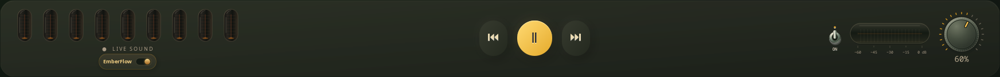
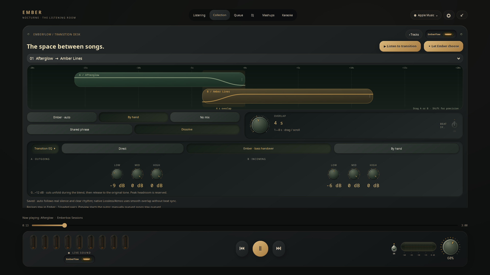

# EmberFlow — one song flows into the next

**English** · [Русский](FLOW.ru.md)

Turn on **EmberFlow** beside the widget's timeline, under the fullscreen tubes,
or in player settings in mini mode. The tactile amber switch is shared across
these views. The recessed glass indicator warms from dull red to amber and gold,
with the filament's centre warmer than its ends, then gently cools when switched
off. Quick repeated presses retain its current heat. Its animation stops after settling and
respects the desktop's animation setting. Its preference is saved; it is off on
first installation.

## Transition desk · 0.28

Open a playlist in **Collection → EmberFlow · Transitions**. Two recessed decks,
a machined time dial, tactile selectors and softly lit curves behind glass
make a small analogue mixing desk inside Ember.

- Select an adjacent pair and **By hand**. Set **1–30 seconds** by dragging the dial,
  scrolling or using arrow keys. Very short songs and slow preparation can
  shorten the actual overlap.
- **Shared phrase** holds both songs in the foreground longer; **Dissolve**
  transfers gain evenly and gently. **No mix** keeps ordinary switching for that
  pair. **Custom curve** lets you shape the fade with gold points over measured
  audio peaks.
- **Let Ember choose** selects adaptive mode for every **loaded** pair. It does
  not run a neural model over the whole playlist: during playback the existing
  meter observes real energy and a clear pulse. A confident rhythm suggests
  eight beats, capped at eight seconds; a quiet ending shortens the transition.
  Uncertain measurements retain a conservative smooth blend.
- **Listen to transition** uses the real playback engines: warm both decks,
  seek into the first song's outro, then continue the list. Manually queued
  songs remain; the pair's next song moves ahead of them for audition.
  Audition enables EmberFlow, changes current playback and does not produce an audio file.
- Turn on the **EmberFlow** lamp to enable mixing. Editing a recipe never starts
  playback. Recipes are local to a playlist and an ordered pair of track URIs.
  Repeated identical pairs in one playlist share a recipe; inserting or
  reordering another song never assigns it somebody else's transition.

### Measured lanes, custom curves and transition EQ · 0.30

The timeline shows **measured peaks from 32 seconds of A's outro and B's intro**,
with gain envelopes and a highlighted overlap. Drag either track: moving A right increases
overlap; moving B right decreases it. The range is **1–30 seconds**, in 0.1 s
steps. Shift gives finer movement; up/down selects a lane, left/right moves it.
Dragging selects manual mode. A recipe is written on release, while drawing
follows GTK's frame clock. Automatic changes ease into place and settle;
system reduced-animation preferences are respected. Songs remain complete;
this edits the overlap without extracting audio files.

**Custom curve.** Pull a gold point horizontally to move the handover time,
vertically to change the level at that point. Both envelopes are linked: their
gains sum to one to retain peak headroom. A smooth monotone curve with gentle
endpoints drives the actual Apple Music (including native Lossless/Atmos) and
YouTube engines. Ctrl+arrows moves the selected lane's point; Ctrl+Shift is
finer. Mouse edits save on release.

**Zoom and peaks.** −/+ zooms, ‹/› pans and ↺ restores the overview.
“Peaks · 64 s” extends the analyzed window to 64 seconds. These are real decoded
minimum/maximum/RMS values before transition EQ, not individual instrument stems.
Partial coverage is never stretched over the entire window. Unavailable peaks
are clearly labeled and can be retried.

Peaks support **native Apple Music and YouTube**, using existing access to each
track. MusicKit, Spotify and Yandex do not currently provide them to this editor.
Preparation is sequential, outside GTK, using one extra low-priority decoder.
It takes time and network data; Apple transport/seek requests take priority.
Closing the editor cancels analysis. Only eight short peak summaries remain in
RAM; neither audio files nor PCM are saved. Native Apple uses an isolated source
context without evicting either playback deck.

**Transition EQ** opens two sets of physical low/mid/high dials, one per track.
The **0…−12 dB** cut range leaves room for the next song's bass or voice while
reserving peak headroom. **Ember · bass handover** gradually releases A's low
frequencies and restores B's. It is a lightweight automatic profile, without
a neural model. **By hand** saves your own cuts; **Direct** bypasses EQ.
Switching from automatic to manual preserves the current dial positions.

EQ supports **in-player Apple Music**, including native AAC, Lossless, Hi-Res
and Atmos. MusicKit uses ordinary nodes in its authorized Web Audio graph;
an unavailable graph safely falls back to ordinary track switching.
YouTube supports the lanes and envelopes, with **EQ disabled in the UI**.
Spotify/Yandex retain their existing mixing limitation.

Two fixed crossover filters form three complementary bands. Attenuation moves
smoothly per sample, with headroom calculated from the impulse response.
The incoming track finishes at its original tone; cancellation smoothly
releases filtering. Native output rate, source codec, existing spatial
processing and audio buffers stay intact. A private recipe stores only pair
placement/settings, the curve point and six EQ values.

Playback mixing supports **in-player Apple Music and YouTube**. Spotify and Yandex
recipes can be saved, but mixing auditions are unavailable. Native Apple
Lossless/Hi-Res/Atmos supports all three curves and manual duration,
**without beat alignment**; its rhythm switch is disabled. Source formats,
decoding, output buffers and the existing spatial processing stay intact.

The editor covers up to 200 loaded songs; load additional pages before opening
it. Storage holds 100 playlists and 199 distinct pairs per playlist, refuses
full writes without evicting recipes, and contains no audio, cookies or keys.
There is no new neural model, mandatory download or paid API. Glass and metal
use small cached sprites. Dial, switch and envelope animations run only after
an action and stop when settled or closed. Audio analysis stays outside GTK.

## Listen as one continuous set

Add songs to Ember's **Queue**, play an album/search result list or start an
Ember DJ set. The next queued track is prepared near the end of the current one.
Its opening overlaps the outgoing tail for up to **eight seconds**:

1. The incoming texture is introduced gently.
2. Both songs share the foreground for a few seconds: the outgoing tail and
   incoming opening remain clearly present. An eight-second transition has
   about 2.2 seconds of this shared phrase.
3. The outgoing ambience dissolves behind the new song.

The envelope has no sharp slope or curvature changes at phase boundaries. Gains
sum to unity, retaining peak headroom; the master dial remains independent.
Short tracks receive proportionally shorter transitions. When the existing lamp
meter detects an already quiet outro, the entrance shortens to 1.4 seconds.
Stale measurements and muted playback cannot trigger this shortcut.
Source format and quality settings are retained.

The same musical envelope is used by YouTube, ordinary in-player Apple Music
and native Apple Atmos/Lossless. Fast manual switches, seeks and cancellation
keep their existing short envelopes; the shared phrase belongs to automatic
transitions. It needs no additional analysis or AI.

| Source | EmberFlow |
| --- | --- |
| In-player Apple Music | Yes, with the updated native playback engine and an authorized subscription. |
| In-player YouTube | Yes, for the Ember listening queue. |
| Spotify, Yandex Music, browser companion sessions | Not supported in this release. The switch describes source availability. |

The transition follows the next item in the Ember queue. It does not choose a
different song. A restored queue can be adopted when its current song is already
playing; restoring the preference alone never starts playback. Pausing, seeking,
manually changing tracks, switching source or disabling Flow clears staged audio.
Vocal reduction temporarily uses ordinary transitions.

## Apple Music Atmos · beta

Spatial EmberFlow uses two native decoders and one 48 kHz mixer with sample-based
gain curves. AAC transitions are supported too. The badge follows each song's
actual decoded format. **Beat alignment is not available in this path yet**;
the Web Audio implementation below describes ordinary MusicKit playback.
[Setup and limitations →](ATMOS_PROTOTYPE.md)

## When the beats meet

The separate **Beats** switch in player settings enables rhythm matching when
EmberFlow is on; it defaults to enabled. Native Apple Music and YouTube estimate
both tempo and beat phase from measured attacks. When the pulse is confident
and tempos are close, the incoming song changes speed by at most **±6%**, with
pitch preserved, and enters on the outgoing beat grid. Its original tempo returns
over four beats after the old song has faded out.

A short intro is analyzed before mixing, then playback starts at the beginning.
The search covers roughly **80–180 BPM**, including half/double-time matching,
and requires at least six stable attacks. Speech, loose rhythm, quiet intros,
unrelated tempos or low confidence retain the ordinary musical crossfade.
Syncopated passages also need a repeating onset envelope; a few coincidental
hits alone are insufficient.
Disable Beats to keep volume blending alone.

Late network startup may shorten the overlap; an unready next track falls back to the
normal queue. With no next item there is nothing to mix.

## Lightweight by design

- No neural model or playback re-encoding. Short analysis runs in memory; no PCM
  is saved to disk and no microphone is used.
- At most one extra playback deck is staged: usually within the last 28 seconds,
  earlier for long manual overlaps. Native Apple prepares ahead of time.
  It is paused while preparing, and the outgoing deck is released after mixing.
- Apple uses two authorized MusicKit pages inside Ember's existing engine.
  The hidden staged page is throttled until playback. This temporarily adds a
  renderer and decoder, so memory and startup CPU rise during preparation.
- Apple measures energy in the authorized page's ordinary Web Audio graph. The
  silent pre-listen rewinds before the handover. Audio envelopes are scheduled
  by the engine against the actual output clock.
- YouTube uses a second audio-only mpv deck, with a 16 MiB forward demux cache
  per deck and no video rendering. Percentage gain is compensated for mpv's
  cubic volume law; the source's master volume and mute remain separate.
- One low-priority, single-thread FFmpeg worker reads at most 6.5 seconds of the
  already selected public YouTube audio stream, with a nine-second deadline.
  The playback deck is primed at the selected tempo while paused. No temporary
  output device is created. The installer already checks FFmpeg availability.
- The outgoing YouTube grid reuses the lamp meter's worker and updates at most
  once a second. Turning Beats off stops this analysis and intro decoding.
- The GTK switch animates only while changing state. No continuous switch timer
  or background mix runs while Flow is off. Peak preparation in the open editor
  is separate from enabling playback mixing.

Apple support depends on MusicKit's current playback implementation. The engine
keeps a short, already authorized outgoing media element alive during handover;
a twenty-four-second watchdog bounds that lease, including analysis and startup. Both
pages receive a shared envelope start time. Logical source volume is isolated
from the fade, and user transport commands cancel the handover. Authentication
and EME/CDM checks remain with the service. No media URLs or keys are extracted.

## Verification

The live Apple check exercised queue-driven overlap, independently audible
outgoing/incoming pages, queue adoption without restarting the new song, pause,
cleanup and absence of delayed resume. A private PulseAudio sink check used
generated 220/440 Hz tones to measure actual mpv overlap and verify that the
mixed peak did not exceed its input peak. These are reference-machine checks,
not performance guarantees for every source or computer.

Generated 120/124 BPM drum fixtures measure tempo and actual beat displacement
in the native browser engine and real mpv output. The mpv check also measures an
880 Hz reference to verify pitch preservation, and checks speed recovery. These
fixtures do not guarantee beat detection in every recording.

Real Apple recordings also confirmed measured 117/111.75 BPM grids, a matching
plan and an applied native rate of 1.04698, plus rewind of the silent intro.
Tracks whose intros/outros did not qualify correctly retained volume blending.

Developer checks: `tests/test_ember_flow.py`, `node tests/flow_engine_checks.cjs`,
`python tests/flow_audio_smoke.py`, `tests/flow_ui_smoke.py`,
`tests/test_flow_beats.py`, `python tests/beat_engine_smoke.py` and
`python tests/flow_beat_audio_smoke.py`.
