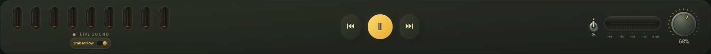
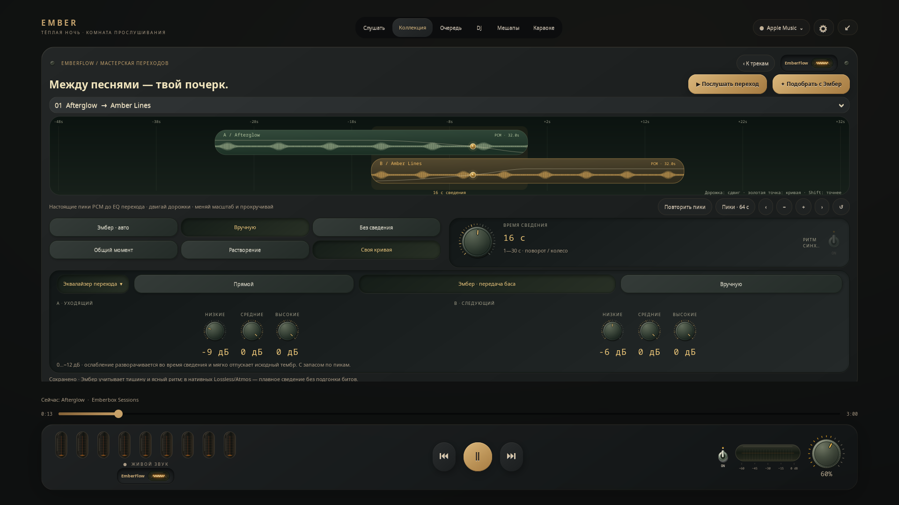

# EmberFlow — песни перетекают одна в другую

[English](FLOW.md) · **Русский**

Включи **EmberFlow** рядом со временем трека в виджете, под лампами в полном
экране или в настройках плеера в мини-режиме. Янтарный тумблер синхронизирован
между этими местами. Утопленная стеклянная лампа разгорается от тусклого красного
к янтарному и золотому, с более горячим центром нити, и мягко остывает при выключении.
Повторное нажатие сохраняет текущий накал. Анимация завершается и учитывает системную
настройку анимаций. Выбор сохраняется; при первой установке функция выключена.

## Мастерская переходов · 0.28

Открой свой плейлист в **Коллекции → EmberFlow · Переходы**. Две дорожки,
утопленные переключатели, металлическая крутилка времени и стеклянный экран
с мягкими светящимися кривыми — небольшой аналоговый пульт внутри Ember.

- Выбери соседнюю пару и режим **Вручную**. Крутилка задаёт **1–30 секунд**;
  её можно тянуть, вращать колесом или менять стрелками. Очень короткие песни
  и медленная подготовка могут уменьшить фактическое перекрытие.
- **Общий момент** дольше удерживает обе песни на переднем плане;
  **Растворение** даёт равномерную мягкую передачу громкости. **Без сведения**
  оставляет обычное переключение этой пары. **Своя кривая** позволяет менять
  затухание золотыми точками прямо над настоящими пиками звука.
- **Подобрать с Эмбер** включает адаптивный режим для всех **загруженных** пар.
  Это не предварительное AI-прослушивание всего плейлиста: во время проигрывания
  существующий индикатор анализирует реальную энергетику и ясный пульс.
  При уверенном ритме длина стремится к восьми ударам (до 8 секунд), при тишине
  сокращается. Без уверенного измерения остаётся консервативное плавное сведение.
- **Послушать переход** включает выбранную пару через настоящие движки:
  готовит дорожки, перематывает к окончанию первого трека и продолжает список.
  Вручную добавленные песни сохраняются; следующая песня пары перемещается перед
  ними для прослушивания. Это меняет текущее воспроизведение, не создаёт файл.
- Лампа **EmberFlow** включает смешивание. Изменение рецепта само музыку не запускает.
  Параметры сохраняются локально, отдельно для плейлиста и упорядоченной пары URI.
  Одинаковая пара внутри одного плейлиста использует общий рецепт; перестановка
  или вставка другой песни не применяет к ней чужой переход.

### Настоящие дорожки, своя кривая и эквалайзер · 0.30

В ленте показаны **измеренные пики 32 секунд окончания A и вступления B**,
огибающие громкости и подсвеченное перекрытие. Потяни любую дорожку:
сдвиг A вправо увеличит перекрытие, сдвиг B вправо уменьшит его. Диапазон —
**1–30 секунд**, с точностью до 0,1 с. Shift даёт более точное перемещение;
стрелки вверх/вниз выбирают дорожку, влево/вправо двигают её. Самостоятельный
сдвиг переводит пару в ручной режим. Рецепт записывается при отпускании мыши,
а изображение обновляется с кадровыми часами GTK. Автоматическое изменение
мягко анимируется и завершается; настройка отключённых системных анимаций учитывается.
Это монтаж перекрытия, без обрезки песен или извлечения их звуковых файлов.

**Своя кривая.** Тяни золотую точку влево/вправо — меняется момент передачи
звука, вверх/вниз — уровень на этой части перехода. Обе огибающие связаны:
их сумма равна единице, чтобы сохранять запас по пикам. Кривая плавная и
монотонная, с мягкими концами; настройка применяется в настоящих движках
Apple Music (включая нативные Lossless/Atmos) и YouTube. Ctrl+стрелки двигают
точку выбранной дорожки, Ctrl+Shift — точнее. Сохранение — при отпускании мыши.

**Масштаб и пики.** Кнопки −/+ меняют масштаб, ‹/› прокручивают ленту, ↺
возвращает обзор. «Пики · 64 с» расширяет анализируемое окно до 64 секунд.
Это реальные минимумы, максимумы и RMS декодированного звука до EQ перехода;
они не обозначают отдельные инструменты. Частичная загрузка не растягивается
на всё окно. Недоступные пики честно обозначаются и могут быть запрошены снова.

Пики доступны для **нативного Apple Music и YouTube**, при существующем доступе
к треку. MusicKit, Spotify и Яндекс пока не предоставляют их этому редактору.
Подготовка последовательная, вне GTK, одним дополнительным декодером с низким
приоритетом. Она занимает время и использует сеть; переключение или перемотка
Apple отдаёт приоритет воспроизведению. При закрытии анализ отменяется. В RAM
остаётся не более восьми коротких сводок пиков; аудиофайл и PCM не сохраняются.
Для нативного Apple это отдельный контекст, не вытесняющий две дорожки микса.

**Эквалайзер перехода** открывает две группы физических крутилок: низкие,
средние и высокие отдельно для A и B. Диапазон — **0…−12 дБ**: можно освободить
место для баса или голоса следующей песни, сохраняя запас по пикам.
В режиме **«Эмбер · передача баса»** A постепенно освобождает низкие частоты,
а B мягко возвращает свои. Это лёгкий автоматический профиль, без нейросети.
**«Вручную»** сохраняет собственные значения; **«Прямой»** выключает EQ.
При переходе из авто в ручной режим крутилки продолжают текущую настройку.

EQ работает во **встроенном Apple Music**, включая нативные AAC, Lossless,
Hi-Res и Atmos. В MusicKit используются обычные узлы авторизованного Web Audio;
если граф не готов, сведение безопасно уступает место обычному переключению.
Для YouTube пока доступны дорожки и огибающие, **EQ отключён в интерфейсе**.
Spotify/Яндекс сохраняют прежнее ограничение на смешивание.

Два фиксированных разделительных фильтра дают три дополняющие полосы.
Ослабление движется плавно по отсчётам, а запас рассчитывается по импульсной
характеристике. Вход следующей песни заканчивается исходным тембром;
при отмене фильтрация мягко снимается. Частота нативного вывода, кодек источника,
существующая пространственная обработка и звуковые буферы сохраняются.
Приватный рецепт хранит только положение/параметры пары, точку кривой и шесть чисел EQ.

Рабочие источники: **встроенные Apple Music и YouTube**. У Spotify и Яндекса можно
сохранить рецепт, но прослушивание сведения недоступно. В нативных Apple
Lossless/Hi-Res/Atmos доступны все три характера огибающей и ручное время,
**без подгонки битов**. Тумблер ритма там неактивен. Исходный формат, декодирование,
буферы вывода и существующая пространственная обработка сохраняются.

В редакторе обрабатываются до 200 загруженных песен; загрузи дополнительные
страницы до открытия мастерской. Хранилище вмещает 100 плейлистов и 199 разных
пар на плейлист, не удаляет старые настройки при заполнении и не хранит звук,
куки или ключи. Новой нейросети, обязательных загрузок и платного API нет.
Стекло и металл — небольшие кешируемые спрайты. Крутилка, тумблер и смена кривых
анимируются только при действии; после завершения и при закрытии редактора
их анимации останавливаются. Анализ звука работает вне потока GTK.

## Музыка одним непрерывным сетом

Добавь песни в **Очередь** Ember, включи список результатов поиска, альбом или
сет Ember DJ. Перед окончанием текущего трека плеер готовит следующий.
Его начало смешивается с уходящим хвостом до **восьми секунд**:

1. В начале мягко проступает фактура следующей песни.
2. В середине обе песни несколько секунд делят передний план: слышны и хвост
   уходящей композиции, и начало следующей. При восьмисекундном переходе
   этот общий участок занимает около 2,2 секунды.
3. Хвост прежней песни постепенно растворяется за новой.

Кривые не имеют резких изломов на границах фаз. Громкости дополняют друг друга,
сохраняя запас по пиковому уровню; общая крутилка остаётся независимой.
Для коротких песен длительность пропорционально уменьшается. Если уже работающий
индикатор ламп видит затихшее окончание, вход сокращается до 1,4 секунды.
Устаревшие измерения и выключенный звук не принимаются за тихое окончание.
Формат и настройки качества источника сохраняются.

Одинаковая музыкальная огибающая работает в YouTube, обычном встроенном
Apple Music и нативном Apple Atmos/Lossless. Быстрые ручные переключения,
перемотка и отмена используют прежние короткие огибающие: общий участок
добавлен именно автоматическим переходам. Нового анализа или AI для него нет.

| Источник | EmberFlow |
| --- | --- |
| Встроенный Apple Music | Да: обновлённый нативный движок, вход и действующая подписка. |
| Встроенный YouTube | Да, для очереди прослушивания Ember. |
| Spotify, Яндекс Музыка, подключение браузерных вкладок | В этом выпуске не поддерживаются. Доступность указана у тумблера. |

Переход использует следующую песню очереди Ember. Самостоятельно другую музыку
он не выбирает. Сохранённая очередь может подхватиться, если её текущая песня
уже играет; одно восстановление настройки не запускает воспроизведение.
Пауза, перемотка, ручная смена песни, смена источника и выключение Flow очищают
подготовленные потоки. При включённом приглушении вокала переключение обычное.

## Apple Music Atmos · бета

В пространственном режиме EmberFlow использует два нативных декодера и один
микшер 48 кГц с огибающей по отсчётам. Переходы к AAC также поддерживаются.
Значок отражает реально декодируемый формат каждой песни. **Подгонка битов в этом
тракте пока недоступна**; следующие описания Web Audio относятся к обычному
режиму MusicKit. [Подключение и ограничения →](ATMOS_PROTOTYPE.ru.md)

## Когда совпадают удары

В настройках рядом с EmberFlow есть отдельный тумблер **«Биты»**. При включённом
Flow он по умолчанию разрешает подгонку ритма для встроенных Apple Music и YouTube.
Плеер ищет устойчивые атаки в звуке, оценивает BPM и положение ударов обеих песен.
Для достаточно близких темпов скорость следующего трека меняется в пределах
**±6%**, с сохранением высоты голоса. Его начало запускается на сетке уходящего
трека. После исчезновения прежней песни обычный темп возвращается за четыре удара.

Перед смешиванием анализируется короткое начало; при воспроизведении оно звучит
с начала. Ищется пульс примерно **80–180 BPM**, учитываются половинный и двойной
темп. Нужны не менее шести устойчивых атак. Речь, свободный ритм, тихое вступление,
разные темпы или недостаточная уверенность оставляют обычное мягкое наложение.
Для синкоп дополнительно проверяется повторяемость звуковых атак: нескольких
случайно совпавших ударов недостаточно.
Тумблер «Биты» позволяет оставить только плавное смешивание.

Медленный запуск потока может сократить перекрытие. Если следующая песня не
успела подготовиться, работает обычная очередь. Без следующего трека микса нет.

## Как ограничена нагрузка

- Нет нейросети и повторного кодирования воспроизводимого потока. Короткий анализ
  идёт в памяти; PCM не сохраняется на диск, микрофон не используется.
- Подготавливается максимум один дополнительный проигрыватель. Обычно — в последние
  28 секунд, для длинного ручного перехода — раньше; нативный Apple готовится заранее. До перехода он на паузе; уходящий освобождается после микса.
- Apple использует две авторизованные страницы MusicKit внутри существующего
  движка Ember. Скрытая подготовка работает с ограничением фоновой активности.
  Дополнительный рендерер и декодер временно увеличивают память и нагрузку при запуске.
- Apple анализирует энергетику внутри обычного Web Audio графа авторизованной
  страницы. Беззвучное начало возвращается на нулевую позицию перед входом в микс.
  Огибающие планируются аудиодвижком, учитывая часы фактического вывода.
- YouTube использует второй аудиопроигрыватель mpv без видео, с передним
  демультиплексным кэшем 16 МиБ на проигрыватель. Учтена кубическая шкала
  громкости mpv; основная крутилка и выключение звука работают отдельно.
- Для YouTube один фоновый FFmpeg-декодер читает до 6,5 секунды уже выбранного
  публичного аудиопотока. Один поток вычисления, пониженный приоритет и предел
  ожидания 9 секунд; воспроизводящий декодер заранее готовится на нужном темпе.
  Дополнительные аудиоустройства не создаются. Установщик уже проверяет FFmpeg.
- Ритм текущего YouTube-трека измеряется рабочим потоком существующих ламп;
  оценка сетки обновляется не чаще раза в секунду. При выключенных «Битах» этот
  анализ и предварительное декодирование не запускаются.
- Анимация тумблера работает только при переключении. При выключенном Flow
  фоновое сведение и постоянный таймер тумблера не запускаются. Подготовка пиков
  в открытом редакторе выполняется отдельно от включения сведения.

Поддержка Apple зависит от текущего устройства MusicKit. При передаче управления
движок ненадолго сохраняет уже авторизованный медиапоток уходящего трека;
сторожевой таймер ограничивает это двадцатью четырьмя секундами, включая анализ и запуск
следующей песни. Огибающие обеих страниц получают общее время старта. Внутренняя громкость
источника отделена от огибающей микса. Команды пользователя отменяют переход.
Проверки аккаунта и EME/CDM остаются у сервиса; ссылки потоков и ключи не извлекаются.

## Что проверено

Живая проверка Apple: автоматический переход очереди, два одновременно слышимых
потока, передача позиции очереди без повторного запуска песни, пауза, очистка
и отсутствие отложенного возобновления. На отдельном тихом выходе PulseAudio
сгенерированные тоны 220/440 Гц подтвердили реальное наложение mpv и отсутствие
роста пика относительно входного сигнала. Это проверки на рабочем компьютере,
а не гарантия скорости любого сервиса и устройства.

Сгенерированные барабанные партии 120/124 BPM проверяют темп и фактический сдвиг
ударов в нативном браузерном движке и на реальном выходе mpv. Для mpv дополнительно
измеряется контрольный тон 880 Гц и проверяется возврат скорости. Эти проверки
не гарантируют распознавание ритма в любой записи.

На реальных записях Apple дополнительно подтверждены сетки 117/111,75 BPM,
расчёт подгонки, применённая нативная скорость 1,04698 и возврат беззвучного
вступления к началу. Нераспознанные вступления и окончания сохраняли обычное наложение.

Проверки для разработчиков: `tests/test_ember_flow.py`,
`node tests/flow_engine_checks.cjs`, `python tests/flow_audio_smoke.py`
и `tests/flow_ui_smoke.py`. Подгонка битов: `tests/test_flow_beats.py`,
`python tests/beat_engine_smoke.py`, `python tests/flow_beat_audio_smoke.py`.
