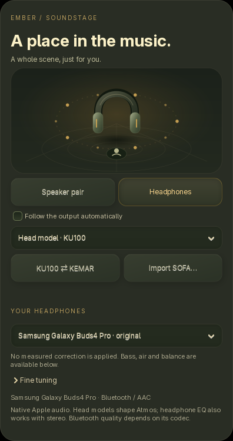

# A scene that fits your ears

**English** · [Русский](HEADPHONES.ru.md)

Open native **Apple Music → Settings → Soundstage → Headphones**. Choose a
head model, an independent headphone profile and gentle voicing controls. The
fullscreen gear opens the same card; long controls scroll on small screens.

## Head model and headphone correction

**KU100 / KEMAR** select the bundled SADIE II head-and-ear models for binaural
Atmos. **KU100 ⇄ KEMAR** compares them on the current song; the renderer may
need a short preparation. Choose what sounds natural to you; neither model is
claimed to suit every listener.

The independent **Your headphones** menu includes ten RTINGS / AutoEq measured
profiles: AirPods Pro, Pro 2, Max, AirPods 3, AirPods 4 with ANC, Galaxy Buds Pro,
Buds2 Pro, Buds3 Pro, Buds2 and Buds FE. These are frequency-response corrections,
not official Apple or Samsung spatial engines. Use the factory headphone EQ;
another setting in the manufacturer's app can stack with Ember's correction.
Fit, tips and ANC mode affect the result.

**Galaxy Buds4 Pro · original** is explicitly unmeasured. The pinned AutoEq
revision has no preset for this model; Ember does not substitute Buds3 Pro
measurements. Choose an Atmos head model and adjust bass, air and balance by
ear. Selecting Buds4 Pro alone leaves PCM unchanged.

## Fine tuning

- **Correction, 0–100%:** measured-profile strength, disabled for unmeasured models.
- **Bass / Air, ±4 dB:** smooth shelf filters.
- **L / R balance:** attenuates one channel without boosting the other.
- **A / B · Original:** bypasses voicing and balance with the same preamp
  headroom. This is not measured perceived-loudness matching. HRTF stays independent.
- **Reset tuning:** restores the original signal without EQ or balance changes.

Choices are saved separately for each output. Headphone voicing is bypassed in
**Speaker pair** mode; the existing speaker geometry controls remain available.

## Personal SOFA models

**Import SOFA…** adds a compatible head model to a private library of up to 32
files. The pinned OpenJOC accepts its `SimpleFreeFieldHRIR` scope: two receivers,
compatible coordinates, delays and direction coverage. Regular NetCDF CDF-1 /
HDF5 files up to **32 MB** are checked by the real decoder in a separate process
with time and memory limits. A verified copy is stored by SHA256 in Ember's
private configuration `hrtf` folder. An incompatible import keeps the previous
model. No uploaded file or cloud account is involved.

Open or personally measured HRTFs can be used. Apple / Samsung account profiles
are not imported, and these headphones' head-tracking sensors are not used.

## Signal path and resources

One Float64 EQ stage processes the shared stereo output **after EmberFlow**.
There is no extra song decoder or neural network. The existing output rate and
source format are retained; output PCM remains Float32. EQ intentionally changes
PCM. An ALAC / Hi-Res badge describes the source, not bit-perfect processed output.

Headroom is calculated from the complete filter response. A linked peak guard
preserves ear balance, analyses intersample peaks and uses a 5 ms lookahead and
smooth release. Original mode preserves every sample with the same fixed 5 ms
delay, accounted for by the playback clock. Changes use a 180 ms envelope; rapid
edits are coalesced. History and buffers have fixed bounds. Compiled SciPy
filters run away from GTK; CPU cost depends on sample rate, filters and hardware.

Selecting a branded device does not enable official Apple Personalized Spatial
Audio or Samsung 360 Audio. Bluetooth codec information stays separate from
source quality: SBC / AAC transport does not become lossless.

This processing applies to **native Apple Atmos / Lossless / AAC**. Browser
Spotify, Yandex, YouTube and external MPRIS currently have separate output paths
and are not covered by this EQ feature.

The installer checks SciPy ≥1.10 with **`--apple-atmos`** / **`--apple-lossless`**,
and on normal updates when a native decoder is already configured. Missing
packages use a private runtime. If SciPy is unavailable, original playback
continues and the card explains that voicing is unavailable.

## Attribution

The measured presets are pinned to [AutoEq 7ae0f56](https://github.com/jaakkopasanen/AutoEq/tree/7ae0f56d53074872b028649617a22bbb4232feb7).
The catalogue includes each source URL and SHA256. [AutoEq's MIT license](../assets/licenses/AutoEq-LICENSE.txt)
and author notice are included. Built-in KU100 / KEMAR models come from
[OpenJOC](https://github.com/chyinan/OpenJOC/blob/v0.20.1/docs/site/using/binaural-sofa.md).

[Soundstage](SOUNDSTAGE.md) · [Requirements](REQUIREMENTS.md)
