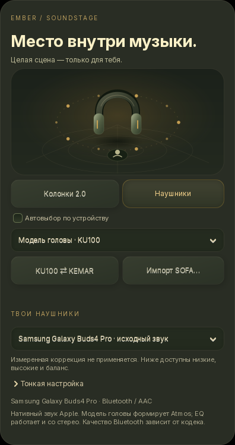

# Сцена, которая подходит твоим ушам

[English](HEADPHONES.md) · **Русский**

В нативном **Apple Music → ⚙ → Звуковая сцена → Наушники** доступны
модель головы, профиль наушников и тонкая настройка звучания. Шестерёнка есть
и в полноэкранном режиме. Длинная карточка прокручивается на небольшом экране.

## Два независимых выбора

**KU100 / KEMAR** — модели головы и ушей SADIE II. Они формируют бинауральную
сцену Atmos. Кнопка **KU100 ⇄ KEMAR** переключает их для сравнения на текущем
треке; рендеру может понадобиться небольшая подготовка. Подходящий профиль
выбирается на слух: универсального победителя для всех слушателей нет.

**Твои наушники** — отдельная коррекция частотной характеристики. В комплекте
десять профилей RTINGS / AutoEq: AirPods Pro, Pro 2, Max, AirPods 3, AirPods 4
с ANC, Galaxy Buds Pro, Buds2 Pro, Buds3 Pro, Buds2 и Buds FE. Это коррекция
по измерениям, а не официальный пространственный движок Apple или Samsung.
Используй заводскую настройку EQ наушников; иная настройка в их приложении
может сложиться с коррекцией Ember. Посадка, насадки и режим ANC влияют на результат.

**Galaxy Buds4 Pro** имеют отдельную позицию **«исходный звук»**. В закреплённой
версии AutoEq для них нет профиля: Ember не подставляет измерения Buds3 Pro.
Можно выбрать KU100 / KEMAR для Atmos и настроить низкие, высокие и баланс
вручную. Выбор модели Buds4 Pro сам по себе не меняет PCM.

## Тонкая настройка

- **Коррекция, 0–100%** — сила измеренного профиля; недоступна для неизмеренных моделей.
- **Низкие / высокие, ±4 dB** — плавные полочные фильтры.
- **Баланс L / R** — ослабление одного канала без усиления другого.
- **A / B · Исходный звук** — отключает коррекцию и баланс, сохраняя тот же
  запас по громкости. Это сравнение с одинаковым предусилением, не измеренное
  выравнивание воспринимаемой громкости. HRTF остаётся выбранной отдельно.
- **Сбросить настройку** — исходное звучание без EQ и изменения баланса.

Настройки сохраняются отдельно для каждого выхода. Профиль наушников не
применяется в режиме **Колонки 2.0**. Расстановка колонок сохраняет прежнюю логику.

## Личная HRTF в SOFA

**Импорт SOFA…** добавляет совместимую модель в личную библиотеку до 32 файлов.
Поддерживается область `SimpleFreeFieldHRIR`, которую принимает закреплённый
OpenJOC: два приёмника, совместимые координаты, задержки и покрытие направлений.
Принимаются обычные NetCDF CDF-1 / HDF5 файлы до **32 МБ**; совместимость
проверяется настоящим декодером в отдельном процессе с ограничением времени
и памяти. Файл копируется в личную папку `hrtf` настроек Ember с проверкой SHA256.
Несовместимая модель не заменяет текущую. Импорт не загружает файл в интернет.

Это позволяет использовать открытые измерения или собственную измеренную HRTF.
Персональные профили Apple и Samsung не импортируются из их аккаунтов; датчики
поворота головы этих наушников в этой версии не используются.

## Качество, задержка и нагрузка

EQ применяется **один раз после EmberFlow**, к общей стереопаре. Формат исходного
трека и частота существующего выхода не понижаются. Фильтры используют Float64,
выход остаётся Float32. При включённой коррекции PCM намеренно меняется;
плашка ALAC / Hi-Res продолжает описывать источник, а не побитовую неизменность вывода.

Нужный запас предусиления рассчитывается по частотному отклику фильтров.
Дополнительная общая защита пиков сохраняет соотношение каналов, анализирует
межсемпловые пики и использует 5 мс упреждения и плавный отпуск. В исходном
режиме сэмплы проходят неизменными с той же фиксированной задержкой 5 мс.
Часы воспроизведения учитывают её. Настройки меняются огибающей 180 мс;
частые изменения объединяются. Короткая история и буферы ограничены по размеру.

Фильтры выполняются скомпилированным SciPy, без нейросети и второго звукового
декодера. Нагрузка зависит от CPU, числа фильтров и частоты выхода. Наушники
не получают официальный Samsung 360 Audio или Apple Personalized Spatial Audio
просто от выбора названия устройства. Bluetooth-кодек показывается отдельно:
значок Lossless у источника не делает SBC / AAC передачей без потерь.

Эта обработка работает с **нативным Apple Atmos / Lossless / AAC**. Встроенные
браузерные Spotify, Яндекс, YouTube и внешний MPRIS сейчас используют свои пути
вывода. Коррекция для них в этой версии не заявляется.

Установщик с **`--apple-atmos`** / **`--apple-lossless`** проверяет SciPy ≥1.10
и добавляет отсутствующий пакет в личную среду. Обычное обновление также
проверяет его, если нативный декодер уже подготовлен. Если SciPy недоступен,
исходное воспроизведение работает, а карточка сообщает о недоступной коррекции.

## Происхождение данных

Профили закреплены на [AutoEq 7ae0f56](https://github.com/jaakkopasanen/AutoEq/tree/7ae0f56d53074872b028649617a22bbb4232feb7).
JSON содержит ссылку и SHA256 каждого исходного файла. [Лицензия MIT AutoEq](../assets/licenses/AutoEq-LICENSE.txt)
сохранена с уведомлением автора. HRTF KU100 / KEMAR поставляются самим
[OpenJOC](https://github.com/chyinan/OpenJOC/blob/v0.20.1/docs/site/using/binaural-sofa.md).

[Звуковая сцена](SOUNDSTAGE.ru.md) · [Системные требования](REQUIREMENTS.ru.md)
