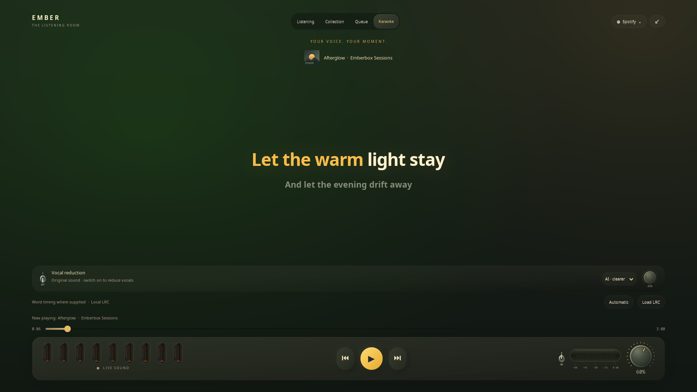

# Karaoke

**English** · [Русский](KARAOKE.ru.md)

Open fullscreen with **⛶ / F11**, then select **Karaoke**. Large cream type,
amber word lighting, gentle line transitions and the familiar tubes give your
voice room. Transport, the volume dial and the listening queue keep working.
Leaving fullscreen returns to the desktop widget.

## A warmer connection

Enabling AI vocal reduction brings up warm embers, a gentle amber waiting bar
and “Let the sound warm up”. Captions follow preparation and audio buffering.
Once processed audio is ready, the timed lyrics softly return. The switch can
cancel preparation at any time; an error ends the waiting scene. With system
animations disabled, the same stages remain readable without motion.

[Preview the connection](../assets/karaoke-startup.png).

## Words and timing

- Automatic lyrics come from LRCLIB, using the same recording matching as the
  ordinary lyrics panel. Only opening Lyrics or Karaoke starts a lookup.
- Ordinary LRC highlights **lines**. The footer explicitly says when word
  timestamps are unavailable. Words are never assigned invented equal timings.
- **Load LRC** accepts a UTF-8 enhanced LRC file for the current recording,
  with real `<mm:ss.xxx>` word tags. Supplied word segments warm to amber on
  their timestamp. Sub-word tags also work when the file supplies them.
- A countdown appears in the last five seconds before a timed entry. Empty
  timed lines and explicit final word ends allow instrumental rests. Pause,
  backward/forward seeks and song changes update the stage without restarting
  playback. Plain text is readable but has no timed highlighting.
- Imported text stays in a private per-user configuration file, associated with
  that title, artist, album and duration. It is not uploaded. **Automatic**
  removes that override and looks up lyrics again. Files are limited to 120 KB.

The common automatic source usually supplies line timing. Importing an LRC
does not align a different recording, live performance or remix automatically.
This release supports enhanced LRC, not Apple's TTML catalogue or a connection
to Apple Music Sing. Song lyrics are not bundled with Emberbox.

**Network disclosure:** an automatic lookup sends title, artist, album and
duration to [LRCLIB](https://lrclib.net/). Lyrics remain optional; unavailable
text does not stop the music.

## Vocal reduction

[Hardware guidance and additional AI requirements →](REQUIREMENTS.md)

Choose **AI · clearer** (the default), then enable the metal switch. UVR's
MDX-Net estimates a vocal stem and the dial blends it out of the original
stereo signal. It does not remove the entire stereo centre. Results still
vary by song; backing vocals, reverb or separation artifacts can remain.

On first use, **Prepare AI** downloads a pinned, SHA256-verified 30 MB UVR
model from the authors' release and builds a separate Python environment with
ONNX Runtime, ONNX and SciPy. Runtime packages add roughly 100–250 MB depending
on existing dependencies. The operation shows download/setup progress and can
be retried. System Python packages are not changed. Weights and runtime live
in the private `karaoke-ai` cache directory; clearing that cache requires setup
again. [Model credits, source, hash and license](THIRD_PARTY_KARAOKE.md).

AI runs locally on CPU, with a bounded pool of up to four inference threads
and no account/API key.
Audio is never saved or uploaded. The original 44.1 kHz model uses a bounded
sliding context, resampling from/to the 48 kHz application route. Overlapping
vocal estimates are blended at block boundaries; strength changes are smoothed.
A startup benchmark chooses a block size. If the CPU cannot keep up or queues
exceed their limit, the helper stops and restores original playback; it never
silently switches to centre cancellation.

The model processes both signal polarities and averages its estimates using
UVR's denoising method. This reduces sign-independent model artifacts, especially
at full vocal subtraction; a requested 100% is not silently reduced. There is
no global low-pass filter on the accompaniment. Some separation artifacts remain
possible for individual recordings.

A stereo-linked peak limiter anticipates residual peaks above 0.98 instead of
hard-clipping them. It uses future audio already present in the model context,
adding no model passes or extra audio delay itself. Quiet signals are not boosted,
stereo balance is retained and an initial 0% returns the exact original PCM.

AI needs buffering. On the development AMD four-core machine the expected
buffer with denoising is around 2–3 seconds; the panel reports the measured delay rather
than promising this for every computer. Karaoke lyrics, song information,
artwork, progress and tubes follow the buffered output. Pause, seek and natural
track changes reach your ears through that same buffer. Source transport
buttons show the requested source state. Switching the effect off returns to
live source audio and can skip the buffered interval. Mute is also applied to
the return stream. The large dial still controls overall source volume.

**Fast · stereo** retains the lightweight centre filter, with much less delay
and no model download. It also quiets centred instruments. Use the mode selector
explicitly; the helper never substitutes it for AI after a failure.

Both modes require `pactl` and `pacat` and a compatible PipeWire-Pulse or
PulseAudio server with null-sink support. There is no GNOME/KDE-specific routing.
Only the selected application is processed; an external browser can share audio
across its tabs. The dedicated Apple/Yandex engine gives a separate application
boundary. The processed return stream is excluded from source routing and source
volume; only the meter can explicitly select it, without a feedback loop.

The effect is off initially and stops on leaving Karaoke/fullscreen or changing
source. On normal exit, GUI failure, device loss or helper termination, original
stream destinations are restored. If the helper itself is forcibly killed, the
next Emberbox start recovers its private route journal. Manually moved streams
are respected and the default output is never changed. Processing is not a
bit-perfect or lossless output path regardless of the original quality badge.

## Verification

`tests/karaoke_smoke.py` checks actual GTK controls down to 1024×600, genuine
word timing, pauses, seeks and filter lifecycle with offline fixtures.
`test_karaoke_audio.py` checks synthetic DSP, neural framing/mixing, buffered metadata and restoration invariants.

An opt-in `EMBERBOX_AUDIO_ROUTE_TEST=1 python3 tests/karaoke_route_smoke.py`
creates original tones and private inaudible null sinks to verify real routing,
suppression, preserved bass/sides, EOF/SIGTERM cleanup and forced-kill recovery.
It does not move existing application streams or change the default output.
Live song separation quality still depends on each recording; synthetic checks
cannot establish it for an entire music catalogue.

Use the optional AI runtime interpreter and add `--ai` to the route smoke check
to exercise real model inference, bounded buffering, EOF/SIGTERM and kill recovery.
The check uses generated audio and a zero-strength mix to verify timing without
assuming a learned model classifies test tones as vocals.
