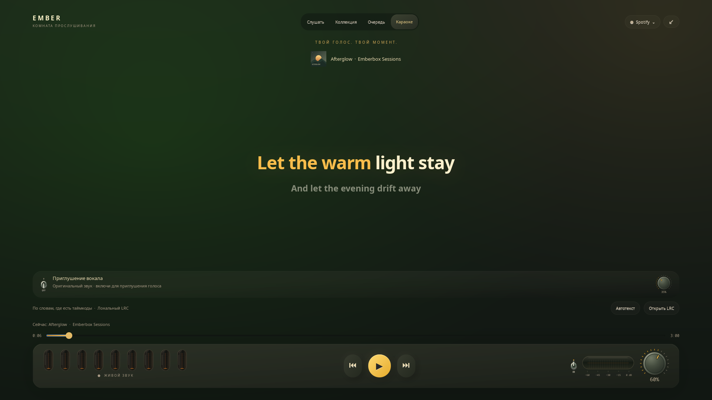

# Караоке

[English](KARAOKE.md) · **Русский**

Откройте полный экран кнопкой **⛶ / F11**, затем вкладку **Караоке**.
Крупный кремовый текст, янтарная подсветка слов, мягкие переходы строк и
знакомые лампы оставляют место вашему голосу. Кнопки воспроизведения,
крутилка громкости и очередь продолжают работать. Выход из полного экрана
возвращает к виджету.

## Слова и синхронизация

- Автотекст приходит из LRCLIB с проверкой совпадения записи, как и в обычной
  панели текста. Запрос начинается только при открытии «Текст песни» или «Караоке».
- Обычный LRC подсвечивается **по строкам**. Если таймкодов слов нет, это прямо
  указано внизу экрана. Равномерные таймкоды слов не выдумываются.
- **Открыть LRC** позволяет загрузить файл для текущей записи в UTF-8.
  Расширенный LRC содержит настоящие метки слов `<мм:сс.xxx>`: сегменты текста
  мягко загораются янтарным при наступлении указанного времени. Если файл
  размечен по слогам, работают и такие сегменты.
- За пять секунд до вступления появляется отсчёт. Пустые строки с таймкодами и
  явное время окончания последнего слова позволяют показывать музыкальные паузы.
  Пауза, перемотка в обе стороны и смена песни обновляют сцену без перезапуска
  музыки. Обычный текст читается без синхронной подсветки.
- Импорт сохраняется в личной папке настроек с привязкой к названию, исполнителю,
  альбому и длительности записи. Текст никуда не загружается. **Автотекст**
  удаляет эту замену и снова ищет слова в сети. Ограничение файла — 120 КБ.

Общий автоматический источник обычно даёт синхронизацию по строкам. LRC от
другого ремикса, концерта или версии песни сам по себе не выравнивается.
В этой версии поддержан расширенный LRC; подключения к каталогу TTML Apple
и к Apple Music Sing нет. Тексты песен не поставляются вместе с Emberbox.

**Сетевые запросы:** автоматический поиск передаёт название, исполнителя,
альбом и длительность в [LRCLIB](https://lrclib.net/). Отсутствие текста
не останавливает воспроизведение.

## Приглушение вокала

Металлический тумблер включает **экспериментальный стереофильтр центра**
для выбранного плеера. Отдельная маленькая крутилка меняет силу приглушения,
а большая крутилка консоли по-прежнему управляет общей громкостью. При 0%
сигнал проходит без приглушения, но с задержкой буферизации фильтра.

Это спектральная обработка mid/side в реальном времени. Голос в центре
стереозаписи может стать значительно тише; стереобэк-вокал, реверберация и
голоса со смещением могут остаться. Инструменты в центре тоже могут стать
тише. Бас ниже вокального диапазона и боковые стереосоставляющие защищены.
Начните с умеренной силы. Моно и многоканальные потоки не обрабатываются.
Нейросетевого разделения на отдельные дорожки здесь нет.

Обработка работает в отдельном процессе Python/NumPy, вне GTK: перекрывающиеся
окна и плавные коэффициенты не нагружают цикл отрисовки. Алгоритмическая задержка
32 мс, плюс буферы звукового сервера. Используется стерео float PCM 48 кГц:
при включённом эффекте выход не является bit-perfect или lossless, даже если
исходный поток имеет такую плашку качества. Нужны `pactl`, `pacat` (установщик
проверяет оба) и совместимый PipeWire-Pulse или PulseAudio с null-sink.
Обработка не зависит от интерфейсов GNOME или KDE.

Во временный выход направляется только выбранное приложение. Другие приложения
и общий системный микс не захватываются. У внешнего браузера общий аудиопоток
может включать другие вкладки того же сеанса; встроенный отдельный движок
Apple/Яндекс удобнее для изоляции. Микрофон не открывается, звук не сохраняется
и не отправляется в сеть.

Изначально эффект выключен. Выход из «Караоке», закрытие полного экрана или
смена источника выключают его. Новые аудиопотоки того же плеера подхватываются,
пока эффект активен. При сбое помощник возвращает исходные назначения потоков;
при отключении устройства используется доступный выход сервера по умолчанию.
Потоки, вручную перенесённые пользователем, не трогаются. Устройство по умолчанию
не меняется. Закрытие Emberbox или принудительное завершение его интерфейса
закрывает управляющий канал помощника и возвращает звук. Если принудительно
убит сам помощник, следующий запуск Emberbox восстановит маршрут по личному
журналу. При переносе потоков или отключении устройства возможна короткая пауза.

## Проверки

`tests/karaoke_smoke.py` проверяет реальные элементы GTK вплоть до 1024×600,
таймкоды слов, паузу, перемотку и жизненный цикл эффекта на автономных примерах.
`test_karaoke_audio.py` проверяет обработку искусственных сигналов и возврат
маршрутов.

Отдельный запуск `EMBERBOX_AUDIO_ROUTE_TEST=1 python3 tests/karaoke_route_smoke.py`
создаёт собственные сигналы и неслышимые тестовые null-sink. Проверяются реальная
маршрутизация, приглушение центра, сохранение баса и боковых звуков, возврат по
EOF/SIGTERM и восстановление после принудительного убийства. Существующие
потоки приложений и выход по умолчанию не меняются. Результат на настоящей
песне зависит от её сведения; искусственный сигнал не подтверждает качество
для всего музыкального каталога.
