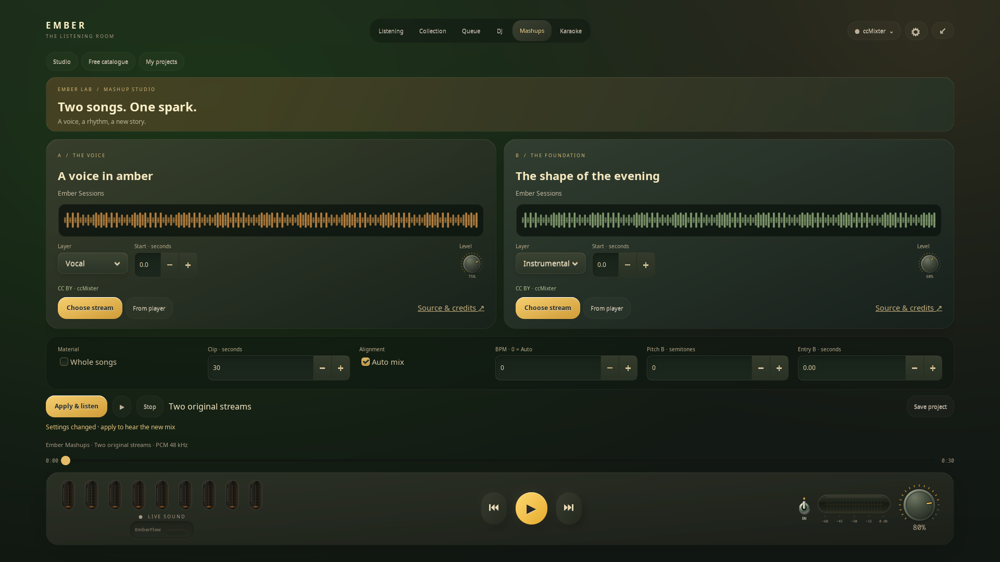

# Ember Mashups · Two songs. One spark.

**English** · [Русский](MASHUPS.ru.md)

Open **Mashups** in fullscreen: two decks, amber/sage waveforms, inset surfaces
and familiar metal knobs. The compact heading leaves room for tools; build,
stop and save stay visible below the scrolling workspace.

## Your first mashup

1. Choose a vocal stream on **A / The voice**.
2. Choose an instrumental on **B / The foundation**. The free ccMixter catalogue
   needs no account, API key or subscription. Search and **More tracks** fetch
   small pages only when requested.
3. Choose whole songs or a 5–120-second clip. Set each source's start and level.
4. Enable **Auto mix**, or set BPM, B's pitch and entry offset manually.
5. **Build & listen** shows preparation progress. Existing playback continues
   until the mashup is ready, then pauses.
6. Name and **Save project**. Reopen it through **My projects**; rebuilding needs
   an internet connection to the catalogue.

The main transport, volume, seek bar and lamps control a ready mashup.
Previous/next move by ten seconds. Leaving the tab stops preview without
resuming the original song. Layer settings need **Apply & listen**, rebuilding
the result; they are not live faders yet. Overall volume changes immediately.

## Alignment and AI

Ember estimates rhythm/key from a short observation, considers supplied BPM
metadata and half/double-time alternatives. Stretching stays within 0.8–1.25
of the original rate. The system FFmpeg's **Rubber Band** filter preserves pitch.
Automatic key shifts require a confident estimate and stay within three
semitones; phase alignment also requires a confident beat estimate.
This is a proposal, not a promise that any two songs fit. Choose a closer pair
or disable Auto mix when tempos are too far apart. Free rhythm may need manual
adjustments. The shorter source fades out while the longer continues; Ember
does not generate new parts or repeated choruses.

Supplied vocals/instrumentals skip AI. For extracting a layer from a full mix,
use **Prepare vocal AI**. This reuses karaoke's optional local UVR model:
[credits and licences](THIRD_PARTY_KARAOKE.md). Quality depends on the recording
and may contain artefacts. Whole songs take longer to prepare than clips.

## Sources and attribution

Only ccMixter-hosted files declaring **CC BY** 1.0–4.0 are admitted.
BY-NC, BY-ND and other variants are excluded. Licence and file are resolved
afresh through the [Query API](https://ccmixter.org/query-api) before each build.
[CC BY permits adaptations with attribution](https://creativecommons.org/licenses/by/4.0/);
additional rights, including rights in samples, still depend on the material.
Having no export feature does not itself make any recording free to remix.

Projects retain titles, artists, declared licences, source links and supplied
attribution notes. **Source & credits** opens the complete original page.
Mixing modifies the recordings; Ember does not claim authorship of them.

**Apple Music, Spotify, Yandex Music and YouTube:** **From player** saves a song
as part of a project idea. Current connections do not provide an approved
editing path, so preparation is blocked pending a suitable integration.
Subscription/playback access does not itself grant stem-extraction permission.
Full mashup support for these catalogues is not available yet.

## Resources and storage

- Network and DSP run outside GTK in one cancellable, lower-priority helper.
  AI uses a bounded CPU pool; CUDA is not required.
- Each source: at most ten minutes and 50 MiB compressed. Output: ten minutes.
  Start with clips and supplied stems for less processing.
- Allow 8 GB RAM for whole songs, preferably 16 GB with AI separation. These
  are recommendations, not measured hardware minima.
- Audio stays in memory/anonymous Linux `memfd` objects, without audio files
  or export. The OS may use swap. Stop releases audio and terminates the helper.
- Up to 24 private recipes in Ember's configuration `mashups.json`, mode `0600`:
  settings/attribution without audio, cookies or tokens. Reaching the limit
  does not evict projects; existing recipes can still be updated.
- Preview is processed stereo PCM at 48 kHz. An MP3 source does not become
  Lossless or Atmos through conversion.

System **mpv** and **FFmpeg** are required; tempo/pitch adjustment also needs
FFmpeg's `rubberband` filter. Check with `ffmpeg -filters`. AI setup is optional.

Offline checks use original tones, real mpv with null output, two languages and
three window sizes. The additional network check
`python3 tests/mashup_worker_smoke.py --live-catalogue` exercises a current
ccMixter pair without desktop audio output. Every catalogue recording and
hardware minima have not been tested.
