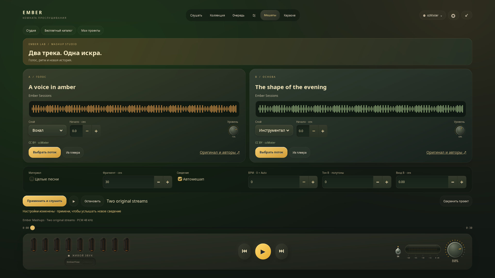

# Ember Mashups · Два трека. Одна искра.

[English](MASHUPS.md) · **Русский**

Открой **Мешапы** в полном экране: две дорожки, янтарные и шалфейные формы
волн, утопленные поверхности и металлические крутилки. Компактная шапка
оставляет место инструментам; сборка, остановка и сохранение закреплены внизу.

## Первый мешап

1. В **A / Голос → Выбрать поток** выбери акапеллу.
2. В **B / Основа** выбери инструментал. Каталог ccMixter бесплатный:
   без аккаунта, ключа и подписки. Поиск и **Ещё треки** загружают небольшие
   страницы только по запросу.
3. Выбери целые песни или фрагмент от 5 до 120 секунд. Начало и уровень
   каждой дорожки задаются отдельно.
4. Включи **Автомешап** или задай BPM, тон B и момент её входа вручную.
5. Нажми **Собрать и слушать**. Индикатор показывает этапы подготовки.
   Исходная музыка играет до готовности, затем ставится на паузу.
6. Назови и **Сохрани проект**. Открыть его можно через **Мои проекты**;
   для новой сборки нужно соединение с каталогом.

Основной транспорт, громкость, перемотка и лампы работают с готовым мешапом.
Кнопки назад/вперёд перемещают его на десять секунд. Выход из вкладки
останавливает предпрослушивание без автоматического возобновления прежней
музыки. Параметры слоёв применяются через **Применить и слушать**, с повторной
сборкой; это пока не живые фейдеры. Общая громкость меняется сразу.

## Сведение и AI

Ember оценивает ритм и тональность короткого фрагмента, учитывает заданный
автором BPM, половинный и двойной темп. Изменение скорости ограничено
0,8–1,25 от исходной; высоту сохраняет **Rubber Band** системного FFmpeg.
Автоматический сдвиг тона допускается при уверенной оценке, до трёх полутонов;
фазовое совмещение — при уверенном ритме. Это предложение сведения,
а не гарантия совместимости любых песен. Если темпы слишком далеки,
выбери другую пару или отключи автомешап. Свободный ритм может требовать
ручной настройки. Короткая дорожка мягко заканчивается, длинная продолжается;
новые партии и повторы припевов не генерируются.

Готовые акапеллы и инструменталы обходятся без AI. Для выделения слоя из
полного микса нажми **Подготовить AI для вокала**. Используется необязательная
локальная UVR-модель караоке: [описание и лицензии](THIRD_PARTY_KARAOKE.md).
Качество зависит от записи, возможны артефакты. Целые песни готовятся дольше.

## Источники и авторство

Принимаются только файлы ccMixter с заявленной **CC BY** 1.0–4.0.
BY-NC, BY-ND и другие варианты исключены. Перед сборкой файл и лицензия
проверяются заново через [Query API](https://ccmixter.org/query-api).
[CC BY разрешает переработки с указанием авторства](https://creativecommons.org/licenses/by/4.0/);
дополнительные права, например на семплы, всё равно зависят от материала.
Отсутствие экспорта само по себе не даёт права перерабатывать любую запись.

Проекты сохраняют названия, авторов, лицензию, исходные ссылки и дополнительные
сведения об авторстве. **Оригинал и авторы** открывает полную страницу записи.
Сведение меняет исходный звук; Ember не объявляет его собственной музыкой.

**Apple Music, Spotify, Яндекс Музыка и YouTube:** **Из плеера** сохраняет песню
как часть замысла проекта. Текущие подключения не предоставляют согласованный
доступ к её редактированию: сборка блокируется до подходящей интеграции.
Подписка и доступ к прослушиванию не дают разрешения извлекать дорожки.
Полноценные мешапы этих каталогов пока не поддерживаются.

## Ресурсы и хранение

- Сеть и обработка — вне GTK, один отменяемый помощник с пониженным приоритетом.
  AI использует ограниченный пул CPU; CUDA не нужна.
- До десяти минут и 50 МиБ сжатого аудио на источник; результат до десяти минут.
  Для меньшей нагрузки начни с фрагментов и готовых акапелл.
- Ориентир для целых песен — 8 ГБ RAM, желательно 16 ГБ при разделении AI.
  Это рекомендация, а не измеренный аппаратный минимум.
- Аудио — в памяти и анонимных Linux `memfd`, без звуковых файлов и экспорта.
  ОС может использовать swap. Остановка освобождает аудио и завершает помощник.
- До 24 частных рецептов в `mashups.json` каталога настроек Ember, права `0600`:
  параметры и авторство без аудио, cookies и токенов. Лимит не удаляет старые
  проекты; существующий проект можно обновить.
- Предпрослушивание — обработанный стерео PCM 48 кГц. Исходный MP3 не
  превращается в Lossless или Atmos.

Нужны системные **mpv** и **FFmpeg**, для темпа/тона — фильтр `rubberband`
в FFmpeg. Проверка: `ffmpeg -filters`. Модель устанавливается отдельно по кнопке.

Автономные проверки: оригинальные тоны, настоящий mpv с нулевым выходом,
два языка и три размера окна. Сетевая проверка
`python3 tests/mashup_worker_smoke.py --live-catalogue` проходит текущую пару
ccMixter без звука на колонках. Все записи каталога и аппаратные минимумы
не проверялись.
