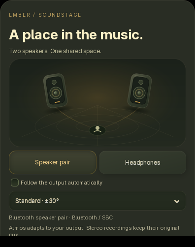

# A place in the music

**English** · [Русский](SOUNDSTAGE.ru.md)

Open **⚙ → Soundstage · speakers / headphones** while native Apple
Atmos / Lossless is enabled. In fullscreen, the gear is at the top right,
between the source picker and the return-to-widget button.
The card uses Ember's warm Grunesphism surfaces,
recessed controls and a small animated listening-room diagram. Its entrance,
speaker spacing and reversible headphone transition animate for about 720 ms.
Animation respects the desktop setting, keeps a bounded 16-frame cache and
stops when settled or hidden. No extra audio capture or neural model is started.

## Two speakers

**Speaker pair** renders the reconstructed JOC scene into physical left and
right points. Choose **±20°, ±30° or ±40°** to match each speaker's angle from
the listening position. These are geometry changes in the renderer, rather
than a post-processing width slider. The center projects between the pair.
The native render also retains LFE, folded equally into both channels at
equal-power gain before the existing linked peak protection.

This is a front stereo scene. Two uncalibrated speakers cannot guarantee
separate rear/height sources; this mode does not claim room correction,
transaural crosstalk cancellation or head tracking.

## Headphones

**Headphones** uses the virtual 7.1.4 binaural path. **KU100** and **KEMAR**
select the renderer's bundled SADIE head/ear models. They are generic profiles;
choose the one that localizes more naturally for you. No microphone measurement
or model download is needed.

## Your output, remembered

Ember checks its own PulseAudio/PipeWire stream's destination in a worker,
with the default output used only when no player stream is present. It reads
the active port and device form factor. Some Bluetooth speaker pairs report
themselves as headphones: select **Speaker pair** manually in that case.
The override is remembered under a hashed device identifier; switching to a
different headset can use automatic detection. Native-audio toggles retain
these choices. Device names/addresses are not saved in the scene preferences.

Changing an Atmos scene reuses the licensed worker and the output device at
the current song position, with the existing short boundary envelope. A brief
preparation interval can still occur. Upcoming EmberFlow audio is rebuilt for
the new scene. Ordinary stereo ALAC / Hi-Res samples remain unchanged.

## Bluetooth

The scene is rendered to two-channel PCM before transmission. The card and
quality details show the reported Bluetooth codec separately from the original
recording's format. An ALAC/Lossless source badge does not make an SBC/AAC
Bluetooth link lossless. Ember does not change the device's codec, system
volume or connection profile.

The implementation uses the pinned [OpenJOC custom-layout API](https://github.com/chyinan/OpenJOC/blob/v0.20.1/docs/site/using/custom-speaker-layouts.md)
and [binaural HRTF selection](https://github.com/chyinan/OpenJOC/blob/v0.20.1/docs/site/reference/c-abi.md).
OpenJOC remains an independent experimental renderer, without Dolby certification.
