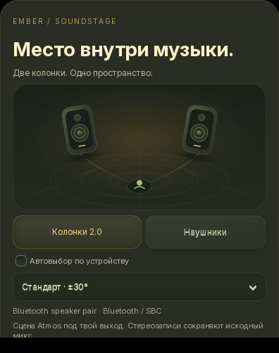

# Место внутри музыки

[English](SOUNDSTAGE.md) · **Русский**

Открой **⚙ → Звуковая сцена · колонки / наушники**, когда включён
нативный Apple Atmos / Lossless. В полноэкранном режиме шестерёнка находится
справа сверху, между выбором источника и кнопкой возврата к виджету.
У карточки тёплые поверхности Грунесфизма,
утопленные регуляторы и анимированная схема комнаты. Появление, расстановка
колонок и обратимый переход к наушникам занимают около 720 мс. Анимация
учитывает настройку рабочего стола, хранит до 16 кадров и останавливается
после перехода или закрытия. Новая запись звука или нейросеть не запускается.

## Две колонки

Режим **Колонки 2.0** строит реконструированную сцену JOC для физических левой
и правой точек. Выбери **±20°, ±30° или ±40°** — угол каждой колонки относительно
центра в месте прослушивания. Меняется геометрия рендера, а не ползунок ширины
готового стерео. Центральные источники располагаются между колонками.
Басовый LFE сохраняется и поровну подмешивается в оба канала с равномощным
коэффициентом перед общей защитой пиков.

Это фронтальная стереосцена. Две колонки без калибровки не гарантируют отдельные
источники сзади и сверху; коррекции комнаты, подавления перекрёстного сигнала
между ушами и отслеживания головы здесь нет.

## Наушники

Режим **Наушники** использует виртуальную бинауральную сцену 7.1.4.
**KU100** и **KEMAR** выбирают встроенные модели головы и ушей SADIE.
Это универсальные профили: можно выбрать тот, с которым расположение
инструментов воспринимается естественнее. Микрофонное измерение и скачивание
новой модели не нужны.

## Выход, который запоминается

Ember проверяет назначение собственного потока PulseAudio/PipeWire в отдельном
потоке выполнения. Системный выход используется, только если у плеера ещё
нет звукового потока. Учитываются активный разъём и тип устройства.
Некоторые Bluetooth-колонки сообщают системе, что они наушники: в таком
случае выбери **Колонки 2.0** вручную. Выбор сохраняется для хешированного
идентификатора устройства; другая гарнитура может использовать автовыбор.
Выключение нативного звука сохраняет настройки. Названия и адреса устройств
в файл предпочтений сцены не записываются.

Смена сцены Atmos использует тот же лицензированный процесс и звуковой выход
на текущем месте песни, с короткой плавной огибающей на границе. Небольшая
подготовка всё ещё возможна. Следующий трек EmberFlow заново готовится под
новую сцену. Обычные стереосэмплы ALAC / Hi-Res остаются без изменений.

## Bluetooth

Сцена формируется в двухканальный PCM до передачи. Карточка и подробности
качества показывают Bluetooth-кодек отдельно от формата исходной записи.
Значок ALAC/Lossless не делает канал SBC/AAC передачей без потерь. Ember
не меняет кодек устройства, системную громкость или профиль подключения.

Используются закреплённые версии [геометрического API OpenJOC](https://github.com/chyinan/OpenJOC/blob/v0.20.1/docs/site/using/custom-speaker-layouts.md)
и [выбора бинауральных HRTF](https://github.com/chyinan/OpenJOC/blob/v0.20.1/docs/site/reference/c-abi.md).
OpenJOC остаётся независимым экспериментальным рендером без сертификации Dolby.
