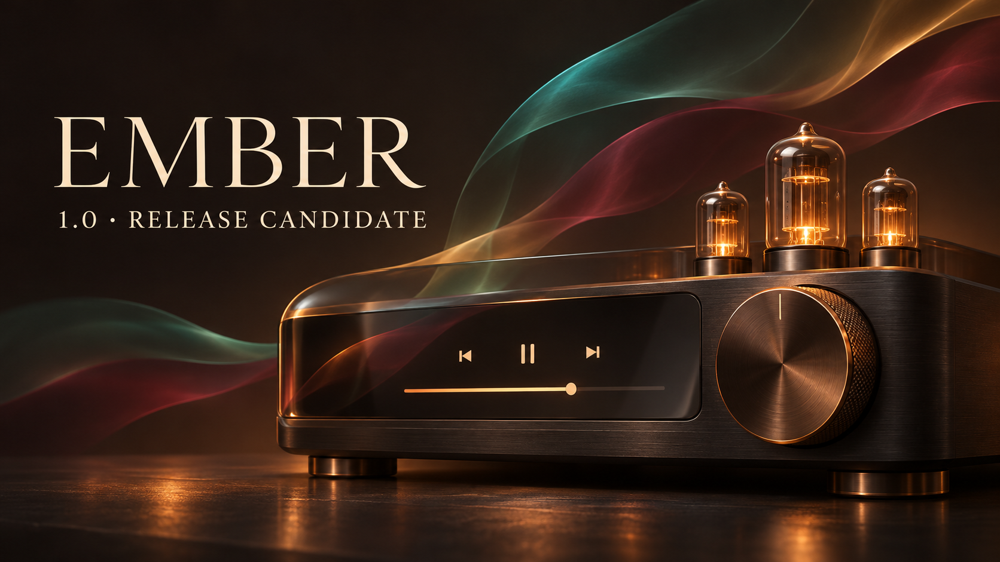

# Ember 1.0.0-rc.1 · The final listening test

**Pre-release · Linux · Release candidate, not stable 1.0.**

Ember is getting ready for its first major release. This is the final testing stage: a complete candidate to install, listen to and help refine. After testers report their results, we will decide whether it is ready for 1.0. Another release candidate may follow if needed.

## Download and install

Download **emberbox-audio-1.0.0-rc.1-linux.tar.gz** or **emberbox-audio-1.0.0-rc.1-linux.zip** from this release’s Assets. Both contain the same application and installer. **No Git clone is needed.** These are installer bundles with source, not standalone executables, AppImages or Windows/macOS builds. Internet access is needed to install missing dependencies and connect music services.

Extract the archive, open a terminal inside the extracted folder and run:

```bash
bash install.sh --autostart
```

The installer checks installed components and offers to install missing packages. Run it as your normal user; it requests sudo only for system dependencies. To install without autostart, use `bash install.sh --no-autostart`. Apple’s optional native quality components can be prepared with `bash install.sh --apple-lossless --autostart`; sign-in and a suitable subscription remain necessary for subscription content.

`SHA256SUMS.txt` verifies the two archives; `BUILD-INFO.txt` records the exact source commit. From the download directory: `sha256sum -c SHA256SUMS.txt` (keep both archives there to check both).

## Inside this candidate

- Spotify, Apple Music, YouTube and Yandex Music in one warm desktop player, with service sign-in inside Ember.
- Fullscreen, compact and Mini; liquid glass, tactile controls, animated artwork where available, lyrics and artist/album rooms.
- EmberFlow transitions, the transition desk, Ember DJ, karaoke and the mashup studio within their documented source capabilities.
- Slow Current: artwork-owned colours, harmonious accents for monochrome covers, varied silhouettes and gentle measured-rhythm motion.
- Persistent Always on top and thresholded window dragging. Ordinary clicks stay clicks; Alt-drag moves the window from sliders and text inputs too.
- Saved Apple Music playlists retain catalogue identities, avoiding an unnecessary playback lookup; unresolved requests now have bounded waits.

## Help us finish 1.0

Please test installation and updating on your distribution, GNOME/KDE, Mini/compact/fullscreen, sign-in and saved playlists, manual track changes, seeking, queue completion, EmberFlow and a long listening session. Check quality indicators against actual playback and try Bluetooth speakers/headphones.

Report issues with distribution/version, desktop, source, reproducible steps, expected and actual behaviour, and the version **1.0.0-rc.1**. Never attach passwords, account tokens, cookies or complete browser profiles.

Native Apple quality paths, AI karaoke, streaming integrations and Quest remain subject to their documented limitations. 60 FPS is a rendering target, not a guarantee on every graphics stack. Existing streaming subscriptions are not included. The experimental Quest port is separate from the Linux desktop release.

---

# Ember 1.0.0-rc.1 · Финальное прослушивание перед релизом

**Pre-release · Linux · Кандидат в релиз, ещё не стабильная 1.0.**

Эмбер готовится к первому большому релизу. Это финальный этап тестирования: целостная версия, которую уже можно установить, слушать и проверять. После отзывов тестировщиков решим, готова ли она стать 1.0. Если потребуются исправления, выпустим следующий кандидат.

## Скачать и установить

В Assets этого выпуска выберите **emberbox-audio-1.0.0-rc.1-linux.tar.gz** или **emberbox-audio-1.0.0-rc.1-linux.zip**. Внутри одинаковое приложение с установщиком. **Клонировать репозиторий не нужно.** Это архивы с исходниками и установщиком, а не автономные бинарники, AppImage или версии для Windows/macOS. Для недостающих зависимостей и музыкальных сервисов нужен интернет.

Распакуйте архив, откройте терминал в распакованной папке и выполните:

```bash
bash install.sh --autostart
```

Установщик проверит компоненты и предложит установить недостающие пакеты. Запускайте его от обычного пользователя: sudo потребуется только для системных зависимостей. Без автозапуска: `bash install.sh --no-autostart`. Дополнительные компоненты Apple Lossless: `bash install.sh --apple-lossless --autostart`; для подписного контента по-прежнему нужны вход и подходящая подписка.

Контрольные суммы архивов — в `SHA256SUMS.txt`, точный коммит сборки — в `BUILD-INFO.txt`. Проверка: `sha256sum -c SHA256SUMS.txt` в папке с обоими архивами.

## Что вошло

- Spotify, Apple Music, YouTube и Яндекс Музыка в одном ламповом плеере со входом в сервисы из Ember.
- Полный экран, компактный и Mini; жидкое стекло, физические регуляторы, анимированные обложки при наличии, тексты, карточки артистов и альбомов.
- Переходы EmberFlow, редактор переходов, Эмбер DJ, караоке и студия мешапов — с возможностями и ограничениями, описанными для каждого источника.
- «Тихое течение»: цвета обложки, гармоничные дополнения для монохромных изображений, разные силуэты и мягкая реакция на измеренный ритм.
- Сохраняемое «Всегда сверху» и перетаскивание окна без потери обычных кликов. За ползунки и поля ввода — с Alt.
- Исправленный запуск сохранённых плейлистов Apple Music: каталожный ID не теряется, лишний запрос исключён, резервное ожидание ограничено.

## Что проверить перед 1.0

Установку и обновление на своём дистрибутиве, GNOME/KDE, все размеры плеера, вход в сервисы и сохранённые плейлисты, ручное переключение, перемотку, очередь, EmberFlow и длительное прослушивание. Сравните индикаторы качества с фактическим воспроизведением, попробуйте Bluetooth-колонки и наушники.

В отчёте укажите дистрибутив и версию, окружение рабочего стола, музыкальный сервис, шаги воспроизведения ошибки, ожидаемый и фактический результат, номер **1.0.0-rc.1**. Не прикладывайте пароли, токены, cookies и полные профили браузера.

Нативные режимы качества Apple, AI-караоке, подключения стримингов и Quest сохраняют документированные ограничения. 60 FPS — цель отрисовки, а не гарантия на любой графической системе. Подписки сервисов в приложение не входят. Экспериментальный Quest-порт распространяется отдельно от этого выпуска для Linux.
