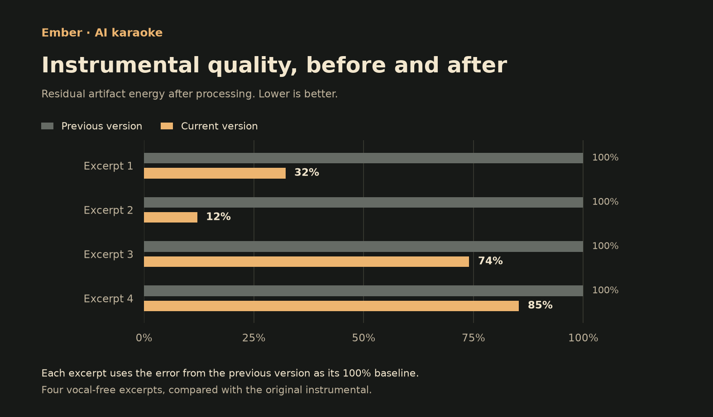

[Русский ↓](#русский) · **Linux desktop · 1.0.0-rc.2 · Pre-release**

## Between the Lines

The space between vocal phrases is part of the music. This candidate gives the bass, the room and the tail of a cymbal more room to breathe in AI karaoke. It also gets you into the next Apple Music album faster and brings podcast show notes into Ember’s glass interface.

### What changed since RC1

- **Cleaner AI karaoke.** Ember subtracts less of the estimated vocal when it is barely present, protects deep bass and eases between model blocks. The stereo limiter now catches peaks between audio samples. The switch waits for the source and shows which stage is active as the model warms up and the buffer fills.
- **Apple Music albums open independently.** A slow request for the previous album can finish in the background. Reopening an album uses its cached list. The first playable tracks can prepare their stream information in advance, with the existing preference for available Atmos, Lossless and Hi‑Res.
- **Podcasts have a place of their own.** Browse Apple Podcasts, Spotify and Yandex Music by language or category. Open **About the show** or **Episode notes** when the source supplies text. The reading panel stays in Ember while the episode plays.
- **A warmer first launch.** A filament logo lights up at startup, and a short, skippable tour introduces the player. Replay it under **Settings → System → Meet Ember**.

### Listen for the difference



In a direct comparison of the previous and current versions on four excerpts without singing, the energy of the error relative to the clean instrumental fell by **15–88%**, with a **3.1 dB median improvement**. In a separate four-excerpt test with singing, the median change in vocal suppression was under 0.01 dB. Quiet backing vocals may still be audible on dense recordings. [SiSEC benchmark excerpts](https://zenodo.org/records/3270814)

### Install on Linux

1. Download `emberbox-audio-1.0.0-rc.2-linux.tar.gz` or `emberbox-audio-1.0.0-rc.2-linux.zip` from **Assets**. Both contain the same source and installer.
2. Extract the archive and run the installer from the extracted folder.

   ```bash
   bash install.sh --autostart
   ```

3. Open **Emberbox Audio** from your applications menu. Use `bash install.sh --no-autostart` to launch only when you choose.

The installer checks dependencies and offers to prepare missing packages. `SHA256SUMS.txt` lists the archive checksums, and `BUILD-INFO.txt` records the source commit. [Install guide](https://github.com/BlackSnaker/emberbox-audio/blob/v1.0.0-rc.2/docs/INSTALL.md)

### What we’d love you to try

Try AI karaoke at 100% on a familiar song with an instrumental intro. Switch between a few Apple Music albums while a track plays. Open podcast notes while an episode runs. If something misbehaves, include your Linux distribution, desktop environment, source and steps to reproduce. [Report an issue](https://github.com/BlackSnaker/emberbox-audio/issues)

---

<a id="русский"></a>

**Linux · 1.0.0-rc.2 · Тестовая версия**

## Между строк

Музыка продолжается и между вокальными фразами. В этом кандидате мы поработали над тем, чтобы бас, пространство записи и затухание тарелок лучше сохранялись в AI-караоке. Заодно ускорили переходы между альбомами Apple Music и добавили описания подкастов прямо в стеклянный интерфейс Ember.

### Что изменилось с RC1

- **Чище инструментал в AI-караоке.** Ember бережнее вычитает слабую оценку вокала, защищает глубокий бас и плавнее сводит блоки обработки. Стереоограничитель ловит пики между цифровыми отсчётами. Одного нажатия хватает, чтобы дождаться потока, прогреть модель и заполнить буфер. Каждый этап виден в интерфейсе.
- **Быстрее переходы между альбомами Apple Music.** Новый альбом открывается независимо от предыдущего запроса. Повторное открытие берёт список из кэша, а первые доступные треки могут начать подготовку заранее. При выборе потока Ember по-прежнему учитывает доступность Atmos, Lossless и Hi‑Res.
- **Подкасты получили своё место.** Apple Podcasts, Spotify и Яндекс Музыка собраны в отдельной вкладке с языками и категориями. Если источник передал текст, **«О подкасте»** и **«О выпуске»** открывают стеклянную карточку прямо в Ember. Эпизод продолжает играть.
- **Первый запуск стал теплее.** Логотип загорается, как нить накала, а короткое знакомство помогает освоиться в плеере. Его можно пропустить и снова открыть через **Настройки → Система → Знакомство с Ember**.

### Разница, которую можно измерить


При прямом сравнении прошлой и текущей версий на четырёх фрагментах без пения энергия отклонения от чистого инструментала снизилась на **15–88%**. Медианное улучшение составило **3,1 дБ**. В отдельном тесте с пением медианное изменение глубины подавления было меньше 0,01 дБ. Тихий бэк-вокал в плотных записях всё ещё может быть слышен. [Тестовые фрагменты SiSEC](https://zenodo.org/records/3270814)

### Установка на Linux

1. Скачайте `emberbox-audio-1.0.0-rc.2-linux.tar.gz` или `emberbox-audio-1.0.0-rc.2-linux.zip` из раздела **Assets**. В обоих архивах одинаковые исходники и установщик.
2. Распакуйте архив и запустите установку из распакованной папки.

   ```bash
   bash install.sh --autostart
   ```

3. Откройте **Emberbox Audio** из меню приложений. Для запуска по требованию используйте `bash install.sh --no-autostart`.

Установщик проверяет зависимости и предлагает поставить недостающие пакеты. Контрольные суммы архивов лежат в `SHA256SUMS.txt`, точный коммит сборки указан в `BUILD-INFO.txt`. [Подробнее об установке](https://github.com/BlackSnaker/emberbox-audio/blob/v1.0.0-rc.2/docs/INSTALL.ru.md)

### Что особенно хочется проверить

Включите AI-караоке на 100% в знакомой песне с инструментальным вступлением. Откройте несколько альбомов Apple Music во время воспроизведения. Почитайте описание подкаста, пока играет выпуск. Если что-то пойдёт не так, укажите дистрибутив, окружение рабочего стола, источник музыки и шаги, на которых возникла ошибка. [Сообщить об ошибке](https://github.com/BlackSnaker/emberbox-audio/issues)
